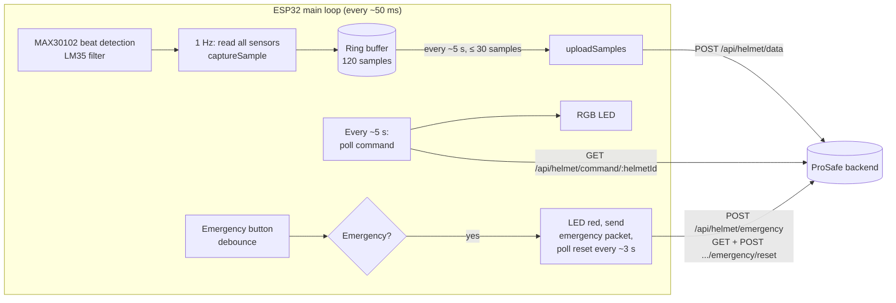
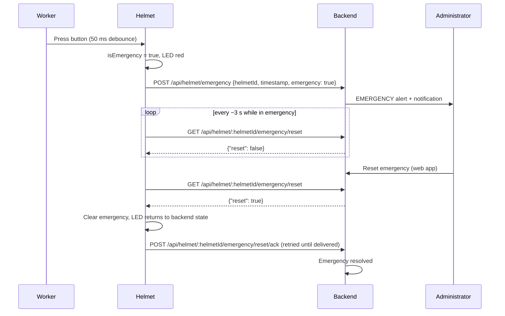

# ProSafe Helmet: ESP32 Firmware

Firmware for the ProSafe smart helmet, the sensing and feedback device of the ProSafe system
(see the [project README](../README.md) for the complete architecture).

The helmet samples six measurement channels once per second, timestamps each sample, and uploads the samples in
batches to the ProSafe backend. It shows the safety state chosen by the backend on an RGB LED and provides a manual
emergency button. **The helmet does not classify risk itself.** Every SAFE / WARNING / CRITICAL / UNCERTAIN decision
is made by the backend and the ProSafe ML V2 service.

> Research prototype. The sensors are low-cost development modules. Their readings suit prototyping but are not
> medical-grade or industrial-grade measurements.

## Contents

- [Hardware components](#hardware-components)
- [Wiring and pin configuration](#wiring-and-pin-configuration)
- [Firmware architecture](#firmware-architecture)
- [Sensor data format](#sensor-data-format)
- [LED status indicators](#led-status-indicators)
- [Emergency button](#emergency-button)
- [Development environment](#development-environment)
- [Configuration](#configuration)
- [Testing and troubleshooting](#testing-and-troubleshooting)

## Hardware components

| Component | Purpose | Interface | Implementation notes |
| --- | --- | --- | --- |
| ESP32 (`esp32dev` board) | Microcontroller, Wi-Fi | – | Arduino framework, built with PlatformIO |
| DHT11 | Ambient temperature | Single-wire digital | Up to 3 read attempts per sample, re-initialised after 5 consecutive failures. Humidity is read for diagnostics but **not transmitted**. The DHT library caches readings for about 2 s, so the value changes at most every ~2 s |
| GUVA-S12SD | UV radiation | Analogue (ADC) | Converted to an approximate fractional UV index: `Vout [mV] / 100` (`UV_MV_PER_INDEX`). Module-datasheet approximation, not validated |
| MQ-2 | Combustible gas / smoke response | Analogue (ADC) | Sent in V2 "sensor units", **not ppm**: `(adc − GAS_ADC_OFFSET) × GAS_UNITS_PER_ADC_COUNT`, by default percent of ADC full scale. The scale is **unverified** and needs calibration |
| INMP441 | Approximate sound level | I2S (MEMS microphone) | RMS of 24-bit samples with DC removed → dBFS → `SPL = 94 − (−26) + dBFS + NOISE_CAL_OFFSET_DB`. **Unweighted (not dBA) and uncalibrated** |
| LM35 | Skin temperature | Analogue (ADC) | 10 mV/°C with an exponential moving-average filter (`BODY_TEMP_FILTER_ALPHA = 0.2`). Measures skin, not core body temperature |
| MAX30102 | Heart rate | I2C | Beat detection (SparkFun `heartRate`), average of the last 4 beats. Finger/skin contact is inferred from the IR level |
| RGB LED | Safety status indication | 3 × PWM (LEDC, 5 kHz, 8-bit) | Colour set from the backend command, see [LED status indicators](#led-status-indicators) |
| Emergency push button | Manual emergency activation | Digital input, internal pull-up (active LOW) | 50 ms debounce, edge-triggered |
| Battery and supporting circuitry | Portable power | – | Not described in the firmware. The thesis records the specification as *to be confirmed from hardware records* |

A GPS module interface (TinyGPSPlus on UART2) is still present in the source, but **GPS reading is disabled**
(the initialisation and read calls are commented out). The firmware therefore never sends a location. The hard-coded
Colombo coordinates in `main.cpp` are used only for the serial display and are never transmitted.

## Wiring and pin configuration

All assignments are taken from the `PIN DEFINITIONS` block in [`src/main.cpp`](src/main.cpp).

| Signal | ESP32 GPIO | Constant |
| --- | --- | --- |
| MQ-2 analogue output | 34 | `MQ2_PIN` |
| DHT11 data | 4 | `DHT_PIN` (`DHT_TYPE DHT11`) |
| INMP441 WS (word select) | 15 | `I2S_WS` |
| INMP441 SD (data) | 32 | `I2S_SD` |
| INMP441 SCK (bit clock) | 14 | `I2S_SCK` |
| MAX30102 SDA | 21 | `I2C_SDA` |
| MAX30102 SCL | 22 | `I2C_SCL` |
| LM35 analogue output | 35 | `LM35_PIN` |
| GUVA-S12SD analogue output | 33 | `UV_PIN` |
| RGB LED red / green / blue | 26 / 27 / 12 | `LED_R`, `LED_G`, `LED_B` (LEDC channels 0 / 1 / 2) |
| Emergency button | 13 | `EMERGENCY_BTN` (`INPUT_PULLUP`, pressed = LOW) |
| GPS RX / TX (disabled) | 16 / 17 | `GPS_RX`, `GPS_TX` |

The ADC is configured for 12-bit resolution with 11 dB attenuation. No wiring diagram is stored in this repository;
the wiring diagram of the assembled prototype is Figure 2.3 of the thesis. Power wiring is not described in the code.

## Firmware architecture

Everything is in a single file, [`src/main.cpp`](src/main.cpp). `include/`, `lib/` and `test/` contain only the
PlatformIO template README files.



### Start-up (`setup()`)

1. Serial at 115200 baud; task watchdog enabled (`WDT_TIMEOUT = 10` s).
2. I2C, the emergency button input and the LED PWM channels are initialised.
3. `setupSensors()`: DHT11, MAX30102 (3 attempts), I2S driver for the INMP441, ADC settings.
4. `calibrateSensors()`: logs an MQ-2 clean-air ADC average (50 reads, diagnostic only) and restarts the MAX30102.
5. `connectWiFi()` starts a non-blocking connection; `configTime()` starts NTP sync (`pool.ntp.org`, `time.google.com`).
6. The LED is set to **blue** (no risk decision yet).

### Main loop (`loop()`)

| Task | Interval | Function |
| --- | --- | --- |
| Emergency button check | every iteration | `updateEmergencyButton()` |
| Heart-rate beat detection, LM35 filtering | every iteration | `readFastSensors()` |
| Read all sensors and record one sample | 1 s (`SAMPLE_INTERVAL_MS`) | `readAllSensors()`, `captureSample()` |
| Threshold diagnostics on the serial console | 1 s | `checkConditions()` (never drives the LED) |
| LED update | every iteration | `handleAlerts()` |
| Serial readings display | 2 s | `displayReadings()` |
| Wi-Fi reconnect | 30 s when disconnected | `checkWiFiConnection()` |
| Poll backend risk command | 5 s (`COMMAND_POLL_INTERVAL_MS`) | `checkBackendCommand()` |
| Batch upload | 5 s (`UPLOAD_INTERVAL_MS`) | `uploadSamples()` |
| Emergency packet / reset poll / reset ack | see [Emergency button](#emergency-button) | |

### Sampling, validation and timestamps

- **One sample per second, no averaging across samples.** Each sample carries its own UTC timestamp with milliseconds.
- **Samples are only recorded after NTP sync.** Before the clock is valid (`MIN_VALID_EPOCH`, 2024-01-01) no sample is
  stored and a warning is logged every 10 s. The helmet needs internet access for NTP.
- **Invalid channels are sent as `null`**, never as `-1` and never as a substituted value: a failed DHT11 read, no
  MAX30102 contact (`heartRate` 0), a failed LM35 ADC read, an I2S read error, and so on. Plausibility, skin-contact
  and artifact checks are done by ProSafe ML V2, not by the firmware.
- The threshold constants near the top of `main.cpp` (`MQ2_SAFE`, `TEMP_SAFE`, `HR_MIN_SAFE`, ...) are used only by
  `checkConditions()` for serial diagnostics.

### Transmission

- Samples are kept in a ring buffer of **120 samples** (`SAMPLE_BUFFER_CAPACITY`, about 2 minutes). When it is full the
  oldest sample is dropped and counted (`samplesDropped`); the backend then sees a gap.
- Every ~5 s, up to **30 samples** (`MAX_SAMPLES_PER_UPLOAD`) are posted, oldest first.
  - **2xx:** the batch is removed from the buffer.
  - **4xx:** the batch is dropped and logged, because a structurally rejected batch would be rejected forever.
  - **Network error or 5xx:** the batch is kept and retried on the next upload.
- Before each HTTP call, `ensureBackendReachable()` opens a TCP probe to `BACKEND_HOST:BACKEND_PORT` (500 ms timeout).
  After a failure, requests are suppressed for 15 s (`BACKEND_PROBE_COOLDOWN_MS`).
- HTTP calls are synchronous with a 4 s timeout (`HTTP_TIMEOUT_MS`), so a slow request can delay the loop.

## Sensor data format

`POST /api/helmet/data`. The values below are **illustrative examples**, not measurements.

```json
{
  "helmetId": "BS-H-001",
  "samples": [
    {
      "timestamp": "2026-10-09T03:30:05.123Z",
      "heartRate": 84,
      "bodyTemp": 36.71,
      "ambientTemp": 29.1,
      "noise": 71.4,
      "gas": 12.31,
      "uv": 2.63
    },
    {
      "timestamp": "2026-10-09T03:30:06.124Z",
      "heartRate": null,
      "bodyTemp": 36.70,
      "ambientTemp": 29.1,
      "noise": 70.9,
      "gas": 12.35,
      "uv": 2.61
    }
  ]
}
```

| Field | Unit | Decimals sent |
| --- | --- | --- |
| `heartRate` | bpm | 0 |
| `bodyTemp` | °C (skin) | 2 |
| `ambientTemp` | °C | 1 |
| `noise` | approximate dB SPL, unweighted | 1 |
| `gas` | V2 sensor units (not ppm) | 2 |
| `uv` | UV index (fractional) | 2 |

The firmware does not send a `workerId`; the backend resolves the worker from the helmet assignment. A `gps` object
is added to a sample only on a genuine GPS fix, which cannot happen while GPS reading is disabled.

## LED status indicators

The LED shows the state from the backend's `SET_RISK` command (`handleAlerts()`):

| LED colour | State | When |
| --- | --- | --- |
| Green | SAFE | Backend command `SAFE` |
| Amber | WARNING | Backend command `WARNING` |
| Red | CRITICAL | Backend command `CRITICAL` |
| Blue | UNCERTAIN | At start-up, when the backend sends `UNCERTAIN`, and when no valid command has arrived for 30 s (`COMMAND_STALE_AFTER_MS`) |
| Red | EMERGENCY | Emergency button pressed (overrides everything until a backend-confirmed reset) |

CRITICAL and EMERGENCY both use red, so the LED alone does not distinguish them. The helmet never falls back to green:
an unrecognised or missing command value is ignored and the last valid state is kept until it becomes stale.

## Emergency button

The emergency workflow is independent of the ML decision.



- **Activation** is edge-triggered: one activation per not-emergency → pressed transition. Holding the button does not
  re-trigger it, and releasing it does not clear the emergency.
- **Transmission:** the emergency packet is retried on every loop iteration until an HTTP response is received.
- **Reset** happens only after an administrator requests it and the backend answers `{"reset": true}`. Button release,
  sensor readings or timeouts never clear it. After a reset, the LED returns to the last backend risk state (never a
  forced SAFE).
- **Acknowledgement:** `POST .../emergency/reset/ack` is retried until it is delivered; only this call resolves the
  emergency in the backend.
- The normal command poll keeps running during an emergency, but it does not change the LED until the emergency ends.

## Development environment

| Item | Value (from [`platformio.ini`](platformio.ini)) |
| --- | --- |
| Tooling | [PlatformIO](https://platformio.org/) (CLI or the VS Code extension) |
| Environment | `esp32dev` |
| Platform / framework | `espressif32` / `arduino` |
| Serial monitor speed | 115200 |
| Build flags | `-DBOARD_HAS_PSRAM -mfix-esp32-psram-cache-issue` |
| Libraries | SparkFun MAX3010x 1.1.2+, Adafruit DHT sensor library 1.4.6+, TinyGPSPlus 1.1.0+, ArduinoJson 7.0.4+ |

PlatformIO downloads the platform and libraries automatically on the first build. From this folder:

```bash
pio run                  # compile
pio run -t upload        # compile and flash the connected ESP32
pio device monitor       # serial monitor (115200 baud)
```

## Configuration

All settings are constants in [`src/main.cpp`](src/main.cpp); there is no separate configuration file. Edit them
before building.

| Setting | Constant(s) | Notes |
| --- | --- | --- |
| Wi-Fi network | `WIFI_SSID`, `WIFI_PASS` | Use your own network. Do not commit real credentials |
| Backend endpoints | `NORMAL_API_URL`, `EMERGENCY_API_URL`, `COMMAND_API_BASE`, `EMERGENCY_RESET_API_BASE` | Full URLs of the backend's `/api/helmet/...` routes |
| Backend reachability probe | `BACKEND_HOST`, `BACKEND_PORT` | Must match the host and port in the URLs above (backend default port 5000) |
| Device identity | `HELMET_ID` | Must match a helmet registered in the web application and assigned to a worker |
| Sampling and upload | `SAMPLE_INTERVAL_MS` (1000), `UPLOAD_INTERVAL_MS` (5000), `SAMPLE_BUFFER_CAPACITY` (120), `MAX_SAMPLES_PER_UPLOAD` (30) | The backend accepts at most 600 samples per upload |
| Command and reset polling | `COMMAND_POLL_INTERVAL_MS` (5000), `EMERGENCY_POLL_INTERVAL_MS` (3000), `COMMAND_STALE_AFTER_MS` (30000) | |
| Sensor conversions | `NOISE_CAL_OFFSET_DB`, `UV_MV_PER_INDEX`, `GAS_UNITS_PER_ADC_COUNT`, `GAS_ADC_OFFSET` | Calibration values; see the component table |

Example with placeholders:

```cpp
const char* WIFI_SSID = "<your-wifi-ssid>";
const char* WIFI_PASS = "<your-wifi-password>";

const char* HELMET_ID         = "<registered-helmet-id>";
const char* NORMAL_API_URL    = "http://<backend-host>:5000/api/helmet/data";
const char* EMERGENCY_API_URL = "http://<backend-host>:5000/api/helmet/emergency";
const char* COMMAND_API_BASE  = "http://<backend-host>:5000/api/helmet/command/";
const char* EMERGENCY_RESET_API_BASE = "http://<backend-host>:5000/api/helmet/";
const char* BACKEND_HOST      = "<backend-host>";
const uint16_t BACKEND_PORT   = 5000;
```

The helmet and the backend must be on networks that can reach each other, and the backend address must be reachable
from the helmet (a LAN IP of the backend machine, not `localhost`). Traffic is plain HTTP and the helmet endpoints
have no device authentication (see [Limitations](#limitations)).

## Testing and troubleshooting

There are **no automated firmware unit tests** (`test/` holds only the PlatformIO template). `pio run` verifies that
the firmware compiles. The thesis reports laboratory functional checks of the assembled helmet (Appendix F); those are
manual procedures, not scripts in this repository.

The serial monitor (115200 baud) is the main diagnostic tool: it prints sensor readings every 2 s, every HTTP status,
Wi-Fi state and sensor warnings.

| Symptom (serial output) | Likely cause | What to check |
| --- | --- | --- |
| `Clock not synced yet (NTP) — sample not recorded` | No internet access, so NTP cannot sync | The Wi-Fi network must provide internet access. No samples are stored until the clock is valid |
| `Wi‑Fi not connected, cannot send data` / repeated reconnection attempts | Wrong SSID/password or no coverage | `WIFI_SSID`, `WIFI_PASS`, signal strength |
| `Backend unreachable (connection refused). Backing off before next attempt.` | Backend not running, wrong host/port, firewall | `BACKEND_HOST`, `BACKEND_PORT`, the backend is running and listening on that interface, firewall rules |
| `Backend rejected N samples (HTTP 4xx) — dropped` | The backend rejected the batch, e.g. `404` when no worker is assigned to `HELMET_ID` | Register the helmet and assign it to a worker in the web application |
| `MAX30102 not found. Check wiring!` | I2C wiring or power | SDA 21, SCL 22. Heart rate is then sent as `null` |
| `I2S driver install failed` / `I2S read timeout` | INMP441 wiring | WS 15, SD 32, SCK 14. Noise is then `null` or the previous value |
| `Warning: DHT11 read failed, ambient temperature sent as null` | DHT11 wiring or sensor fault | Data pin 4. The sensor is re-initialised after 5 failures |
| Heart rate always `null` | No skin contact (IR below the detection level) | Sensor placement against the skin |
| LED stays blue | No valid command for 30 s, or the backend reports UNCERTAIN (e.g. sensor warm-up, missing worker baseline, ML service down) | Serial output for HTTP errors; worker baseline and ML service status in the backend |
| LED stays red after an emergency | Emergency not yet reset by an administrator, or the reset poll cannot reach the backend | Reset the emergency in the web application; check backend reachability |

### Limitations

- Gas, noise and UV conversions are uncalibrated approximations (see the component table).
- HTTP calls are synchronous and unencrypted, and the helmet endpoints are not authenticated.
- If the emergency button is pressed before NTP has synced, the packet timestamp is `Uptime-<ms>`, which the backend
  rejects as an invalid timestamp (HTTP 400). Because `postJSON()` treats any HTTP response as delivered, that packet
  is **not retried**. The local red LED still works. This is documented behaviour of the current code, not a fix.
- Wi-Fi credentials, backend addresses and the helmet ID are compile-time constants.
