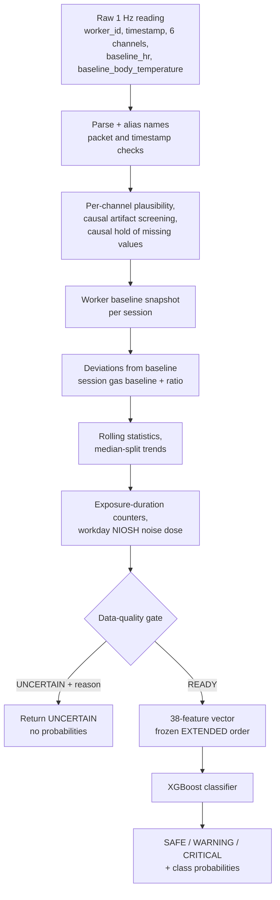

# ProSafe ML V2: Risk-Decision Service

The machine-learning component of ProSafe and the **deployed decision service**. Since 2026-10-09 the backend sends
every helmet sample to this service (`POST /predict/raw`, port 8001). The original `ProSafe-ML/` folder is kept for
reference only and is no longer called ([`../ProSafe-ML`](../ProSafe-ML/README.md)).

For the complete system see the [project README](../README.md). Detailed design notes in this folder:

| Document | Content |
| --- | --- |
| [`BACKEND_INTEGRATION_V2.md`](BACKEND_INTEGRATION_V2.md) | The implemented end-to-end integration: firmware, backend, frontend, contracts, start-up, open items |
| [`PREPROCESSING_V2_DESIGN.md`](PREPROCESSING_V2_DESIGN.md) | Preprocessing rules, offline vs online processing, worker state, UNCERTAIN, resets |
| [`CURRENT_SYSTEM_FLOW.md`](CURRENT_SYSTEM_FLOW.md) | The pre-V2 (v1) flow, historical |
| [`archive/README.md`](archive/README.md) | Earlier outputs, the previous model candidate and retired scripts |

## Contents

- [Overview](#overview)
- [Machine learning pipeline](#machine-learning-pipeline)
- [Datasets](#datasets)
- [Feature engineering](#feature-engineering)
- [Risk labelling](#risk-labelling)
- [Algorithms, experiments and model selection](#algorithms-experiments-and-model-selection)
- [Production model](#production-model)
- [Setup, training and evaluation commands](#setup-training-and-evaluation-commands)
- [Evaluation methodology](#evaluation-methodology)
- [Inference service](#inference-service-servepy)
- [Streamlit demo](#streamlit-demo-prosafe-v2-safety-predictor)
- [Testing](#testing)
- [Troubleshooting](#troubleshooting)
- [Folder layout](#folder-layout)

## Overview

V2 has two components and a small piece of glue:

| Component | Responsibility | Code |
| --- | --- | --- |
| **A. Preprocessing / feature engineering** | Raw 1 Hz readings → validation, causal cleaning, missing-data hold, personalized deviations, session gas baseline, rolling statistics, trends, exposure counters, NIOSH noise dose, **data-quality gate** (READY or UNCERTAIN) | [`src/preprocessing.py`](src/preprocessing.py) (rules), [`src/streaming_preprocessor.py`](src/streaming_preprocessor.py) (per-worker online engine) |
| **B. Classification** | Model-ready features → Safe / Warning / Critical | [`src/predict.py`](src/predict.py), [`src/modeling.py`](src/modeling.py) |
| Glue | UNCERTAIN → classifier not called; READY → classifier | [`src/inference_pipeline.py`](src/inference_pipeline.py), [`serve.py`](serve.py) |

System outputs are **SAFE, WARNING, CRITICAL and UNCERTAIN**. The classifier has only three classes
(Safe, Warning, Critical). **UNCERTAIN is a data-quality outcome, never a fourth class**: it means the data cannot
support a decision, and the classifier is not called. Worker baselines are context for the deviation features and are
never model features.

## Machine learning pipeline

Order of operations for one raw reading, as implemented in `StreamingPreprocessor` and `ProSafeInferencePipeline`:



Key behaviour:

- **Fully causal.** Every output at time *t* uses only readings with timestamp ≤ *t*. Suspected heart-rate or
  body-temperature artifacts are held (last value carried forward, marked IMPUTED) instead of being interpolated from
  future samples. The session gas baseline is a running median of the first 180 s.
- **Per-worker state** (windows, counters, session gas baseline) is kept in process memory. A baseline change ends
  only that worker's session (`BASELINE_CHANGED`).
- **Warm-up.** A cold session is UNCERTAIN for its first 180 s (`SENSOR_WARMUP`); a warm restart needs 20 samples
  (`INSUFFICIENT_HISTORY`). The gas baseline becomes provisional after 20 samples.
- **Gate reasons:** `INVALID_PACKET`, `OUT_OF_ORDER_TIMESTAMP`, `BASELINE_UNAVAILABLE`, `SENSOR_WARMUP`,
  `INSUFFICIENT_HISTORY`, `MAJOR_TIMESTAMP_GAP`, `PACKET_LOSS`, `BODY_CONTACT_FAILURE`, `TOO_MANY_MISSING_SENSORS`,
  `SENSOR_UNAVAILABLE`, `UNSTABLE_HR`, `GAS_BASELINE_UNAVAILABLE`, `REQUIRED_FEATURES_UNAVAILABLE`.
- **Confidence.** The service returns the class probabilities. The 0.70 confidence rule and the 5-vote smoothing are
  applied by the backend, not here.

All window lengths, plausibility ranges, hold limits and gap rules are defined once in `PreprocessingConfig`
([`src/preprocessing.py`](src/preprocessing.py)). The rule values were reverse-engineered from the ML-ready training
files and are verified by [`tests/test_preprocessing_parity.py`](tests/test_preprocessing_parity.py). Values that could
not be recovered from the data are marked `ASSUMED` in the code.

## Datasets

The four ML-ready datasets in [`data/`](data) are the only copies in this repository.

| File | Workers | Rows | Safe / Warning / Critical | Role |
| --- | --- | --- | --- | --- |
| `prosafe_synthetic_ml_ready.csv` | S_001–S_004 (synthetic) | 18,564 | 5,783 / 12,207 / 574 | Training |
| `prosafe_W001_ml_ready.csv` | W_001 (real) | 14,015 | 3,413 / 9,381 / 1,221 | Training or evaluation, depending on the experiment |
| `prosafe_W002_ml_ready.csv` | W_002 (real) | 13,825 | 7,114 / 6,451 / 260 | Evaluation (training only in Experiment 8) |
| `prosafe_W003_ml_ready.csv` | W_003 (real) | 14,036 | 6,201 / 7,331 / 504 | Evaluation only |

- **Format.** CSV, 41 columns: `worker_id`, `timestamp`, the 38 features and `risk_level`. Only labelled rows are
  included; rows the offline framework could not label reliably were left out. Timestamps have minute resolution
  (`7/21/2026 9:03`); row order within a minute is the 1 Hz order.
- **Workers** are identified only by pseudonymous codes; the files contain no names or other personal details.
- **Origin.** The offline pipeline that cleaned, labelled and engineered these files is **not in this repository**,
  and neither is the expanded audit dataset described in the thesis. `run_experiment_v2.py` looks for an optional
  W_003 audit file (`data/prosafe_W003_preprocessed_audit.csv`); it is not included, so that part of the post-hoc
  analysis is skipped.
- **Worker-level separation.** Training and evaluation data always come from different workers.
  [`src/utils.py`](src/utils.py) refuses to load W_002 into the development data, and `load_external_test_data()`
  only opens W_002 once a frozen model configuration exists.

## Feature engineering

The production model uses the **EXTENDED** set of 38 features, in the fixed order of `EXTENDED_FEATURE_COLUMNS` in
[`src/utils.py`](src/utils.py) (also recorded in [`models/frozen_config.json`](models/frozen_config.json)).

| Group | Count | Features |
| --- | --- | --- |
| Raw sensor values | 6 | `ambient_temperature`, `uv_index`, `gas` (sensor units, not ppm), `noise`, `body_temperature`, `heart_rate` |
| Personalized deviations | 4 | `hr_deviation_bpm`, `hr_deviation_pct`, `body_temp_deviation_c`, `body_temp_deviation_pct` |
| Gas ratio | 1 | `gas_ratio_to_baseline` (relative to the session gas baseline) |
| Rolling statistics | 8 | heart-rate mean 30 s / 60 s and std 60 s; body, ambient and UV means over 300 s; gas mean 30 s; noise mean 60 s |
| Trends (per minute) | 6 | heart rate, gas and noise over 60 s; body temperature, ambient temperature and UV over 300 s |
| Noise dose | 1 | `noise_dose_pct` (NIOSH: 85 dBA criterion, 3 dB exchange rate, 80 dBA threshold, 8 h reference, per workday) |
| Exposure durations | 12 | consecutive seconds above the warning / critical level for temperature, UV, gas ratio, noise, heart-rate deviation and body-temperature deviation |

The experiments compared three nested feature sets (defined in [`src/run_experiments.py`](src/run_experiments.py)):

| Feature set | Groups | Features |
| --- | --- | --- |
| `BASIC_PERSONALIZED` | raw + deviations + gas ratio | 11 |
| `TEMPORAL_PERSONALIZED` (= `CORE` in `utils.py`) | + rolling + trends + noise dose | 26 |
| `EXTENDED` | + exposure durations | 38 |

Never used as predictors (enforced by `assert_feature_contract`): worker ID, timestamp, the target, raw baselines and
any label, rule, evidence, quality or imputation column. Raw baselines are excluded because, with so few workers, a
stored baseline value behaves like a worker identifier.

Nine long-window features (`DEFERRABLE_FEATURES`) may legitimately be missing early in a session, in both the training
data and the online preprocessor.

## Risk labelling

`risk_level` is a **rule-informed, personalized reference label** created by the offline framework (thesis
Section 2.5.1). Each second is labelled from combined evidence: environmental exposure, physiological deviation from
the worker's baseline, how long a condition persists and how it is changing.

- These labels are **proxy ground truth** for ML development. They are not medically confirmed diagnoses and not
  observed injuries or incidents.
- Model predictions therefore measure **agreement with the labelling framework**, not clinical or injury-prevention
  accuracy.
- No real safety incidents are recorded in the datasets.

## Algorithms, experiments and model selection

Four algorithms were compared: **Random Forest, XGBoost, Support Vector Machine and Logistic Regression**.

Every algorithm gets the same search budget: 12 seeded hyperparameter configurations × 3 feature sets = 36
candidates per experiment. Feature set, hyperparameters and class weighting are chosen together, on the training side
only:

- several training workers: leave-one-training-worker-out validation (`LeaveOneGroupOut` on `worker_id`);
- a single training worker: 5 contiguous chronological blocks with 300 rows purged on both sides of each validation
  block.

Imputation, scaling, class weights and XGBoost early stopping are fitted inside each training fold. The selection rule
keeps candidates within 0.01 accuracy of the best, then maximizes macro F1 → balanced accuracy → Critical recall →
fewest Critical→Safe errors. The chosen configuration is refitted on all training data, frozen, and scored once on the
evaluation worker.

The thesis reports eight experimental configurations, produced by four scripts:

| Thesis experiment | Training | Evaluation | Script (internal name) | Outputs |
| --- | --- | --- | --- | --- |
| 1 | Synthetic S_001–S_004 | W_001 | `run_experiments.py` (EXP1) | `outputs/`, `models/experiments/` |
| 2 | Synthetic + W_001 | W_002 | `run_experiments.py` (EXP2) | same |
| 3 | W_001 | W_002 | `run_experiments.py` (EXP3) | same |
| 4 | Synthetic | W_003 | `run_experiment_v2.py` (EXP1) | `outputs/experiment_v2/`, `models/experiment_v2/` |
| 5 | Synthetic + W_001 | W_003 | `run_experiment_v2.py` (EXP2) | same |
| 6 | W_001 | W_003 | `run_experiment_v2.py` (EXP3) | same |
| 7 | Synthetic | W_002 | `run_experiment_v3.py` (EXP1) | `outputs/experiment_v3/`, `models/experiment_v3/` |
| 8 | W_001 + W_002 | W_003 | `run_experiment_v4.py` | `outputs/experiment_v4/`, `models/experiment_v4/` |

`run_experiment_v3.py` also re-runs the Experiment 2 and 3 configurations on W_002 for a like-for-like comparison.

Methodological status, as recorded in the scripts and the thesis:

- Experiments 1–3 formed the original study. Experiments 4–6 applied the same configurations to W_003, which was held
  out, without tuning on it.
- Experiment 7 completed the comparison on W_002, which had already been examined. Experiment 8 was specified after the
  W_003 results were known. Both are comparative, not independent, tests.
- The decision to deploy the Experiment 2 XGBoost model was taken after all W_002 results were known, so W_002 is no
  longer an unbiased estimate for the deployed model.

Results are in `outputs/EXPERIMENT_RESULTS.md`, `outputs/experiment_v2/W003_EXPERIMENT_RESULTS.md`,
`outputs/experiment_v3/W002_COMMON_EVALUATION_RESULTS.md` and
`outputs/experiment_v4/W003_REAL_WORKER_COMBINATION_RESULTS.md`, with the CSVs and charts next to them.

## Production model

**XGBoost, EXTENDED feature set (38 features), Experiment 2 artifact**, version
`prosafe-ml-v2-xgboost-extended-exp2-2026-10-09`. Trained on synthetic S_001–S_004 plus real worker W_001; the model is
unscaled, so no `scaler.pkl` is needed.

The deployed model on the two evaluation workers (from the saved results; W_003 is Experiment 5, the same training
configuration evaluated on a held-out worker):

| Worker | Accuracy | Balanced accuracy | Macro F1 | Critical recall | Critical precision | Critical → Safe |
| --- | --- | --- | --- | --- | --- | --- |
| W_002 (Experiment 2) | 0.9546 | 0.6766 | 0.6848 | 0.0885 (23 of 260) | 0.2054 | 0 |
| W_003 (Experiment 5) | 0.9823 | 0.9818 | 0.9661 | 0.9782 (493 of 504) | 0.8851 | 0 |

**Limitation, stated plainly:** Critical detection was inconsistent between the two workers. On W_002, 237 of 260
Critical seconds were predicted Warning (none Safe). W_002's Critical episodes are UV-driven, a pattern almost absent
from the training data (`outputs/critical_failure_analysis.md`). Do not rely on the model alone as a Critical detector.
The backend contains a backstop integration point for a validated deterministic rule set
(`ProSafe-Web/backend/services/criticalBackstopService.js`); it is deliberately a no-op because no validated rules
exist yet.

`python src/promote_model.py` produced the production files (`models/best_model.pkl`, `best_model_meta.pkl`,
`label_encoder.pkl`, `all_models_meta.pkl`, `frozen_config.json`). It accepts only this exact artifact, archives the
previous candidate, and verifies that the production loader reproduces the artifact's W_002 predictions and
probabilities exactly.

## Setup, training and evaluation commands

Python 3.12 (verified versions are listed in [`requirements.txt`](requirements.txt): pandas 2.2.3, numpy 2.1.0,
scikit-learn 1.6.1, xgboost 3.0.0, flask 3.1.0, streamlit 1.62.0). The `.pkl` artifacts were written with
scikit-learn 1.6.1 and xgboost 3.0.0; **load them with the same versions** and pin them exactly for deployment.

```bash
cd ProSafe-ML-V2
python -m venv venv
venv\Scripts\activate          # Windows; on macOS/Linux: source venv/bin/activate
pip install -r requirements.txt
```

All scripts resolve paths from their own location; run them from this folder.

| Command | Effect | Writes |
| --- | --- | --- |
| `python serve.py` | Starts the decision service | nothing |
| `python src/promote_model.py --check` | Re-verifies the production artifact | nothing |
| `python src/predict.py` | Small inference demo with the production model | nothing |
| `python src/run_experiment_v2.py --check` (also `_v3`, `_v4`) | Validations only, no training | nothing |
| `python src/run_experiments.py --charts-only` | Redraws the Experiment 1–3 charts from the saved CSVs | `outputs/*.png` |
| `python src/run_experiment_v2.py --report-only` (also `_v3`, `_v4`) | Rebuilds reports and plots from the frozen models and saved CSV | that experiment's `outputs/` folder |
| `python src/run_experiments.py` | **Full retraining** of Experiments 1–3 | `outputs/`, `models/experiments/` |
| `python src/run_experiment_v2.py` / `_v3.py` / `_v4.py` | **Full retraining** of Experiments 4–6 / 7 (+ comparison) / 8 | the matching `outputs/experiment_vN/`, `models/experiment_vN/` |
| `python src/promote_model.py` | **Replaces the production model** files | `models/` (archives the previous files) |

Full runs overwrite the recorded results that the thesis and the research website cite (the website tests compare its
figures with `outputs/final_experiment_summary.csv`). None of the experiment scripts touches `models/best_model.pkl`.
**Do not run `promote_model.py` without `--check`** unless you intend to re-promote the production model. The
experiment scripts also accept `--smoke` (one configuration, every third training row) for a quick pipeline test;
it requires `--out-dir` and `--models-dir` so that the recorded results are not overwritten.

Hyperparameters of the production model (from `models/frozen_config.json`): `n_estimators` 20, `max_depth` 8,
`learning_rate` 0.15, `subsample` 1.0, `colsample_bytree` 0.6, `gamma` 0.05, `reg_alpha` 0.1, `reg_lambda` 5,
`min_child_weight` 1, balanced class weights.

## Evaluation methodology

Metrics are computed in [`src/modeling.py`](src/modeling.py) on the held-out worker only:

- accuracy and balanced accuracy;
- macro precision, recall and F1 (averaged over the classes present in the evaluation data) and weighted F1;
- Critical precision, recall and F1, and the counts of Critical observations predicted as Warning and as Safe;
- the confusion matrix (saved as `confusion_matrix_*.png`).

Critical observations are rare (1.9% of W_002 and 3.6% of W_003), so accuracy alone is misleading; Critical recall
and macro F1 are reported alongside it. With only three real workers, results vary strongly between workers and do
not establish general reliability.

### Why these scores are lower than the v1 scores

The old ProSafe model was scored on a random 80/20 split of rows from one synthetic dataset, so near-identical
neighbouring seconds of the same workers sat on both sides of the split. V2 always tests on a **different** worker
than it trained on. That is harder and more realistic; the two numbers measure different things.

## Inference service (`serve.py`)

Flask application, loaded once at start-up. Per-worker streaming state is held in process memory and protected by a
single lock.

```bash
python serve.py
curl http://localhost:8001/health
```

| Variable | Default | Meaning |
| --- | --- | --- |
| `PORT` | `8001` | Listening port (binds `0.0.0.0`) |
| `PROSAFE_ENABLE_RAW_ENDPOINT` | `1` | `0` disables `/predict/raw` (HTTP 501) |
| `PROSAFE_EXPECTED_MODEL` | `XGBoost` | The service reports unhealthy for any other model |
| `PROSAFE_EXPECTED_FEATURE_SET` | `EXTENDED` | As above for the feature set |
| `PROSAFE_MAX_BATCH` | `600` | Maximum readings per request (HTTP 413 above it) |

| Endpoint | Purpose |
| --- | --- |
| `GET /health` | Model identity and verification. `200 {"status": "ok", ...}` only if the loaded model is the expected one (XGBoost, EXTENDED, the 38 frozen columns, unscaled); otherwise `503 {"status": "unhealthy", "problems": [...]}` and both predict endpoints answer 503 |
| `GET /schema` | Feature contract: feature order, deferrable features, input aliases, classifier classes, system outputs |
| `POST /predict/raw` | **Production path.** One raw reading, or `{"readings": [...]}` processed strictly in the given order |
| `POST /predict` | Model-ready path for testing: one 38-feature vector |

Raw reading (illustrative values; sensor values and baselines may be `null`):

```json
{
  "worker_id": "W-001", "helmet_id": "BS-H-001", "timestamp": "2026-10-09T09:00:05.123+05:30",
  "heart_rate": 84, "body_temperature": 36.71, "ambient_temperature": 29.1,
  "uv_index": 2.63, "gas": 12.31, "noise": 71.4,
  "baseline_hr": 78, "baseline_body_temperature": 36.5
}
```

Older field names (for example `heartRate`, `bodyTemp`, `gas_ppm`) are accepted as aliases (`INPUT_ALIASES` in
`utils.py`). A batch returns `{"results": [...one per reading, same order...], "latest": {...}, "count": n, model identity}`.

READY result (illustrative):

```json
{"predicted_class": "WARNING", "probabilities": {"SAFE": 0.04, "WARNING": 0.91, "CRITICAL": 0.05},
 "model_ready": true, "data_quality": "VALID", "model_name": "XGBoost", "feature_set": "EXTENDED",
 "model_version": "prosafe-ml-v2-xgboost-extended-exp2-2026-10-09", "worker_id": "W-001",
 "session_id": "...", "session_elapsed_s": 180.0, "imputed_channels": [], "deferred_features": [],
 "derived": {"hr_deviation_pct": 4.1, "body_temp_deviation_pct": 0.2, "...": "..."}}
```

UNCERTAIN result: `"predicted_class": "UNCERTAIN"`, `"probabilities": {}`, `"model_ready": false`,
`"data_quality": "UNCERTAIN"`, `"uncertain_reason"` and `"uncertain_reasons"`, plus the model identity and session
fields. No probabilities are returned because the classifier was not called.

`data_quality` is `VALID`, `IMPUTED` (a value was briefly held but the reading is still model-ready) or `UNCERTAIN`.
`derived` repeats a few already-computed features so the backend can store and display them without re-implementing
the formulas.

Errors: 400 for a body that is not a JSON object, an empty or non-list `readings`, or (on `/predict`) missing or
non-numeric features; 413 for an oversized batch; 501 when the raw endpoint is disabled; 503 when the model check
failed.

**Operational notes.** `serve.py` uses Flask's development server. In a deployment, run it behind a production WSGI
server as a **single process**, because the streaming state is per process. A restart loses all worker state: every
worker re-enters warm-up (UNCERTAIN). `export_state()` / `import_state()` exist but are not wired in.

## Streamlit demo: ProSafe V2 Safety Predictor

```bash
python -m streamlit run app.py
```

A manual live-prediction demo of the **same V2 path the backend uses**: raw readings + worker baselines →
`ProSafeInferencePipeline` → `StreamingPreprocessor` (38 EXTENDED features) → UNCERTAIN gate → XGBoost.

- **Inputs:** worker baseline (heart rate, body temperature), environmental values (ambient temperature, UV index, gas
  in sensor units, noise) and physiological values. Quick inputs are median readings of real W_001 seconds labelled
  Safe / Warning / Critical.
- **History is real.** *Process 1 Second* adds one timestamped reading to the worker's streaming state. *Simulate*
  (1–300 s) repeats the same values once per simulated second through the same call. A new session is UNCERTAIN until
  the gate reports READY.
- **Result:** SAFE / WARNING / CRITICAL / UNCERTAIN banner, confidence, data quality, reasons when UNCERTAIN, class
  probabilities when READY, and expanders with session details, the generated features and status periods.
- **Reset Session** restarts the demo worker's session (warm restart, 20 samples); *Start new workday* also resets
  the noise dose and forces the 180 s cold-start warm-up. There is no model switching.

## Testing

From this folder (Python 3.12). Each file is a self-contained `unittest` script.

```bash
python tests/test_production_integration.py
python tests/test_streaming_preprocessor.py
python tests/test_preprocessing_parity.py
python tests/test_streamlit_app.py
```

| File | Tests | Covers |
| --- | --- | --- |
| `test_production_integration.py` | 19 | Promoted artifact equals the Experiment 2 bundle, metadata, 38-feature contract, baselines never features, baseline lifecycle, W_001 raw-replay prediction parity, HTTP contract |
| `test_streaming_preprocessor.py` | 24 | Warm-up, worker isolation, sessions, missing data, gate, pipeline, HTTP service |
| `test_preprocessing_parity.py` | 5 | Online features reproduce the offline training features (`--report` writes a report to `outputs/`) |
| `test_streamlit_app.py` | 4 | Drives `app.py` headlessly with Streamlit's AppTest |

All 52 tests passed when run on 2026-10-20 while this README was being updated. The W_001 raw replay reported 99.98%
online/offline prediction agreement over 6,554 rows. The parity test takes about 1.5 minutes.

## Troubleshooting

| Symptom | Cause and fix |
| --- | --- |
| `/health` returns 503 with `model failed to load: ...` | Missing or unreadable files in `models/`. Restore `best_model.pkl`, `best_model_meta.pkl`, `label_encoder.pkl` from version control; check with `python src/promote_model.py --check` |
| `/health` lists `problems` such as `model_name is ..., expected 'XGBoost'` | A different model is in the production slot, or `PROSAFE_EXPECTED_*` was changed. Restore the promoted files or the defaults |
| Errors or warnings while unpickling | Library versions differ from the ones the artifacts were written with. Install scikit-learn 1.6.1 and xgboost 3.0.0 |
| Every result is UNCERTAIN `SENSOR_WARMUP` / `INSUFFICIENT_HISTORY` | Expected at the start of a session (180 s cold start, 20 samples warm restart) or after a service restart |
| UNCERTAIN `BASELINE_UNAVAILABLE` | The reading has no `baseline_hr` / `baseline_body_temperature`. Set both baselines for the worker in the web application |
| UNCERTAIN `OUT_OF_ORDER_TIMESTAMP` | A reading's timestamp is not later than the worker's previous one (duplicate or late). Readings must be sent in time order |
| UNCERTAIN `BODY_CONTACT_FAILURE` / `SENSOR_UNAVAILABLE` / `TOO_MANY_MISSING_SENSORS` | Channels are `null` or implausible for longer than their hold limits. Check the helmet sensors |
| `/predict` returns 400 with `expected_features` | The feature vector is missing keys or has non-numeric values. Use the 38 names from `GET /schema` |
| `FileNotFoundError: Dataset not found` | A CSV in `data/` is missing; the experiment scripts need all four files |
| `UncertainLabelError` | A dataset contains a label other than Safe / Warning / Critical; UNCERTAIN rows must not be in the ML-ready files |

`gas` is in the V2 dataset's sensor units, **not** calibrated ppm. `gas_ppm` is accepted only as a legacy alias.

## Folder layout

```
data/                          the four ML-ready datasets
src/
  utils.py                     paths, feature contract, forbidden predictors, aliases, guarded data loaders
  preprocessing.py             V2 preprocessing rules + data-quality vocabulary
  streaming_preprocessor.py    per-worker online feature engine + quality gate
  inference_pipeline.py        raw reading -> gate -> classifier; READY / UNCERTAIN response contract
  predict.py                   SafetyPredictor (model-ready features -> Safe/Warning/Critical)
  modeling.py                  fold-safe fitting, metrics, ranking rule
  run_experiments.py           Experiments 1-3 (training + evaluation)
  run_experiment_v2.py         Experiments 4-6 (W_003)
  run_experiment_v3.py         Experiment 7 and the common-worker comparison on W_002
  run_experiment_v4.py         Experiment 8 (W_001 + W_002 -> W_003)
  promote_model.py             verify + promote the selected artifact (no training)
  plot_style.py                chart style
tests/                         see Testing
models/
  best_model.pkl, best_model_meta.pkl, label_encoder.pkl, all_models_meta.pkl, frozen_config.json   production model
  experiments/, experiment_v2/, experiment_v3/, experiment_v4/                                       experiment models
outputs/                       experiment results, charts, critical_failure_analysis.md
archive/                       earlier outputs, the previous model candidate, retired scripts
serve.py                       the decision service (Flask, port 8001)
app.py                         Streamlit demo
requirements.txt
```
