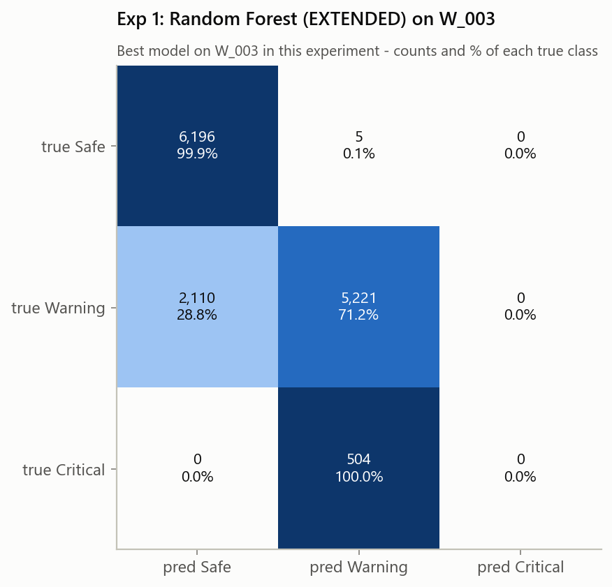
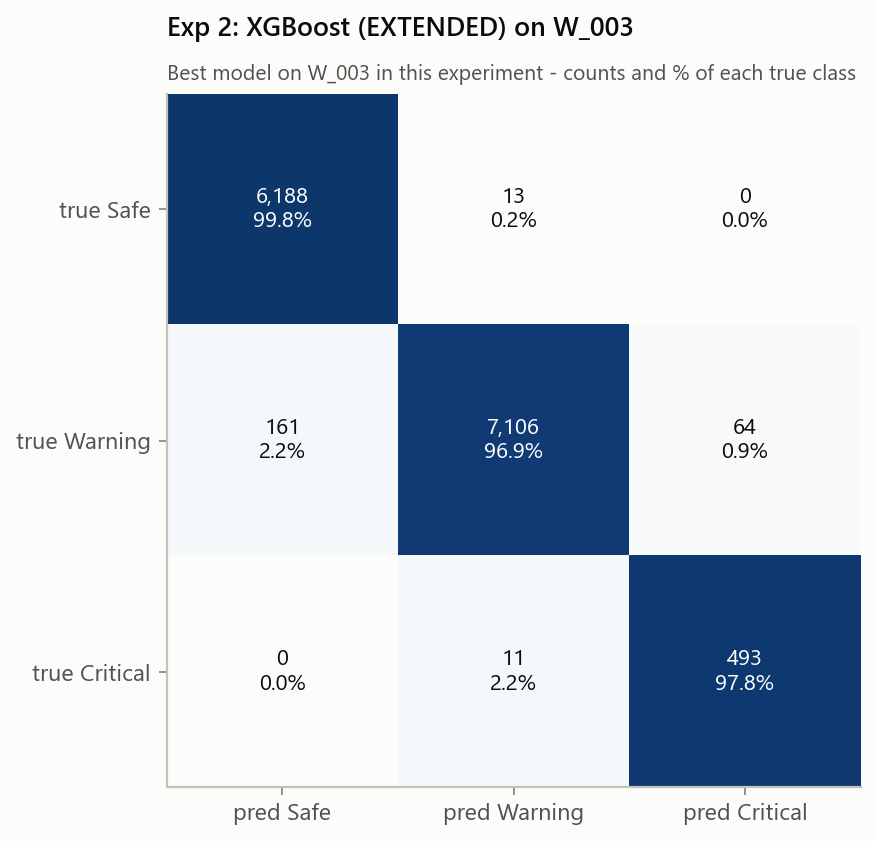
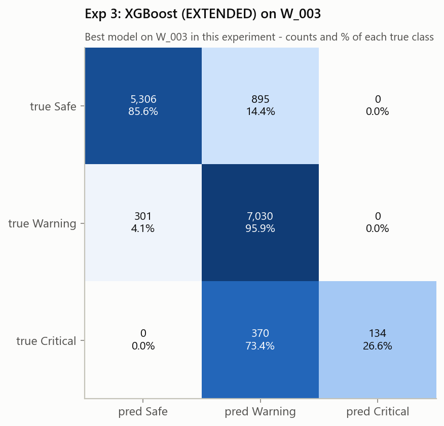
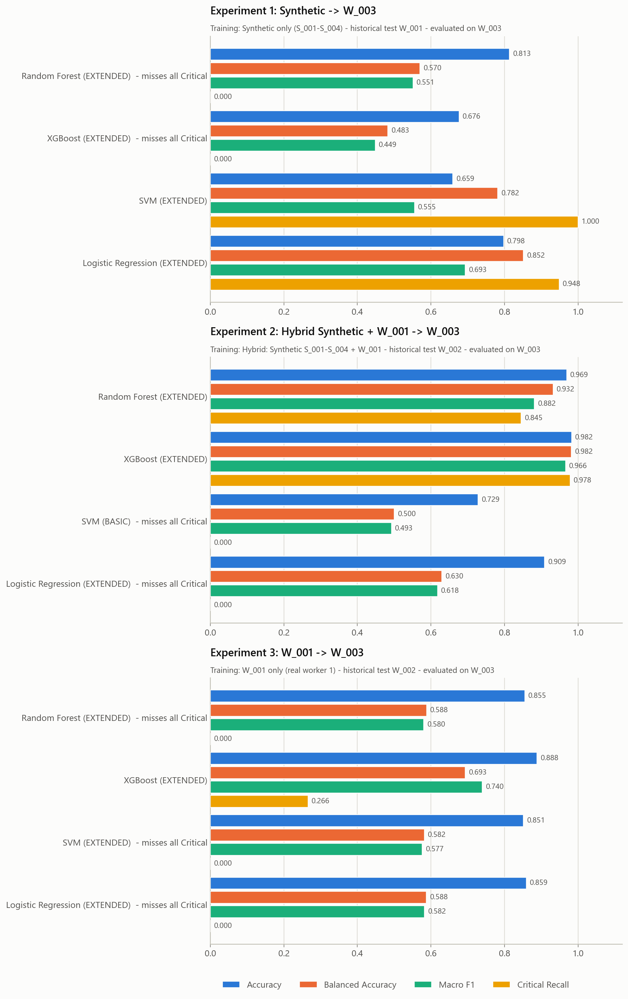
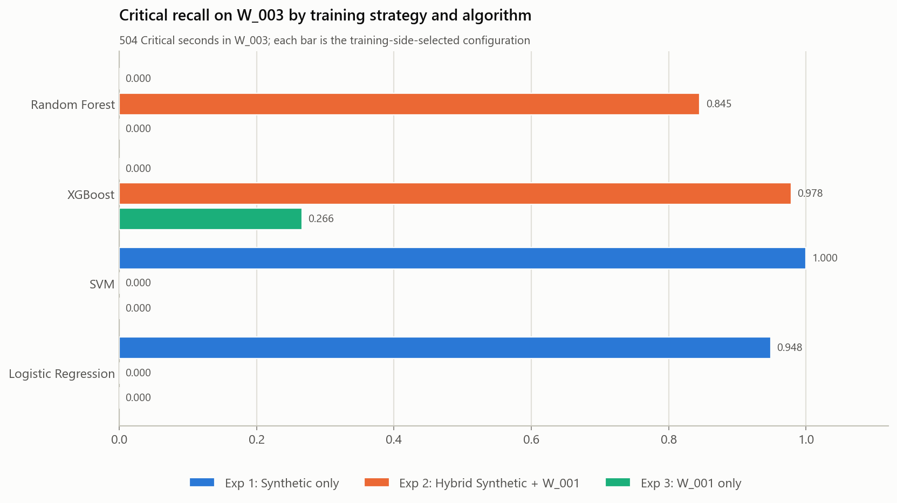

# ProSafe ML V2 - new-worker external evaluation on W_003

Generated by `python src/run_experiment_v2.py`.

## Purpose

How well do the three previously developed ProSafe training strategies generalize to a completely new real worker, W_003? W_001 and W_002 were examined extensively during earlier development (and the deployment decision was taken after the W_002 results were known), so W_003 gives a more independent estimate.

## Independence of W_003

* Before this run, W_003 was only checked for schema, worker ID, labels, row/class counts and missing values (and the audit file for its structure). No code, feature definition, feature set, hyperparameter space, threshold, class weighting, selection rule or synthetic data was changed because of W_003: the whole training side is imported unchanged from `src/run_experiments.py`.
* W_003 never entered the training context, the folds, early stopping, class weighting, feature-set selection or the selection rule. Each configuration was refitted on the training data, saved (frozen) and then scored once on W_003. Under these conditions W_003 acts as the new unseen external evaluation worker.
* Limits: the method itself (feature engineering, selection rule, search spaces) was designed while W_001/W_002 results were known, and W_003 was labelled by the same rule-based labelling framework as the other workers, so this measures agreement with that framework on a new person, not clinical ground truth. W_003 is a single worker on a single day.

## W_003 data validation

* File `data/prosafe_W003_ml_ready.csv`: 14,036 rows, 41 columns (worker_id, timestamp, the 38 EXTENDED features, risk_level); worker W_003 only. The column layout is identical to the training files (which store `noise_dose_pct` after the exposure counters); every model selects its features by name in the contract order.
* Classes: Safe 6,201 (44.2%), Warning 7,331 (52.2%), Critical 504 (3.6%). Not rebalanced, no rows removed or relabelled.
* Missing values: 1,253 cells in 13 features (warm-up / sensor gaps; tree models use NaN natively, SVM / Logistic Regression impute with the training-fold median).
* No raw baseline, label, evidence, rule, quality or audit column is present; the feature names match `utils.EXTENDED_FEATURE_COLUMNS` exactly.

## Method (identical to run_experiments.py)

| Experiment | Training strategy | Training data | Original historical test | New external test | Training-side validation |
|---|---|---|---|---|---|
| 1 Synthetic -> W_003 | Synthetic only (S_001-S_004) | prosafe_synthetic_ml_ready.csv (18,564 rows) | W_001 | W_003 | LeaveOneGroupOut by worker_id (4 folds: S_001, S_002, S_003, S_004) |
| 2 Hybrid Synthetic + W_001 -> W_003 | Hybrid: Synthetic S_001-S_004 + W_001 | prosafe_synthetic_ml_ready.csv + prosafe_W001_ml_ready.csv (32,579 rows) | W_002 | W_003 | LeaveOneGroupOut by worker_id (5 folds: S_001, S_002, S_003, S_004, W_001) |
| 3 W_001 -> W_003 | W_001 only (real worker 1) | prosafe_W001_ml_ready.csv (14,015 rows) | W_002 | W_003 | 5 contiguous chronological blocks of W_001, 300 rows purged on both sides of each validation block |

* Algorithms: Random Forest, XGBoost, SVM, Logistic Regression. Feature sets: BASIC_PERSONALIZED (11), TEMPORAL_PERSONALIZED (26), EXTENDED (38).
* Budget: 36 candidates per algorithm per experiment (12 seeded configurations x 3 feature sets, seed 42); the same search spaces, class-weight handling and XGBoost early stopping as run_experiments.py.
* Selection rule: accuracy within 0.01 of the best CV accuracy, then macro F1 -> balanced accuracy -> Critical recall -> lowest Critical->Safe rate.
* Reproduction check: every selected feature set and hyperparameter set is identical to the original run_experiments.py selection.

## Experiment 1: Synthetic -> W_003

Training: Synthetic only (S_001-S_004). Original historical test: W_001. New external test: W_003.

| model | feature set | accuracy | bal. acc. | macro P | macro R | macro F1 | weighted P | weighted R | weighted F1 | Crit P | Crit R | Crit F1 | Crit FN | Crit FN rate | Crit->Warning | Crit->Safe |
|---|---|---|---|---|---|---|---|---|---|---|---|---|---|---|---|---|
| Random Forest | EXTENDED | 0.8134 | 0.5705 | 0.5524 | 0.5705 | 0.5512 | 0.8055 | 0.8134 | 0.7950 | 0.0000 | 0.0000 | 0.0000 | 504 | 1.0000 | 504 (100.0 %) | 0 (0.0 %) |
| XGBoost | EXTENDED | 0.6763 | 0.4830 | 0.4908 | 0.4830 | 0.4487 | 0.7203 | 0.6763 | 0.6423 | 0.0000 | 0.0000 | 0.0000 | 504 | 1.0000 | 504 (100.0 %) | 0 (0.0 %) |
| SVM | EXTENDED | 0.6593 | 0.7815 | 0.6625 | 0.7815 | 0.5552 | 0.9120 | 0.6593 | 0.6965 | 0.1129 | 1.0000 | 0.2028 | 0 | 0.0000 | 0 (0.0 %) | 0 (0.0 %) |
| Logistic Regression | EXTENDED | 0.7977 | 0.8515 | 0.6760 | 0.8515 | 0.6933 | 0.8606 | 0.7977 | 0.8111 | 0.2694 | 0.9484 | 0.4197 | 26 | 0.0516 | 26 (5.2 %) | 0 (0.0 %) |

Per-class precision / recall / F1:

| model | Safe | Warning | Critical |
|---|---|---|---|
| Random Forest | 0.746 / 0.999 / 0.854 | 0.911 / 0.712 / 0.799 | 0.000 / 0.000 / 0.000 |
| XGBoost | 0.606 / 1.000 / 0.754 | 0.867 / 0.449 / 0.592 | 0.000 / 0.000 / 0.000 |
| SVM | 0.884 / 0.980 / 0.930 | 0.990 / 0.365 / 0.533 | 0.113 / 1.000 / 0.203 |
| Logistic Regression | 0.839 / 0.935 / 0.884 | 0.920 / 0.671 / 0.776 | 0.269 / 0.948 / 0.420 |

Confusion matrices (rows true Safe / Warning / Critical; columns predicted in the same order):

* Random Forest: `[[6196, 5, 0], [2110, 5221, 0], [0, 504, 0]]`
* XGBoost: `[[6199, 2, 0], [4038, 3293, 0], [0, 504, 0]]`
* SVM: `[[6075, 26, 100], [794, 2675, 3862], [0, 0, 504]]`
* Logistic Regression: `[[5797, 404, 0], [1114, 4921, 1296], [0, 26, 478]]`

**Best model on W_003** (selection rule applied descriptively to the W_003 results): Random Forest (EXTENDED). Training-side choice (rule on CV metrics): Random Forest (EXTENDED).

* Random Forest: **UNSAFE CRITICAL DETECTION: missed every W_003 Critical observation.**
* XGBoost: **UNSAFE CRITICAL DETECTION: missed every W_003 Critical observation.**

Selected configurations (training side only):

* **Random Forest** - EXTENDED; n_estimators=200, min_samples_split=12, min_samples_leaf=6, max_features=0.75, max_depth=32, criterion=entropy, class_weight=balanced, bootstrap=False; CV accuracy 0.9438, CV macro F1 0.8258; same as original run: yes.
* **XGBoost** - EXTENDED; subsample=1.0, reg_lambda=2, reg_alpha=1.0, n_estimators=16, min_child_weight=10, max_depth=5, learning_rate=0.05, gamma=0.5, colsample_bytree=0.9, class_weight=balanced, critical_weight=2.0, warning_weight=1.25; CV accuracy 0.9221, CV macro F1 0.7772; same as original run: yes.
* **SVM** - EXTENDED; kernel=linear, C=10, class_weight=balanced; CV accuracy 0.8837, CV macro F1 0.7748; same as original run: yes.
* **Logistic Regression** - EXTENDED; penalty=l1, solver=saga, C=0.3, class_weight=None, max_iter=5000; CV accuracy 0.8728, CV macro F1 0.7502; same as original run: yes.

## Experiment 2: Hybrid Synthetic + W_001 -> W_003 (main hybrid strategy)

Training: Hybrid: Synthetic S_001-S_004 + W_001. Original historical test: W_002. New external test: W_003.

| model | feature set | accuracy | bal. acc. | macro P | macro R | macro F1 | weighted P | weighted R | weighted F1 | Crit P | Crit R | Crit F1 | Crit FN | Crit FN rate | Crit->Warning | Crit->Safe |
|---|---|---|---|---|---|---|---|---|---|---|---|---|---|---|---|---|
| Random Forest | EXTENDED | 0.9692 | 0.9322 | 0.8497 | 0.9322 | 0.8815 | 0.9767 | 0.9692 | 0.9718 | 0.5642 | 0.8452 | 0.6767 | 78 | 0.1548 | 78 (15.5 %) | 0 (0.0 %) |
| XGBoost | EXTENDED | 0.9823 | 0.9818 | 0.9521 | 0.9818 | 0.9661 | 0.9829 | 0.9823 | 0.9823 | 0.8851 | 0.9782 | 0.9293 | 11 | 0.0218 | 11 (2.2 %) | 0 (0.0 %) |
| SVM | BASIC | 0.7286 | 0.5001 | 0.4891 | 0.5001 | 0.4927 | 0.7053 | 0.7286 | 0.7141 | 0.0000 | 0.0000 | 0.0000 | 504 | 1.0000 | 504 (100.0 %) | 0 (0.0 %) |
| Logistic Regression | EXTENDED | 0.9091 | 0.6299 | 0.6062 | 0.6299 | 0.6178 | 0.8764 | 0.9091 | 0.8923 | 0.0000 | 0.0000 | 0.0000 | 504 | 1.0000 | 504 (100.0 %) | 0 (0.0 %) |

Per-class precision / recall / F1:

| model | Safe | Warning | Critical |
|---|---|---|---|
| Random Forest | 0.997 / 0.998 / 0.998 | 0.988 / 0.953 / 0.970 | 0.564 / 0.845 / 0.677 |
| XGBoost | 0.975 / 0.998 / 0.986 | 0.997 / 0.969 / 0.983 | 0.885 / 0.978 / 0.929 |
| SVM | 0.759 / 0.685 / 0.720 | 0.709 / 0.816 / 0.758 | 0.000 / 0.000 / 0.000 |
| Logistic Regression | 0.913 / 0.968 / 0.940 | 0.906 / 0.922 / 0.914 | 0.000 / 0.000 / 0.000 |

Confusion matrices (rows true Safe / Warning / Critical; columns predicted in the same order):

* Random Forest: `[[6191, 10, 0], [16, 6986, 329], [0, 78, 426]]`
* XGBoost: `[[6188, 13, 0], [161, 7106, 64], [0, 11, 493]]`
* SVM: `[[4245, 1956, 0], [1350, 5981, 0], [0, 504, 0]]`
* Logistic Regression: `[[6003, 198, 0], [574, 6757, 0], [0, 504, 0]]`

**Best model on W_003** (selection rule applied descriptively to the W_003 results): XGBoost (EXTENDED). Training-side choice (rule on CV metrics): Random Forest (EXTENDED).

* SVM: **UNSAFE CRITICAL DETECTION: missed every W_003 Critical observation.**
* Logistic Regression: **UNSAFE CRITICAL DETECTION: missed every W_003 Critical observation.**

Selected configurations (training side only):

* **Random Forest** - EXTENDED; n_estimators=300, min_samples_split=8, min_samples_leaf=1, max_features=1.0, max_depth=16, criterion=log_loss, class_weight=balanced_subsample, bootstrap=False; CV accuracy 0.8869, CV macro F1 0.6431; same as original run: yes.
* **XGBoost** - EXTENDED; subsample=1.0, reg_lambda=5, reg_alpha=0.1, n_estimators=20, min_child_weight=1, max_depth=8, learning_rate=0.15, gamma=0.05, colsample_bytree=0.6, class_weight=balanced, critical_weight=1.0, warning_weight=0.75; CV accuracy 0.8256, CV macro F1 0.6879; same as original run: yes.
* **SVM** - BASIC_PERSONALIZED; kernel=rbf, C=10, gamma=0.0001, class_weight=None; CV accuracy 0.8246, CV macro F1 0.6569; same as original run: yes.
* **Logistic Regression** - EXTENDED; penalty=l1, solver=saga, C=0.1, class_weight=None, max_iter=5000; CV accuracy 0.8183, CV macro F1 0.7353; same as original run: yes.

## Experiment 3: W_001 -> W_003

Training: W_001 only (real worker 1). Original historical test: W_002. New external test: W_003.

| model | feature set | accuracy | bal. acc. | macro P | macro R | macro F1 | weighted P | weighted R | weighted F1 | Crit P | Crit R | Crit F1 | Crit FN | Crit FN rate | Crit->Warning | Crit->Safe |
|---|---|---|---|---|---|---|---|---|---|---|---|---|---|---|---|---|
| Random Forest | EXTENDED | 0.8551 | 0.5883 | 0.5769 | 0.5883 | 0.5805 | 0.8302 | 0.8551 | 0.8394 | 0.0000 | 0.0000 | 0.0000 | 504 | 1.0000 | 504 (100.0 %) | 0 (0.0 %) |
| XGBoost | EXTENDED | 0.8884 | 0.6935 | 0.9313 | 0.6935 | 0.7395 | 0.8966 | 0.8884 | 0.8821 | 1.0000 | 0.2659 | 0.4201 | 370 | 0.7341 | 370 (73.4 %) | 0 (0.0 %) |
| SVM | EXTENDED | 0.8513 | 0.5820 | 0.5903 | 0.5820 | 0.5766 | 0.8453 | 0.8513 | 0.8346 | 0.0000 | 0.0000 | 0.0000 | 504 | 1.0000 | 504 (100.0 %) | 0 (0.0 %) |
| Logistic Regression | EXTENDED | 0.8591 | 0.5879 | 0.5935 | 0.5879 | 0.5823 | 0.8502 | 0.8591 | 0.8427 | 0.0000 | 0.0000 | 0.0000 | 504 | 1.0000 | 504 (100.0 %) | 0 (0.0 %) |

Per-class precision / recall / F1:

| model | Safe | Warning | Critical |
|---|---|---|---|
| Random Forest | 0.917 / 0.829 / 0.870 | 0.814 / 0.936 / 0.871 | 0.000 / 0.000 / 0.000 |
| XGBoost | 0.946 / 0.856 / 0.899 | 0.847 / 0.959 / 0.900 | 1.000 / 0.266 / 0.420 |
| SVM | 0.990 / 0.753 / 0.855 | 0.781 / 0.993 / 0.875 | 0.000 / 0.000 / 0.000 |
| Logistic Regression | 0.990 / 0.771 / 0.866 | 0.791 / 0.993 / 0.880 | 0.000 / 0.000 / 0.000 |

Confusion matrices (rows true Safe / Warning / Critical; columns predicted in the same order):

* Random Forest: `[[5139, 1062, 0], [468, 6863, 0], [0, 504, 0]]`
* XGBoost: `[[5306, 895, 0], [301, 7030, 0], [0, 370, 134]]`
* SVM: `[[4667, 1534, 0], [49, 7282, 0], [0, 504, 0]]`
* Logistic Regression: `[[4778, 1423, 0], [50, 7281, 0], [0, 504, 0]]`

**Best model on W_003** (selection rule applied descriptively to the W_003 results): XGBoost (EXTENDED). Training-side choice (rule on CV metrics): SVM (EXTENDED).

* Random Forest: **UNSAFE CRITICAL DETECTION: missed every W_003 Critical observation.**
* XGBoost: **LIMITED CRITICAL DETECTION (Critical recall 0.266)**
* SVM: **UNSAFE CRITICAL DETECTION: missed every W_003 Critical observation.**
* Logistic Regression: **UNSAFE CRITICAL DETECTION: missed every W_003 Critical observation.**

Selected configurations (training side only):

* **Random Forest** - EXTENDED; n_estimators=1000, min_samples_split=12, min_samples_leaf=4, max_features=0.5, max_depth=32, criterion=gini, class_weight=balanced, bootstrap=False; CV accuracy 0.8360, CV macro F1 0.6913; same as original run: yes.
* **XGBoost** - EXTENDED; subsample=0.6, reg_lambda=2, reg_alpha=1.0, n_estimators=283, min_child_weight=5, max_depth=6, learning_rate=0.05, gamma=1.0, colsample_bytree=0.6, class_weight=balanced, critical_weight=1.5, warning_weight=0.75; CV accuracy 0.8163, CV macro F1 0.7114; same as original run: yes.
* **SVM** - EXTENDED; kernel=rbf, C=10, gamma=0.0001, class_weight=None; CV accuracy 0.8736, CV macro F1 0.8090; same as original run: yes.
* **Logistic Regression** - EXTENDED; penalty=l2, solver=lbfgs, C=0.01, class_weight=None, max_iter=5000; CV accuracy 0.8456, CV macro F1 0.7418; same as original run: yes.

## Final W_003 external-evaluation comparison (all 12 models)

| experiment | training strategy | model | feature set | accuracy | bal. acc. | macro F1 | Crit P | Crit R | Crit F1 | Crit->Safe | flag |
|---|---|---|---|---|---|---|---|---|---|---|---|
| 1 | Synthetic only | Random Forest | EXTENDED | 0.8134 | 0.5705 | 0.5512 | 0.0000 | 0.0000 | 0.0000 | 0 | UNSAFE CRITICAL DETECTION: missed every W_003 Critical observation. |
| 1 | Synthetic only | XGBoost | EXTENDED | 0.6763 | 0.4830 | 0.4487 | 0.0000 | 0.0000 | 0.0000 | 0 | UNSAFE CRITICAL DETECTION: missed every W_003 Critical observation. |
| 1 | Synthetic only | SVM | EXTENDED | 0.6593 | 0.7815 | 0.5552 | 0.1129 | 1.0000 | 0.2028 | 0 | ok |
| 1 | Synthetic only | Logistic Regression | EXTENDED | 0.7977 | 0.8515 | 0.6933 | 0.2694 | 0.9484 | 0.4197 | 0 | ok |
| 2 | Hybrid Synthetic + W_001 | Random Forest | EXTENDED | 0.9692 | 0.9322 | 0.8815 | 0.5642 | 0.8452 | 0.6767 | 0 | ok |
| 2 | Hybrid Synthetic + W_001 | XGBoost | EXTENDED | 0.9823 | 0.9818 | 0.9661 | 0.8851 | 0.9782 | 0.9293 | 0 | ok |
| 2 | Hybrid Synthetic + W_001 | SVM | BASIC | 0.7286 | 0.5001 | 0.4927 | 0.0000 | 0.0000 | 0.0000 | 0 | UNSAFE CRITICAL DETECTION: missed every W_003 Critical observation. |
| 2 | Hybrid Synthetic + W_001 | Logistic Regression | EXTENDED | 0.9091 | 0.6299 | 0.6178 | 0.0000 | 0.0000 | 0.0000 | 0 | UNSAFE CRITICAL DETECTION: missed every W_003 Critical observation. |
| 3 | W_001 only | Random Forest | EXTENDED | 0.8551 | 0.5883 | 0.5805 | 0.0000 | 0.0000 | 0.0000 | 0 | UNSAFE CRITICAL DETECTION: missed every W_003 Critical observation. |
| 3 | W_001 only | XGBoost | EXTENDED | 0.8884 | 0.6935 | 0.7395 | 1.0000 | 0.2659 | 0.4201 | 0 | LIMITED CRITICAL DETECTION (Critical recall 0.266) |
| 3 | W_001 only | SVM | EXTENDED | 0.8513 | 0.5820 | 0.5766 | 0.0000 | 0.0000 | 0.0000 | 0 | UNSAFE CRITICAL DETECTION: missed every W_003 Critical observation. |
| 3 | W_001 only | Logistic Regression | EXTENDED | 0.8591 | 0.5879 | 0.5823 | 0.0000 | 0.0000 | 0.0000 | 0 | UNSAFE CRITICAL DETECTION: missed every W_003 Critical observation. |

**Best overall result on W_003** (selection rule over all 12): Experiment 2 XGBoost (EXTENDED) - accuracy 0.9823, macro F1 0.9661, Critical recall 0.9782.
Highest Critical recall: Exp 1 SVM (1.0000).

## Training strategies compared on the same unseen worker

All three strategies are scored on the same W_003 rows, so they can be compared directly.

| model | metric | Exp 1 synthetic only | Exp 2 hybrid | Exp 3 W_001 only | Exp 2 - Exp 1 | Exp 2 - Exp 3 |
|---|---|---|---|---|---|---|
| Random Forest | Accuracy | 0.8134 | 0.9692 | 0.8551 | +0.1557 | +0.1141 |
| Random Forest | Balanced Accuracy | 0.5705 | 0.9322 | 0.5883 | +0.3617 | +0.3439 |
| Random Forest | Macro F1 | 0.5512 | 0.8815 | 0.5805 | +0.3303 | +0.3011 |
| Random Forest | Critical Recall | 0.0000 | 0.8452 | 0.0000 | +0.8452 | +0.8452 |
| Random Forest | Critical F1 | 0.0000 | 0.6767 | 0.0000 | +0.6767 | +0.6767 |
| XGBoost | Accuracy | 0.6763 | 0.9823 | 0.8884 | +0.3060 | +0.0938 |
| XGBoost | Balanced Accuracy | 0.4830 | 0.9818 | 0.6935 | +0.4988 | +0.2883 |
| XGBoost | Macro F1 | 0.4487 | 0.9661 | 0.7395 | +0.5174 | +0.2266 |
| XGBoost | Critical Recall | 0.0000 | 0.9782 | 0.2659 | +0.9782 | +0.7123 |
| XGBoost | Critical F1 | 0.0000 | 0.9293 | 0.4201 | +0.9293 | +0.5092 |
| SVM | Accuracy | 0.6593 | 0.7286 | 0.8513 | +0.0693 | -0.1228 |
| SVM | Balanced Accuracy | 0.7815 | 0.5001 | 0.5820 | -0.2814 | -0.0818 |
| SVM | Macro F1 | 0.5552 | 0.4927 | 0.5766 | -0.0625 | -0.0838 |
| SVM | Critical Recall | 1.0000 | 0.0000 | 0.0000 | -1.0000 | +0.0000 |
| SVM | Critical F1 | 0.2028 | 0.0000 | 0.0000 | -0.2028 | +0.0000 |
| Logistic Regression | Accuracy | 0.7977 | 0.9091 | 0.8591 | +0.1114 | +0.0499 |
| Logistic Regression | Balanced Accuracy | 0.8515 | 0.6299 | 0.5879 | -0.2216 | +0.0420 |
| Logistic Regression | Macro F1 | 0.6933 | 0.6178 | 0.5823 | -0.0755 | +0.0355 |
| Logistic Regression | Critical Recall | 0.9484 | 0.0000 | 0.0000 | -0.9484 | +0.0000 |
| Logistic Regression | Critical F1 | 0.4197 | 0.0000 | 0.0000 | -0.4197 | +0.0000 |

Mean over the four algorithms:

| strategy | Accuracy | Balanced Accuracy | Macro F1 | Critical Recall | Critical F1 |
|---|---|---|---|---|---|
| Exp 1 Synthetic only | 0.7367 | 0.6716 | 0.5621 | 0.4871 | 0.1556 |
| Exp 2 Hybrid Synthetic + W_001 | 0.8973 | 0.7610 | 0.7395 | 0.4559 | 0.4015 |
| Exp 3 W_001 only | 0.8635 | 0.6129 | 0.6197 | 0.0665 | 0.1050 |

Representative per strategy (selection rule over its four models):

* Exp 1 Synthetic only: Random Forest (EXTENDED) - accuracy 0.8134, macro F1 0.5512, Critical recall 0.0000.
* Exp 2 Hybrid Synthetic + W_001: XGBoost (EXTENDED) - accuracy 0.9823, macro F1 0.9661, Critical recall 0.9782.
* Exp 3 W_001 only: XGBoost (EXTENDED) - accuracy 0.8884, macro F1 0.7395, Critical recall 0.2659.

### Primary research question

*Does combining synthetic data with real W_001 data improve generalization to W_003 compared with synthetic-only and W_001-only training?*

* Best strategy on W_003 (pre-specified: the selection rule over the three representatives): **Experiment 2 - Hybrid: Synthetic S_001-S_004 + W_001**.
* Hybrid (Exp 2) beats synthetic-only (Exp 1) for Accuracy 4/4, Balanced Accuracy 2/4, Macro F1 2/4, Critical Recall 2/4, Critical F1 2/4 algorithms.
* Hybrid (Exp 2) beats W_001-only (Exp 3) for Accuracy 3/4, Balanced Accuracy 3/4, Macro F1 3/4, Critical Recall 2/4, Critical F1 2/4 algorithms.
* Strategy with the highest value per algorithm (wins out of 4): Accuracy: Exp 1 0, Exp 2 3, Exp 3 1; Balanced Accuracy: Exp 1 2, Exp 2 2, Exp 3 0; Macro F1: Exp 1 1, Exp 2 2, Exp 3 1; Critical Recall: Exp 1 2, Exp 2 2, Exp 3 0; Critical F1: Exp 1 2, Exp 2 2, Exp 3 0.
* Answer (pre-specified rule: YES if Exp 2 is the best strategy and beats both others on macro F1 for at least 3 of 4 algorithms; NO if another strategy is best and Exp 2 beats one of the others on macro F1 for at most 1 of 4; otherwise MIXED): **MIXED**.

## Comparison with the previous historical test results

Previous results are read from `outputs/experiment_results.csv` (not re-run). Experiment 1's historical test worker was W_001; Experiments 2-3 used W_002. The selected configurations are the same models.

| experiment | model | historical worker | hist. accuracy | W_003 accuracy | hist. macro F1 | W_003 macro F1 | hist. Crit R | W_003 Crit R | delta accuracy | delta macro F1 | delta Crit R |
|---|---|---|---|---|---|---|---|---|---|---|---|
| 1 | Random Forest | W_001 | 0.7814 | 0.8134 | 0.5400 | 0.5512 | 0.0008 | 0.0000 | +0.0320 | +0.0112 | -0.0008 |
| 1 | XGBoost | W_001 | 0.7382 | 0.6763 | 0.5851 | 0.4487 | 0.1409 | 0.0000 | -0.0619 | -0.1364 | -0.1409 |
| 1 | SVM | W_001 | 0.6279 | 0.6593 | 0.6389 | 0.5552 | 0.9762 | 1.0000 | +0.0314 | -0.0837 | +0.0238 |
| 1 | Logistic Regression | W_001 | 0.7144 | 0.7977 | 0.6814 | 0.6933 | 1.0000 | 0.9484 | +0.0832 | +0.0119 | -0.0516 |
| 2 | Random Forest | W_002 | 0.9285 | 0.9692 | 0.6553 | 0.8815 | 0.0885 | 0.8452 | +0.0406 | +0.2262 | +0.7568 |
| 2 | XGBoost | W_002 | 0.9546 | 0.9823 | 0.6848 | 0.9661 | 0.0885 | 0.9782 | +0.0276 | +0.2813 | +0.8897 |
| 2 | SVM | W_002 | 0.6365 | 0.7286 | 0.4248 | 0.4927 | 0.0000 | 0.0000 | +0.0920 | +0.0679 | +0.0000 |
| 2 | Logistic Regression | W_002 | 0.9132 | 0.9091 | 0.6139 | 0.6178 | 0.0000 | 0.0000 | -0.0041 | +0.0039 | +0.0000 |
| 3 | Random Forest | W_002 | 0.8895 | 0.8551 | 0.5981 | 0.5805 | 0.0000 | 0.0000 | -0.0344 | -0.0177 | +0.0000 |
| 3 | XGBoost | W_002 | 0.8927 | 0.8884 | 0.6004 | 0.7395 | 0.0000 | 0.2659 | -0.0042 | +0.1392 | +0.2659 |
| 3 | SVM | W_002 | 0.8439 | 0.8513 | 0.5679 | 0.5766 | 0.0000 | 0.0000 | +0.0074 | +0.0086 | +0.0000 |
| 3 | Logistic Regression | W_002 | 0.8357 | 0.8591 | 0.5621 | 0.5823 | 0.0000 | 0.0000 | +0.0234 | +0.0202 | +0.0000 |

## Is the deployed Experiment 2 XGBoost supported by W_003?

* Experiment 2 XGBoost on W_003: accuracy 0.9823, balanced accuracy 0.9818, macro F1 0.9661, Critical precision / recall / F1 0.8851 / 0.9782 / 0.9293.
* Rank among the 12 models: accuracy #1 (gap to best 0.0000), macro F1 #1 (gap 0.0000); inside the 0.01 accuracy band of the best: yes.
* Verdict for overall classification (pre-specified: SUPPORTED if it is the overall best under the selection rule, PARTIALLY SUPPORTED if inside the accuracy band, else NOT SUPPORTED): **SUPPORTED**.
* Critical detection: **no Critical-recall flag**.
* The production artifact itself (`models/best_model.pkl`, prosafe-ml-v2-xgboost-extended-exp2-2026-10-09) was scored read-only on W_003: accuracy 0.9823, macro F1 0.9661, Critical recall 0.9782; prediction agreement with the re-trained Experiment 2 XGBoost 100.00%. The production model was not changed.

## POST-HOC ANALYSIS - NOT USED FOR MODEL SELECTION

Done after every model was frozen and scored. Nothing here was fed back into training, tuning or thresholds.

### Critical outcomes of every model (504 W_003 Critical seconds)

|   experiment | model               |   critical_seconds |   caught |   to_warning |   to_safe |   mean P(Critical) on true Critical |
|-------------:|:--------------------|-------------------:|---------:|-------------:|----------:|------------------------------------:|
|            1 | Random Forest       |                504 |        0 |          504 |         0 |                               0.004 |
|            1 | XGBoost             |                504 |        0 |          504 |         0 |                               0.195 |
|            1 | SVM                 |                504 |      504 |            0 |         0 |                               0.952 |
|            1 | Logistic Regression |                504 |      478 |           26 |         0 |                               0.941 |
|            2 | Random Forest       |                504 |      426 |           78 |         0 |                               0.684 |
|            2 | XGBoost             |                504 |      493 |           11 |         0 |                               0.762 |
|            2 | SVM                 |                504 |        0 |          504 |         0 |                               0.134 |
|            2 | Logistic Regression |                504 |        0 |          504 |         0 |                               0.099 |
|            3 | Random Forest       |                504 |        0 |          504 |         0 |                               0.264 |
|            3 | XGBoost             |                504 |      134 |          370 |         0 |                               0.296 |
|            3 | SVM                 |                504 |        0 |          504 |         0 |                               0.030 |
|            3 | Logistic Regression |                504 |        0 |          504 |         0 |                               0.026 |

### Feature medians: training Critical vs W_003 Critical

W_003 outcome groups use the Experiment 2 XGBoost predictions (the deployed strategy). Group sizes: Train Critical: synthetic 574, Train Critical: W_001 1,221, W_003 Critical (all) 504, W_003 Critical detected 493, W_003 Critical -> Warning 11, W_003 Critical -> Safe 0.

|                                 |   Train Critical: synthetic |   Train Critical: W_001 |   W_003 Critical (all) |   W_003 Critical detected |   W_003 Critical -> Warning |
|:--------------------------------|----------------------------:|------------------------:|-----------------------:|--------------------------:|----------------------------:|
| ambient_temperature             |                       34.9  |                   31.7  |                  30.8  |                     30.8  |                       31.2  |
| uv_index                        |                        4.38 |                    7.68 |                   6.97 |                      6.99 |                        4.92 |
| gas_ratio_to_baseline           |                        0.94 |                    0.95 |                   0.99 |                      0.99 |                        1    |
| noise                           |                       66.75 |                   66.8  |                  66.3  |                     66.3  |                       65.5  |
| noise_rolling_mean_60s          |                       67.03 |                   66.69 |                  66.07 |                     66.05 |                       66.39 |
| hr_deviation_pct                |                       46.25 |                   26.51 |                  26.58 |                     26.58 |                       24.05 |
| body_temp_deviation_c           |                        0.5  |                    0.38 |                   0.29 |                      0.29 |                        0.24 |
| temp_warning_exposure_sec       |                     1578.5  |                 4870    |                2093.5  |                   2099    |                     1831    |
| temp_critical_exposure_sec      |                       33    |                    0    |                   0    |                      0    |                        0    |
| uv_warning_exposure_sec         |                       72.5  |                  335    |                 392.5  |                    398    |                      130    |
| uv_critical_exposure_sec        |                        0    |                    0    |                   0    |                      0    |                        0    |
| gas_critical_exposure_sec       |                        0    |                    0    |                   0    |                      0    |                        0    |
| noise_critical_exposure_sec     |                        0    |                    0    |                   0    |                      0    |                        0    |
| hr_critical_exposure_sec        |                       72    |                    0    |                   0    |                      0    |                        0    |
| body_temp_critical_exposure_sec |                        0    |                    0    |                   0    |                      0    |                        0    |
| noise_dose_pct                  |                       13.47 |                    1.02 |                   2.94 |                      2.94 |                        2.94 |

W_003 Critical medians outside the 10th-90th percentile range of the pooled training Critical rows (synthetic + W_001):

* `body_temp_deviation_c`: W_003 median 0.29 is below the training Critical range [0.34, 0.64]

### Hazard-counter signatures of Critical rows

Share of Critical rows whose exposure counter is active (definitions from run_experiments.py):

|           |   synthetic |   W_001 |   W_003 |
|:----------|------------:|--------:|--------:|
| heat      |       0.943 |   0.99  |       1 |
| uv        |       0.772 |   1     |       1 |
| uv_crit   |       0.134 |   0.446 |       0 |
| gas       |       0     |   0.021 |       0 |
| noise     |       0.352 |   0.022 |       0 |
| hr        |       0.916 |   1     |       1 |
| hr_crit   |       0.711 |   0     |       0 |
| body_temp |       0.443 |   0.007 |       0 |

Most frequent W_003 Critical signatures and how the training data labels rows with the same signature:

* `heat + uv + hr` - 504 W_003 Critical rows; training rows: Safe 0, Warning 1,286, Critical 726

* Critical episodes: synthetic 7 (median 60 s), W_001 17 (median 47 s), W_003 5 (median 3 s)

### Audit file (verification and failure analysis only)

* Alignment: aligned row by row (labels and five feature columns identical).
* Data-quality status of all audit rows: VALID 13,820, UNCERTAIN 364, IMPUTED 216. UNCERTAIN rows are not in the ML-ready file (reasons: baseline calibration window 180, HR optical signal unstable 129, HR unavailable 24, personalised features not computable 19, body/contact temperature unavailable 8, >=2 environmental sensors unavailable 3, packet loss (>=3 sensors) 1).

Labelling rule (`rules_triggered`) of W_003 Critical rows by Experiment 2 XGBoost outcome:

| Critical   |   Critical |   Warning |
|:-----------|-----------:|----------:|
| C5         |        493 |        11 |

Most frequent label reasons of W_003 Critical rows:

* Critical: 3 evidence sources for 642 s, not recovering (1)
* Critical: 3 evidence sources for 120 s, not recovering (1)
* Critical: 3 evidence sources for 121 s, not recovering (1)
* Critical: 3 evidence sources for 122 s, not recovering (1)
* Critical: 3 evidence sources for 123 s, not recovering (1)

Data-quality status of W_003 Critical rows by outcome:

| data_quality_status   |   Critical |   Warning |
|:----------------------|-----------:|----------:|
| IMPUTED               |         10 |         0 |
| VALID                 |        483 |        11 |

* Training audit synthetic: Critical rules C1;C2;C3;C5;C6;C7 107, C3 83, C5 78, C1;C7 70, C3;C5 60, C2 48.
* Training audit W_001: Critical rules C5 676, C1;C5 358, C1 187.

## Files

* `w003_results.csv` - every metric of the 12 models; `w003_summary.csv` - key metrics with the historical comparison.
* Models: `models/experiment_v2/exp{1,2,3}_{random_forest,xgboost,svm,logistic_regression}.pkl` (frozen before scoring W_003). `models/best_model.pkl`, `models/experiments/` and the original `outputs/` files were not changed.
* No production decision is taken here; the results are for review.
* Total runtime: 226.7 min.
