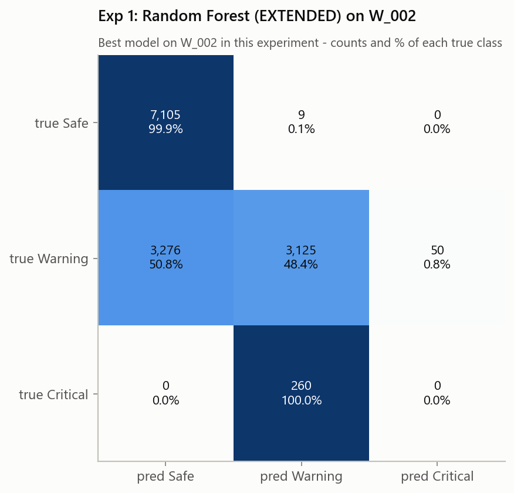
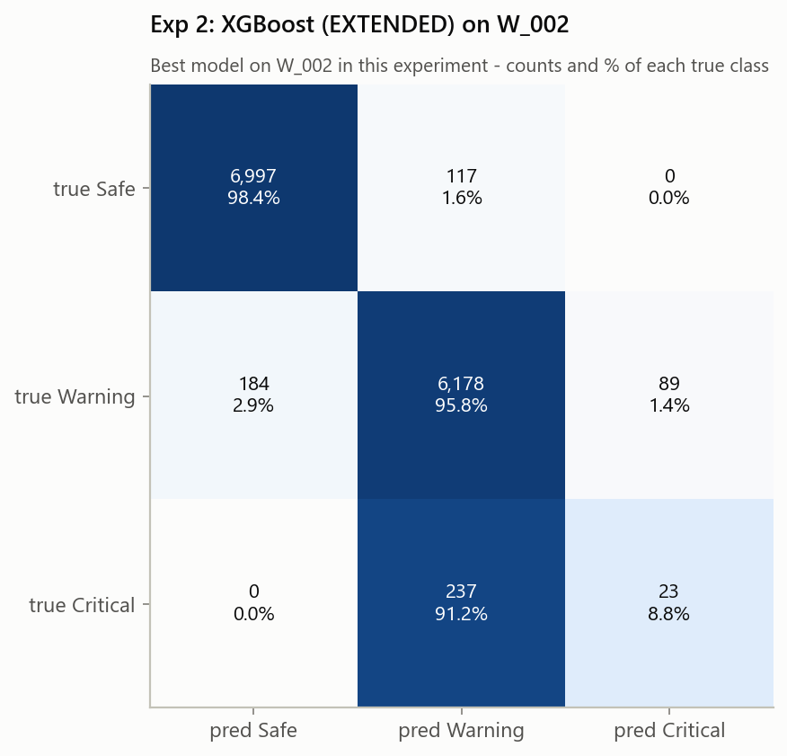
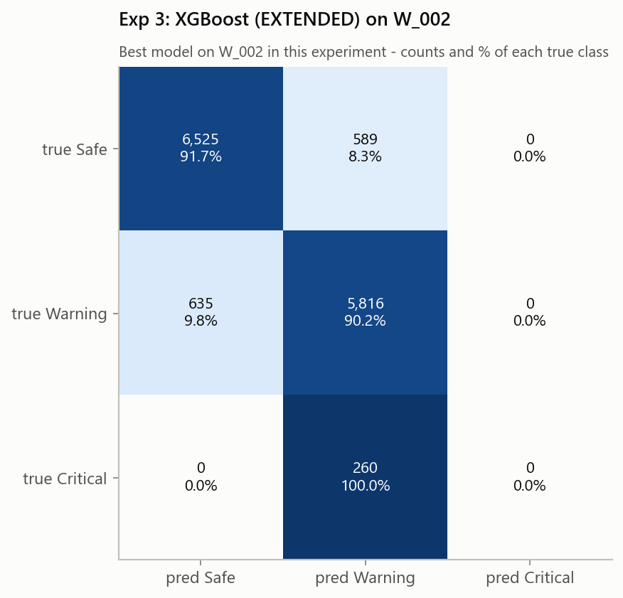
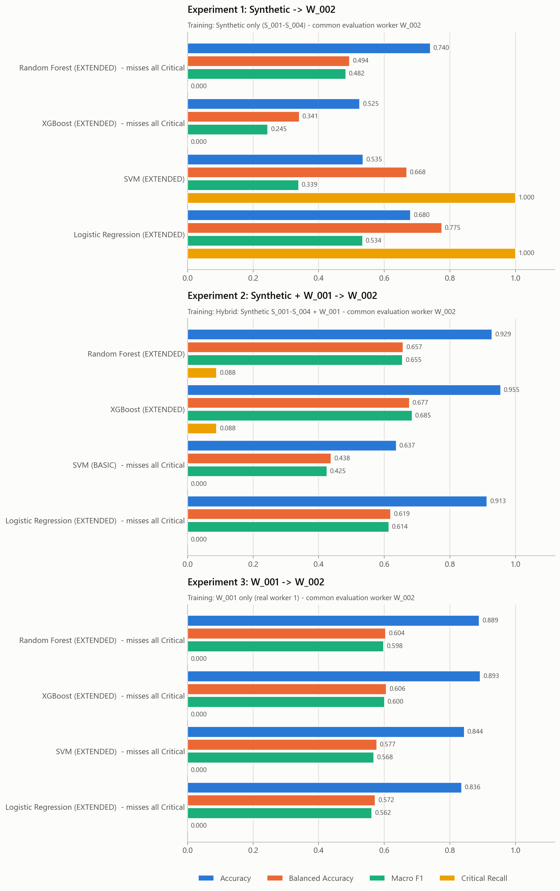
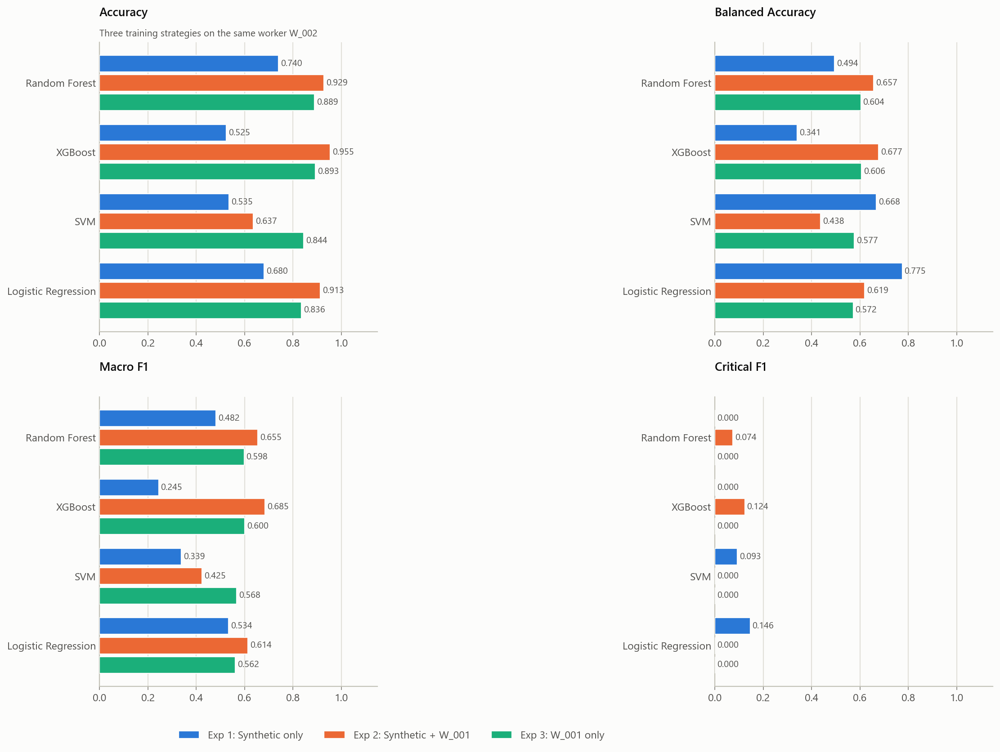
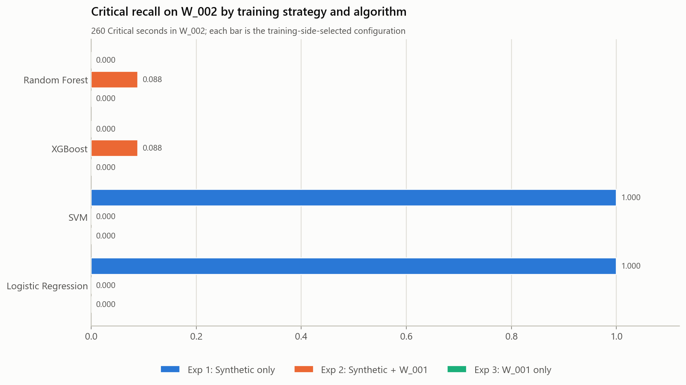

# ProSafe ML V2 - common evaluation of the three training strategies on W_002

Generated by `python src/run_experiment_v3.py`.

## Purpose and status of W_002

All three training strategies are evaluated on exactly the same worker, W_002, so they are directly comparable (in the original `run_experiments.py`, Experiment 1 was tested on W_001 instead).

* **W_002 is not a pristine unseen test worker.** It was used in earlier ProSafe development: the original Experiments 2-3 were scored on it, Critical failures were analysed on it, and the decision to deploy the Experiment 2 XGBoost was taken after its results were known. These results are a **controlled comparative evaluation**, not a new external validation.
* Within this run, W_002 never entered training, the folds, early stopping, class weighting, feature-set selection or the selection rule. Each configuration was refitted on the training data, saved (frozen) and then scored once on W_002.
* **W_003** (`run_experiment_v2.py`, `outputs/experiment_v2/`) remains the newer, more independent evaluation worker.

## W_002 data validation

* `data/prosafe_W002_ml_ready.csv`: 13,825 rows, 41 columns (worker_id, timestamp, 38 EXTENDED features, risk_level); worker W_002 only; loaded through the guarded `utils.load_external_test_data()`.
* Classes: Safe 7,114 (51.5%), Warning 6,451 (46.7%), Critical 260 (1.9%). Not rebalanced; no rows removed or relabelled.
* Missing values: 1,217 cells in 14 features. worker_id, timestamp and risk_level are not predictors; no raw baseline, evidence or audit column is present; feature names match `utils.EXTENDED_FEATURE_COLUMNS` exactly.

## Method (identical to run_experiments.py)

| Experiment | Training strategy | Training data | Evaluation | Training-side validation |
|---|---|---|---|---|
| 1 Synthetic -> W_002 | Synthetic only (S_001-S_004) | prosafe_synthetic_ml_ready.csv (18,564 rows) | W_002 | LeaveOneGroupOut by worker_id (4 folds: S_001, S_002, S_003, S_004) |
| 2 Synthetic + W_001 -> W_002 | Hybrid: Synthetic S_001-S_004 + W_001 | prosafe_synthetic_ml_ready.csv + prosafe_W001_ml_ready.csv (32,579 rows) | W_002 | LeaveOneGroupOut by worker_id (5 folds: S_001, S_002, S_003, S_004, W_001) |
| 3 W_001 -> W_002 | W_001 only (real worker 1) | prosafe_W001_ml_ready.csv (14,015 rows) | W_002 | 5 contiguous chronological blocks of W_001, 300 rows purged on both sides of each validation block |

* Algorithms: Random Forest, XGBoost, SVM, Logistic Regression. Feature sets: BASIC_PERSONALIZED (11), TEMPORAL_PERSONALIZED (26), EXTENDED (38).
* Budget: 36 candidates per algorithm per experiment (12 seeded configurations x 3 feature sets, seed 42), with the search spaces, class-weight handling and XGBoost early stopping of run_experiments.py.
* Selection rule: accuracy within 0.01 of the best CV accuracy, then macro F1 -> balanced accuracy -> Critical recall -> lowest Critical->Safe rate.
* Reproduction checks: selected configuration identical to run_experiments.py for 12/12 models and to run_experiment_v2.py for 12/12; Experiments 2-3 reproduce the original W_002 confusion matrices for 8/8 models.

## Experiment 1: Synthetic -> W_002

| model | feature set | accuracy | bal. acc. | macro P | macro R | macro F1 | weighted P | weighted R | weighted F1 | Crit P | Crit R | Crit F1 | Crit FN | Crit FN rate | Crit->Warning | Crit->Safe |
|---|---|---|---|---|---|---|---|---|---|---|---|---|---|---|---|---|
| Random Forest | EXTENDED | 0.7400 | 0.4944 | 0.5351 | 0.4944 | 0.4824 | 0.7818 | 0.7400 | 0.7142 | 0.0000 | 0.0000 | 0.0000 | 260 | 1.0000 | 260 (100.0 %) | 0 (0.0 %) |
| XGBoost | EXTENDED | 0.5247 | 0.3406 | 0.2939 | 0.3406 | 0.2445 | 0.4368 | 0.5247 | 0.3755 | 0.0000 | 0.0000 | 0.0000 | 260 | 1.0000 | 258 (99.2 %) | 2 (0.8 %) |
| SVM | EXTENDED | 0.5355 | 0.6682 | 0.6290 | 0.6682 | 0.3386 | 0.8987 | 0.5355 | 0.4758 | 0.0490 | 1.0000 | 0.0934 | 0 | 0.0000 | 0 (0.0 %) | 0 (0.0 %) |
| Logistic Regression | EXTENDED | 0.6802 | 0.7750 | 0.6012 | 0.7750 | 0.5337 | 0.8485 | 0.6802 | 0.7245 | 0.0787 | 1.0000 | 0.1460 | 0 | 0.0000 | 0 (0.0 %) | 0 (0.0 %) |

Per-class precision / recall / F1:

| model | Safe | Warning | Critical |
|---|---|---|---|
| Random Forest | 0.684 / 0.999 / 0.812 | 0.921 / 0.484 / 0.635 | 0.000 / 0.000 / 0.000 |
| XGBoost | 0.530 / 1.000 / 0.693 | 0.352 / 0.022 / 0.041 | 0.000 / 0.000 / 0.000 |
| SVM | 0.838 / 0.999 / 0.911 | 1.000 / 0.005 / 0.011 | 0.049 / 1.000 / 0.093 |
| Logistic Regression | 0.880 / 0.900 / 0.890 | 0.845 / 0.425 / 0.566 | 0.079 / 1.000 / 0.146 |

Confusion matrices (rows true Safe / Warning / Critical; columns predicted in the same order):

* Random Forest: `[[7105, 9, 0], [3276, 3125, 50], [0, 260, 0]]`
* XGBoost: `[[7114, 0, 0], [6311, 140, 0], [2, 258, 0]]`
* SVM: `[[7108, 0, 6], [1375, 35, 5041], [0, 0, 260]]`
* Logistic Regression: `[[6402, 502, 210], [877, 2742, 2832], [0, 0, 260]]`

**Best model on W_002** (selection rule applied descriptively): Random Forest (EXTENDED). Training-side choice (rule on CV metrics): Random Forest (EXTENDED).

* Random Forest: **UNSAFE CRITICAL DETECTION: missed every W_002 Critical observation.**
* XGBoost: **UNSAFE CRITICAL DETECTION: missed every W_002 Critical observation.**

Selected configurations (training side only):

* **Random Forest** - EXTENDED; n_estimators=200, min_samples_split=12, min_samples_leaf=6, max_features=0.75, max_depth=32, criterion=entropy, class_weight=balanced, bootstrap=False; CV accuracy 0.9438, CV macro F1 0.8258.
* **XGBoost** - EXTENDED; subsample=1.0, reg_lambda=2, reg_alpha=1.0, n_estimators=16, min_child_weight=10, max_depth=5, learning_rate=0.05, gamma=0.5, colsample_bytree=0.9, class_weight=balanced, critical_weight=2.0, warning_weight=1.25; CV accuracy 0.9221, CV macro F1 0.7772.
* **SVM** - EXTENDED; kernel=linear, C=10, class_weight=balanced; CV accuracy 0.8837, CV macro F1 0.7748.
* **Logistic Regression** - EXTENDED; penalty=l1, solver=saga, C=0.3, class_weight=None, max_iter=5000; CV accuracy 0.8728, CV macro F1 0.7502.

## Experiment 2: Synthetic + W_001 -> W_002 (production training strategy)

| model | feature set | accuracy | bal. acc. | macro P | macro R | macro F1 | weighted P | weighted R | weighted F1 | Crit P | Crit R | Crit F1 | Crit FN | Crit FN rate | Crit->Warning | Crit->Safe |
|---|---|---|---|---|---|---|---|---|---|---|---|---|---|---|---|---|
| Random Forest | EXTENDED | 0.9285 | 0.6574 | 0.6562 | 0.6574 | 0.6553 | 0.9357 | 0.9285 | 0.9310 | 0.0630 | 0.0885 | 0.0736 | 237 | 0.9115 | 237 (91.2 %) | 0 (0.0 %) |
| XGBoost | EXTENDED | 0.9546 | 0.6766 | 0.7085 | 0.6766 | 0.6848 | 0.9466 | 0.9546 | 0.9501 | 0.2054 | 0.0885 | 0.1237 | 237 | 0.9115 | 237 (91.2 %) | 0 (0.0 %) |
| SVM | BASIC | 0.6365 | 0.4377 | 0.4425 | 0.4377 | 0.4248 | 0.6554 | 0.6365 | 0.6233 | 0.0000 | 0.0000 | 0.0000 | 260 | 1.0000 | 259 (99.6 %) | 1 (0.4 %) |
| Logistic Regression | EXTENDED | 0.9132 | 0.6193 | 0.6091 | 0.6193 | 0.6139 | 0.8963 | 0.9132 | 0.9042 | 0.0000 | 0.0000 | 0.0000 | 260 | 1.0000 | 260 (100.0 %) | 0 (0.0 %) |

Per-class precision / recall / F1:

| model | Safe | Warning | Critical |
|---|---|---|---|
| Random Forest | 0.946 / 0.999 / 0.972 | 0.959 / 0.885 / 0.920 | 0.063 / 0.088 / 0.074 |
| XGBoost | 0.974 / 0.984 / 0.979 | 0.946 / 0.958 / 0.952 | 0.205 / 0.088 / 0.124 |
| SVM | 0.749 / 0.497 / 0.597 | 0.578 / 0.816 / 0.677 | 0.000 / 0.000 / 0.000 |
| Logistic Regression | 0.909 / 0.964 / 0.936 | 0.918 / 0.894 / 0.906 | 0.000 / 0.000 / 0.000 |

Confusion matrices (rows true Safe / Warning / Critical; columns predicted in the same order):

* Random Forest: `[[7108, 6, 0], [403, 5706, 342], [0, 237, 23]]`
* XGBoost: `[[6997, 117, 0], [184, 6178, 89], [0, 237, 23]]`
* SVM: `[[3535, 3579, 0], [1183, 5265, 3], [1, 259, 0]]`
* Logistic Regression: `[[6860, 254, 0], [685, 5765, 1], [0, 260, 0]]`

**Best model on W_002** (selection rule applied descriptively): XGBoost (EXTENDED). Training-side choice (rule on CV metrics): Random Forest (EXTENDED).

* Random Forest: **POOR CRITICAL DETECTION (Critical recall 0.088)**
* XGBoost: **POOR CRITICAL DETECTION (Critical recall 0.088)**
* SVM: **UNSAFE CRITICAL DETECTION: missed every W_002 Critical observation.**
* Logistic Regression: **UNSAFE CRITICAL DETECTION: missed every W_002 Critical observation.**

Selected configurations (training side only):

* **Random Forest** - EXTENDED; n_estimators=300, min_samples_split=8, min_samples_leaf=1, max_features=1.0, max_depth=16, criterion=log_loss, class_weight=balanced_subsample, bootstrap=False; CV accuracy 0.8869, CV macro F1 0.6431.
* **XGBoost** - EXTENDED; subsample=1.0, reg_lambda=5, reg_alpha=0.1, n_estimators=20, min_child_weight=1, max_depth=8, learning_rate=0.15, gamma=0.05, colsample_bytree=0.6, class_weight=balanced, critical_weight=1.0, warning_weight=0.75; CV accuracy 0.8256, CV macro F1 0.6879.
* **SVM** - BASIC_PERSONALIZED; kernel=rbf, C=10, gamma=0.0001, class_weight=None; CV accuracy 0.8246, CV macro F1 0.6569.
* **Logistic Regression** - EXTENDED; penalty=l1, solver=saga, C=0.1, class_weight=None, max_iter=5000; CV accuracy 0.8183, CV macro F1 0.7353.

## Experiment 3: W_001 -> W_002

| model | feature set | accuracy | bal. acc. | macro P | macro R | macro F1 | weighted P | weighted R | weighted F1 | Crit P | Crit R | Crit F1 | Crit FN | Crit FN rate | Crit->Warning | Crit->Safe |
|---|---|---|---|---|---|---|---|---|---|---|---|---|---|---|---|---|
| Random Forest | EXTENDED | 0.8895 | 0.6038 | 0.5925 | 0.6038 | 0.5981 | 0.8727 | 0.8895 | 0.8810 | 0.0000 | 0.0000 | 0.0000 | 260 | 1.0000 | 260 (100.0 %) | 0 (0.0 %) |
| XGBoost | EXTENDED | 0.8927 | 0.6063 | 0.5946 | 0.6063 | 0.6004 | 0.8761 | 0.8927 | 0.8843 | 0.0000 | 0.0000 | 0.0000 | 260 | 1.0000 | 260 (100.0 %) | 0 (0.0 %) |
| SVM | EXTENDED | 0.8439 | 0.5770 | 0.5772 | 0.5770 | 0.5679 | 0.8546 | 0.8439 | 0.8358 | 0.0000 | 0.0000 | 0.0000 | 260 | 1.0000 | 260 (100.0 %) | 0 (0.0 %) |
| Logistic Regression | EXTENDED | 0.8357 | 0.5719 | 0.5753 | 0.5719 | 0.5621 | 0.8524 | 0.8357 | 0.8271 | 0.0000 | 0.0000 | 0.0000 | 260 | 1.0000 | 260 (100.0 %) | 0 (0.0 %) |

Per-class precision / recall / F1:

| model | Safe | Warning | Critical |
|---|---|---|---|
| Random Forest | 0.902 / 0.923 / 0.912 | 0.876 / 0.889 / 0.882 | 0.000 / 0.000 / 0.000 |
| XGBoost | 0.911 / 0.917 / 0.914 | 0.873 / 0.902 / 0.887 | 0.000 / 0.000 / 0.000 |
| SVM | 0.973 / 0.754 / 0.850 | 0.759 / 0.977 / 0.854 | 0.000 / 0.000 / 0.000 |
| Logistic Regression | 0.980 / 0.732 / 0.838 | 0.745 / 0.984 / 0.848 | 0.000 / 0.000 / 0.000 |

Confusion matrices (rows true Safe / Warning / Critical; columns predicted in the same order):

* Random Forest: `[[6563, 551, 0], [717, 5734, 0], [0, 260, 0]]`
* XGBoost: `[[6525, 589, 0], [635, 5816, 0], [0, 260, 0]]`
* SVM: `[[5366, 1744, 4], [150, 6301, 0], [0, 260, 0]]`
* Logistic Regression: `[[5207, 1907, 0], [104, 6347, 0], [0, 260, 0]]`

**Best model on W_002** (selection rule applied descriptively): XGBoost (EXTENDED). Training-side choice (rule on CV metrics): SVM (EXTENDED).

* Random Forest: **UNSAFE CRITICAL DETECTION: missed every W_002 Critical observation.**
* XGBoost: **UNSAFE CRITICAL DETECTION: missed every W_002 Critical observation.**
* SVM: **UNSAFE CRITICAL DETECTION: missed every W_002 Critical observation.**
* Logistic Regression: **UNSAFE CRITICAL DETECTION: missed every W_002 Critical observation.**

Selected configurations (training side only):

* **Random Forest** - EXTENDED; n_estimators=1000, min_samples_split=12, min_samples_leaf=4, max_features=0.5, max_depth=32, criterion=gini, class_weight=balanced, bootstrap=False; CV accuracy 0.8360, CV macro F1 0.6913.
* **XGBoost** - EXTENDED; subsample=0.6, reg_lambda=2, reg_alpha=1.0, n_estimators=283, min_child_weight=5, max_depth=6, learning_rate=0.05, gamma=1.0, colsample_bytree=0.6, class_weight=balanced, critical_weight=1.5, warning_weight=0.75; CV accuracy 0.8163, CV macro F1 0.7114.
* **SVM** - EXTENDED; kernel=rbf, C=10, gamma=0.0001, class_weight=None; CV accuracy 0.8736, CV macro F1 0.8090.
* **Logistic Regression** - EXTENDED; penalty=l2, solver=lbfgs, C=0.01, class_weight=None, max_iter=5000; CV accuracy 0.8456, CV macro F1 0.7418.

## Final common-worker comparison (all 12 models on W_002)

| experiment | training strategy | model | feature set | accuracy | bal. acc. | macro F1 | Crit P | Crit R | Crit F1 | Crit->Safe | flag |
|---|---|---|---|---|---|---|---|---|---|---|---|
| 1 | Synthetic only | Random Forest | EXTENDED | 0.7400 | 0.4944 | 0.4824 | 0.0000 | 0.0000 | 0.0000 | 0 | UNSAFE CRITICAL DETECTION: missed every W_002 Critical observation. |
| 1 | Synthetic only | XGBoost | EXTENDED | 0.5247 | 0.3406 | 0.2445 | 0.0000 | 0.0000 | 0.0000 | 2 | UNSAFE CRITICAL DETECTION: missed every W_002 Critical observation. |
| 1 | Synthetic only | SVM | EXTENDED | 0.5355 | 0.6682 | 0.3386 | 0.0490 | 1.0000 | 0.0934 | 0 | ok |
| 1 | Synthetic only | Logistic Regression | EXTENDED | 0.6802 | 0.7750 | 0.5337 | 0.0787 | 1.0000 | 0.1460 | 0 | ok |
| 2 | Synthetic + W_001 | Random Forest | EXTENDED | 0.9285 | 0.6574 | 0.6553 | 0.0630 | 0.0885 | 0.0736 | 0 | POOR CRITICAL DETECTION (Critical recall 0.088) |
| 2 | Synthetic + W_001 | XGBoost | EXTENDED | 0.9546 | 0.6766 | 0.6848 | 0.2054 | 0.0885 | 0.1237 | 0 | POOR CRITICAL DETECTION (Critical recall 0.088) |
| 2 | Synthetic + W_001 | SVM | BASIC | 0.6365 | 0.4377 | 0.4248 | 0.0000 | 0.0000 | 0.0000 | 1 | UNSAFE CRITICAL DETECTION: missed every W_002 Critical observation. |
| 2 | Synthetic + W_001 | Logistic Regression | EXTENDED | 0.9132 | 0.6193 | 0.6139 | 0.0000 | 0.0000 | 0.0000 | 0 | UNSAFE CRITICAL DETECTION: missed every W_002 Critical observation. |
| 3 | W_001 only | Random Forest | EXTENDED | 0.8895 | 0.6038 | 0.5981 | 0.0000 | 0.0000 | 0.0000 | 0 | UNSAFE CRITICAL DETECTION: missed every W_002 Critical observation. |
| 3 | W_001 only | XGBoost | EXTENDED | 0.8927 | 0.6063 | 0.6004 | 0.0000 | 0.0000 | 0.0000 | 0 | UNSAFE CRITICAL DETECTION: missed every W_002 Critical observation. |
| 3 | W_001 only | SVM | EXTENDED | 0.8439 | 0.5770 | 0.5679 | 0.0000 | 0.0000 | 0.0000 | 0 | UNSAFE CRITICAL DETECTION: missed every W_002 Critical observation. |
| 3 | W_001 only | Logistic Regression | EXTENDED | 0.8357 | 0.5719 | 0.5621 | 0.0000 | 0.0000 | 0.0000 | 0 | UNSAFE CRITICAL DETECTION: missed every W_002 Critical observation. |

**Best overall result on W_002** (selection rule over all 12): Experiment 2 XGBoost (EXTENDED) - accuracy 0.9546, macro F1 0.6848, Critical recall 0.0885.

## Primary comparison: training strategies on the same worker

| model | metric | Exp 1 synthetic only | Exp 2 synthetic + W_001 | Exp 3 W_001 only | Exp 2 - Exp 1 | Exp 2 - Exp 3 | Exp 1 - Exp 3 |
|---|---|---|---|---|---|---|---|
| Random Forest | Accuracy | 0.7400 | 0.9285 | 0.8895 | +0.1886 | +0.0391 | -0.1495 |
| Random Forest | Balanced Accuracy | 0.4944 | 0.6574 | 0.6038 | +0.1630 | +0.0536 | -0.1094 |
| Random Forest | Macro F1 | 0.4824 | 0.6553 | 0.5981 | +0.1730 | +0.0572 | -0.1158 |
| Random Forest | Critical Recall | 0.0000 | 0.0885 | 0.0000 | +0.0885 | +0.0885 | +0.0000 |
| Random Forest | Critical F1 | 0.0000 | 0.0736 | 0.0000 | +0.0736 | +0.0736 | +0.0000 |
| XGBoost | Accuracy | 0.5247 | 0.9546 | 0.8927 | +0.4299 | +0.0620 | -0.3680 |
| XGBoost | Balanced Accuracy | 0.3406 | 0.6766 | 0.6063 | +0.3360 | +0.0703 | -0.2657 |
| XGBoost | Macro F1 | 0.2445 | 0.6848 | 0.6004 | +0.4403 | +0.0844 | -0.3559 |
| XGBoost | Critical Recall | 0.0000 | 0.0885 | 0.0000 | +0.0885 | +0.0885 | +0.0000 |
| XGBoost | Critical F1 | 0.0000 | 0.1237 | 0.0000 | +0.1237 | +0.1237 | +0.0000 |
| SVM | Accuracy | 0.5355 | 0.6365 | 0.8439 | +0.1010 | -0.2074 | -0.3084 |
| SVM | Balanced Accuracy | 0.6682 | 0.4377 | 0.5770 | -0.2305 | -0.1393 | +0.0912 |
| SVM | Macro F1 | 0.3386 | 0.4248 | 0.5679 | +0.0863 | -0.1431 | -0.2294 |
| SVM | Critical Recall | 1.0000 | 0.0000 | 0.0000 | -1.0000 | +0.0000 | +1.0000 |
| SVM | Critical F1 | 0.0934 | 0.0000 | 0.0000 | -0.0934 | +0.0000 | +0.0934 |
| Logistic Regression | Accuracy | 0.6802 | 0.9132 | 0.8357 | +0.2330 | +0.0775 | -0.1555 |
| Logistic Regression | Balanced Accuracy | 0.7750 | 0.6193 | 0.5719 | -0.1557 | +0.0474 | +0.2031 |
| Logistic Regression | Macro F1 | 0.5337 | 0.6139 | 0.5621 | +0.0801 | +0.0518 | -0.0284 |
| Logistic Regression | Critical Recall | 1.0000 | 0.0000 | 0.0000 | -1.0000 | +0.0000 | +1.0000 |
| Logistic Regression | Critical F1 | 0.1460 | 0.0000 | 0.0000 | -0.1460 | +0.0000 | +0.1460 |

Mean over the four algorithms:

| strategy | Accuracy | Balanced Accuracy | Macro F1 | Critical Recall | Critical F1 |
|---|---|---|---|---|---|
| Exp 1 Synthetic only | 0.6201 | 0.5695 | 0.3998 | 0.5000 | 0.0598 |
| Exp 2 Synthetic + W_001 | 0.8582 | 0.5977 | 0.5947 | 0.0442 | 0.0493 |
| Exp 3 W_001 only | 0.8654 | 0.5898 | 0.5821 | 0.0000 | 0.0000 |

Representative per strategy (selection rule over its four models):

* Exp 1 Synthetic only: Random Forest (EXTENDED) - accuracy 0.7400, macro F1 0.4824, Critical recall 0.0000.
* Exp 2 Synthetic + W_001: XGBoost (EXTENDED) - accuracy 0.9546, macro F1 0.6848, Critical recall 0.0885.
* Exp 3 W_001 only: XGBoost (EXTENDED) - accuracy 0.8927, macro F1 0.6004, Critical recall 0.0000.

### Answers

* **Does adding real W_001 data to synthetic data improve performance on W_002?** Experiment 2 is higher than Experiment 1 for Accuracy 4/4, Balanced Accuracy 2/4, Macro F1 4/4, Critical Recall 2/4, Critical F1 2/4 algorithms.
* **Synthetic-only vs W_001-only:** Experiment 1 is higher than Experiment 3 for Accuracy 0/4, Balanced Accuracy 2/4, Macro F1 0/4, Critical Recall 2/4, Critical F1 2/4 algorithms.
* Experiment 2 vs W_001-only (Experiment 3): higher for Accuracy 3/4, Balanced Accuracy 3/4, Macro F1 3/4, Critical Recall 2/4, Critical F1 2/4 algorithms.
* **Strongest overall generalization to W_002** (pre-specified: selection rule over the three strategy representatives): **Experiment 2 - Hybrid: Synthetic S_001-S_004 + W_001**.
* Hybrid-improvement verdict (same pre-specified rule as run_experiment_v2.py: YES if Exp 2 is the best strategy and beats both others on macro F1 for at least 3 of 4 algorithms; NO if another strategy is best and Exp 2 beats one of the others on macro F1 for at most 1 of 4; otherwise MIXED): **YES**.

### Experiment 2 (production training strategy) - is it the strongest?

| metric | algorithms where Exp 2 is highest (of 4) | strategy with the best representative | strategy with the best mean |
|---|---|---|---|
| Accuracy | 3 | Exp 2 | Exp 3 |
| Macro F1 | 3 | Exp 2 | Exp 2 |
| Balanced Accuracy | 2 | Exp 2 | Exp 2 |
| Critical Recall | 2 | Exp 2 | Exp 1 |

Experiment 2 XGBoost on W_002: accuracy 0.9546, balanced accuracy 0.6766, macro F1 0.6848, Critical recall 0.0885 (POOR CRITICAL DETECTION (Critical recall 0.088)).

## Comparison with the V2 W_003 results (descriptive)

Source: `outputs\experiment_v2\w003_results.csv` (not re-run). Same training strategies; the evaluation worker differs.

| experiment | model | W_002 accuracy | W_003 accuracy | W_002 macro F1 | W_003 macro F1 | W_002 Crit R | W_003 Crit R | W_003 - W_002 macro F1 |
|---|---|---|---|---|---|---|---|---|
| 1 | Random Forest | 0.7400 | 0.8134 | 0.4824 | 0.5512 | 0.0000 | 0.0000 | +0.0689 |
| 1 | XGBoost | 0.5247 | 0.6763 | 0.2445 | 0.4487 | 0.0000 | 0.0000 | +0.2041 |
| 1 | SVM | 0.5355 | 0.6593 | 0.3386 | 0.5552 | 1.0000 | 1.0000 | +0.2167 |
| 1 | Logistic Regression | 0.6802 | 0.7977 | 0.5337 | 0.6933 | 1.0000 | 0.9484 | +0.1596 |
| 2 | Random Forest | 0.9285 | 0.9692 | 0.6553 | 0.8815 | 0.0885 | 0.8452 | +0.2262 |
| 2 | XGBoost | 0.9546 | 0.9823 | 0.6848 | 0.9661 | 0.0885 | 0.9782 | +0.2813 |
| 2 | SVM | 0.6365 | 0.7286 | 0.4248 | 0.4927 | 0.0000 | 0.0000 | +0.0679 |
| 2 | Logistic Regression | 0.9132 | 0.9091 | 0.6139 | 0.6178 | 0.0000 | 0.0000 | +0.0039 |
| 3 | Random Forest | 0.8895 | 0.8551 | 0.5981 | 0.5805 | 0.0000 | 0.0000 | -0.0177 |
| 3 | XGBoost | 0.8927 | 0.8884 | 0.6004 | 0.7395 | 0.0000 | 0.2659 | +0.1392 |
| 3 | SVM | 0.8439 | 0.8513 | 0.5679 | 0.5766 | 0.0000 | 0.0000 | +0.0086 |
| 3 | Logistic Regression | 0.8357 | 0.8591 | 0.5621 | 0.5823 | 0.0000 | 0.0000 | +0.0202 |

Consistency:

* Mean absolute difference W_003 vs W_002: Accuracy 0.0583, Balanced Accuracy 0.0988, Macro F1 0.1178, Critical Recall 0.1637, Critical F1 0.1843.
* Spearman rank correlation of the 12 models between workers: accuracy 0.972, macro F1 0.874.
* Best strategy: W_002 Experiment 2, W_003 Experiment 2. Hybrid verdict: W_002 YES, W_003 MIXED. Best overall model: W_002 Exp 2 XGBoost, W_003 Exp 2 XGBoost.

## Files

* `w002_results.csv` - every metric of the 12 models; `w002_summary.csv` - key metrics with the W_003 comparison.
* Models: `models/experiment_v3/exp{1,2,3}_{random_forest,xgboost,svm,logistic_regression}.pkl` (frozen before scoring W_002). The production model, `models/experiments/`, `models/experiment_v2/` and earlier outputs were not changed.
* No production decision is taken here; the results are for review.
* Total runtime: 118.6 min.
