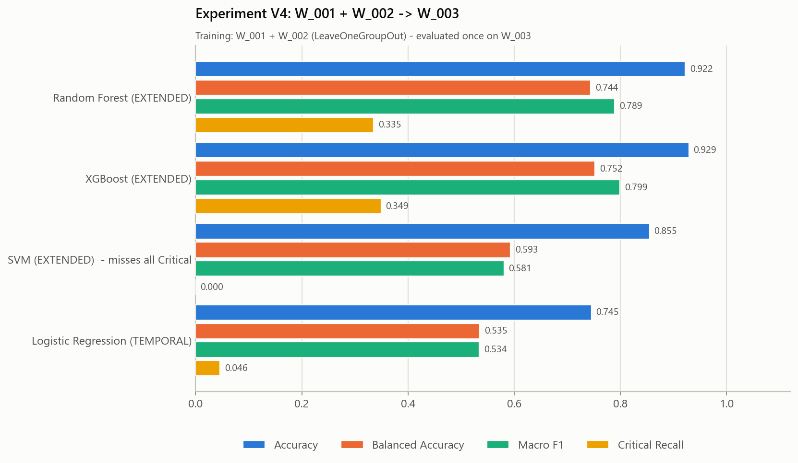
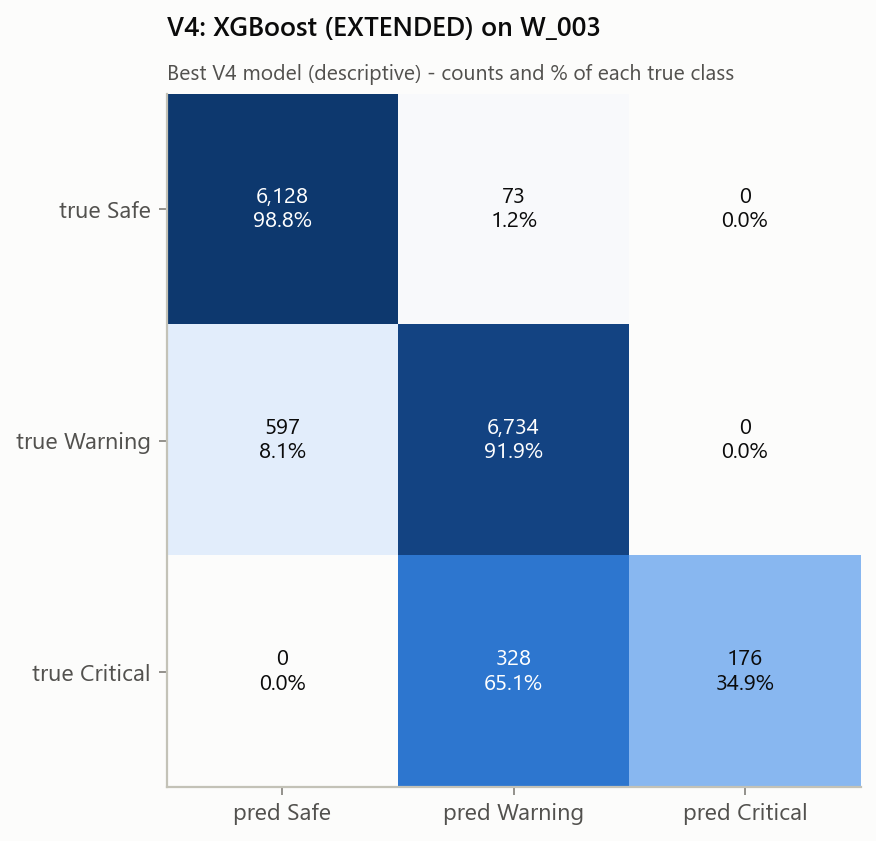
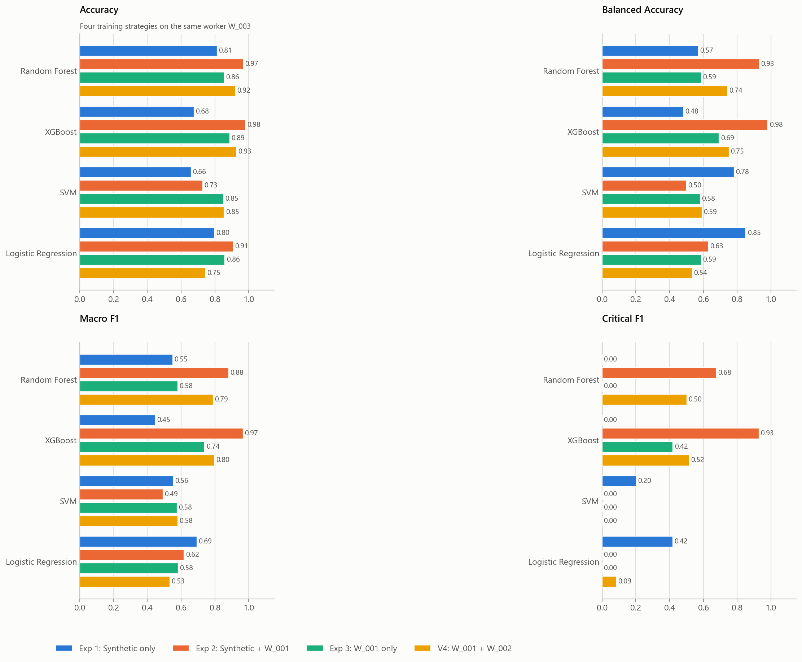
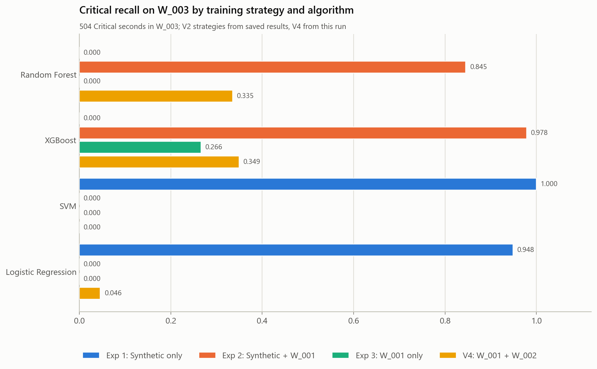

# ProSafe ML V2 - real-worker combination: W_001 + W_002 -> W_003

Generated by `python src/run_experiment_v4.py`.

## Purpose

How well does training on two real workers, W_001 and W_002, generalize to a new real worker, W_003? The result is compared with the three run_experiment_v2.py strategies on the same worker.

## Methodological status of W_003

* This V4 strategy was specified **after** run_experiment_v2.py had produced W_003 results. W_003 is therefore no longer untouched for the decision to try this strategy, and V4 is **an additional comparative evaluation on W_003**, not a pristine independent test. Comparing several strategies on the same worker and preferring the best one would also make that worker's score optimistic for the chosen strategy.
* Within this run, W_003 never entered the training context, the folds, early stopping, class weighting, feature-set selection or the selection rule. Each configuration was refitted on W_001 + W_002, saved (frozen) and then scored once on W_003. No code, feature, search space, threshold or data was changed for V4.
* W_002 is used here as **training** data. It was previously the external test worker of run_experiments.py; it does not appear in any evaluation of this run.

## Data

* Training: `prosafe_W001_ml_ready.csv` 14,015 rows (Safe 3,413, Warning 9,381, Critical 1,221) + `prosafe_W002_ml_ready.csv` 13,825 rows (Safe 7,114, Warning 6,451, Critical 260) = 27,840 rows.
* Evaluation: `prosafe_W003_ml_ready.csv` 14,036 rows, worker W_003 only (Safe 6,201, Warning 7,331, Critical 504); 1,253 missing cells in 13 features. Not rebalanced; no rows removed or relabelled.
* All three files: 41 columns (worker_id, timestamp, 38 EXTENDED features, risk_level) with the exact contract names and the same layout; worker_id is used only for grouping, timestamp only for ordering; no raw baseline, evidence, rule, quality or audit column is present.

## Method (identical to run_experiments.py)

* Training-side validation: LeaveOneGroupOut by worker_id (2 folds: W_001, W_002).
* Algorithms: Random Forest, XGBoost, SVM, Logistic Regression. Feature sets: BASIC_PERSONALIZED (11), TEMPORAL_PERSONALIZED (26), EXTENDED (38).
* Budget: 36 candidates per algorithm (12 seeded configurations x 3 feature sets, seed 42); the search spaces, class-weight handling and XGBoost early stopping of run_experiments.py.
* Selection rule: accuracy within 0.01 of the best CV accuracy, then macro F1 -> balanced accuracy -> Critical recall -> lowest Critical->Safe rate.

## Results on W_003

| model | feature set | accuracy | bal. acc. | macro P | macro R | macro F1 | weighted P | weighted R | weighted F1 | Crit P | Crit R | Crit F1 | Crit FN | Crit FN rate | Crit->Warning | Crit->Safe |
|---|---|---|---|---|---|---|---|---|---|---|---|---|---|---|---|---|
| Random Forest | EXTENDED | 0.9221 | 0.7439 | 0.9475 | 0.7439 | 0.7892 | 0.9265 | 0.9221 | 0.9165 | 1.0000 | 0.3353 | 0.5022 | 335 | 0.6647 | 335 (66.5 %) | 0 (0.0 %) |
| XGBoost | EXTENDED | 0.9289 | 0.7520 | 0.9517 | 0.7520 | 0.7989 | 0.9314 | 0.9289 | 0.9237 | 1.0000 | 0.3492 | 0.5176 | 328 | 0.6508 | 328 (65.1 %) | 0 (0.0 %) |
| SVM | EXTENDED | 0.8547 | 0.5926 | 0.5696 | 0.5926 | 0.5807 | 0.8243 | 0.8547 | 0.8389 | 0.0000 | 0.0000 | 0.0000 | 504 | 1.0000 | 504 (100.0 %) | 0 (0.0 %) |
| Logistic Regression | TEMPORAL | 0.7453 | 0.5352 | 0.7566 | 0.5352 | 0.5338 | 0.7565 | 0.7453 | 0.7317 | 0.7667 | 0.0456 | 0.0861 | 481 | 0.9544 | 481 (95.4 %) | 0 (0.0 %) |

Per-class precision / recall / F1:

| model | Safe | Warning | Critical |
|---|---|---|---|
| Random Forest | 0.891 / 1.000 / 0.942 | 0.951 / 0.896 / 0.923 | 1.000 / 0.335 / 0.502 |
| XGBoost | 0.911 / 0.988 / 0.948 | 0.944 / 0.919 / 0.931 | 1.000 / 0.349 / 0.518 |
| SVM | 0.848 / 0.916 / 0.881 | 0.861 / 0.861 / 0.861 | 0.000 / 0.000 / 0.000 |
| Logistic Regression | 0.698 / 0.884 / 0.780 | 0.805 / 0.676 / 0.735 | 0.767 / 0.046 / 0.086 |

Confusion matrices (rows true Safe / Warning / Critical; columns predicted in the same order):

* Random Forest: `[[6201, 0, 0], [759, 6572, 0], [0, 335, 169]]`
* XGBoost: `[[6128, 73, 0], [597, 6734, 0], [0, 328, 176]]`
* SVM: `[[5683, 518, 0], [1017, 6314, 0], [0, 504, 0]]`
* Logistic Regression: `[[5479, 722, 0], [2365, 4959, 7], [0, 481, 23]]`

* Random Forest: **LIMITED CRITICAL DETECTION (Critical recall 0.335)**
* XGBoost: **LIMITED CRITICAL DETECTION (Critical recall 0.349)**
* SVM: **UNSAFE CRITICAL DETECTION: missed every W_003 Critical observation.**
* Logistic Regression: **POOR CRITICAL DETECTION (Critical recall 0.046)**

Selected configurations (training side only):

* **Random Forest** - EXTENDED; n_estimators=1000, min_samples_split=12, min_samples_leaf=4, max_features=0.5, max_depth=32, criterion=gini, class_weight=balanced, bootstrap=False; CV accuracy 0.7939, CV macro F1 0.7037; 12.6 min.
* **XGBoost** - EXTENDED; subsample=0.9, reg_lambda=5, reg_alpha=1.0, n_estimators=236, min_child_weight=10, max_depth=8, learning_rate=0.02, gamma=1.0, colsample_bytree=0.6, class_weight=balanced, critical_weight=1.25, warning_weight=0.75; CV accuracy 0.7950, CV macro F1 0.5455; 14.7 min.
* **SVM** - EXTENDED; kernel=rbf, C=10, gamma=0.0001, class_weight=None; CV accuracy 0.8028, CV macro F1 0.5827; 7.4 min.
* **Logistic Regression** - TEMPORAL_PERSONALIZED; penalty=l1, solver=saga, C=0.1, class_weight=None, max_iter=5000; CV accuracy 0.7764, CV macro F1 0.6456; 6.9 min.

**Best V4 model** (accuracy-band selection rule on the W_003 results, descriptive only): XGBoost (EXTENDED) - accuracy 0.9289, macro F1 0.7989, Critical recall 0.3492. Training-side choice (rule on CV metrics): Random Forest (EXTENDED). Not deployed.

Best accuracy 0.9289 (XGBoost); best macro F1 0.7989 (XGBoost); best Critical recall 0.3492 (XGBoost).

## Comparison with the run_experiment_v2.py strategies on W_003

Source of strategies 1-3: `outputs\experiment_v2\w003_results.csv` (not re-run). All four strategies are scored on the same W_003 rows.

| model | metric | Exp 1 synthetic only | Exp 2 synthetic + W_001 | Exp 3 W_001 only | V4 W_001 + W_002 | V4 - Exp 1 | V4 - Exp 2 | V4 - Exp 3 |
|---|---|---|---|---|---|---|---|---|
| Random Forest | Accuracy | 0.8134 | 0.9692 | 0.8551 | 0.9221 | +0.1086 | -0.0471 | +0.0670 |
| Random Forest | Balanced Accuracy | 0.5705 | 0.9322 | 0.5883 | 0.7439 | +0.1735 | -0.1883 | +0.1556 |
| Random Forest | Macro F1 | 0.5512 | 0.8815 | 0.5805 | 0.7892 | +0.2380 | -0.0923 | +0.2088 |
| Random Forest | Critical Recall | 0.0000 | 0.8452 | 0.0000 | 0.3353 | +0.3353 | -0.5099 | +0.3353 |
| Random Forest | Critical F1 | 0.0000 | 0.6767 | 0.0000 | 0.5022 | +0.5022 | -0.1745 | +0.5022 |
| XGBoost | Accuracy | 0.6763 | 0.9823 | 0.8884 | 0.9289 | +0.2526 | -0.0534 | +0.0405 |
| XGBoost | Balanced Accuracy | 0.4830 | 0.9818 | 0.6935 | 0.7520 | +0.2690 | -0.2298 | +0.0585 |
| XGBoost | Macro F1 | 0.4487 | 0.9661 | 0.7395 | 0.7989 | +0.3503 | -0.1671 | +0.0594 |
| XGBoost | Critical Recall | 0.0000 | 0.9782 | 0.2659 | 0.3492 | +0.3492 | -0.6290 | +0.0833 |
| XGBoost | Critical F1 | 0.0000 | 0.9293 | 0.4201 | 0.5176 | +0.5176 | -0.4117 | +0.0976 |
| SVM | Accuracy | 0.6593 | 0.7286 | 0.8513 | 0.8547 | +0.1954 | +0.1262 | +0.0034 |
| SVM | Balanced Accuracy | 0.7815 | 0.5001 | 0.5820 | 0.5926 | -0.1889 | +0.0924 | +0.0106 |
| SVM | Macro F1 | 0.5552 | 0.4927 | 0.5766 | 0.5807 | +0.0254 | +0.0879 | +0.0041 |
| SVM | Critical Recall | 1.0000 | 0.0000 | 0.0000 | 0.0000 | -1.0000 | +0.0000 | +0.0000 |
| SVM | Critical F1 | 0.2028 | 0.0000 | 0.0000 | 0.0000 | -0.2028 | +0.0000 | +0.0000 |
| Logistic Regression | Accuracy | 0.7977 | 0.9091 | 0.8591 | 0.7453 | -0.0524 | -0.1638 | -0.1139 |
| Logistic Regression | Balanced Accuracy | 0.8515 | 0.6299 | 0.5879 | 0.5352 | -0.3163 | -0.0947 | -0.0527 |
| Logistic Regression | Macro F1 | 0.6933 | 0.6178 | 0.5823 | 0.5338 | -0.1595 | -0.0840 | -0.0485 |
| Logistic Regression | Critical Recall | 0.9484 | 0.0000 | 0.0000 | 0.0456 | -0.9028 | +0.0456 | +0.0456 |
| Logistic Regression | Critical F1 | 0.4197 | 0.0000 | 0.0000 | 0.0861 | -0.3335 | +0.0861 | +0.0861 |

Mean over the four algorithms:

| strategy | Accuracy | Balanced Accuracy | Macro F1 | Critical Recall | Critical F1 |
|---|---|---|---|---|---|
| EXP1 Synthetic only | 0.7367 | 0.6716 | 0.5621 | 0.4871 | 0.1556 |
| EXP2 Synthetic + W_001 | 0.8973 | 0.7610 | 0.7395 | 0.4559 | 0.4015 |
| EXP3 W_001 only | 0.8635 | 0.6129 | 0.6197 | 0.0665 | 0.1050 |
| V4 W_001 + W_002 | 0.8627 | 0.6559 | 0.6757 | 0.1825 | 0.2765 |

Representative per strategy (selection rule over its four models):

* EXP1 Synthetic only: Random Forest (EXTENDED) - accuracy 0.8134, macro F1 0.5512, Critical recall 0.0000.
* EXP2 Synthetic + W_001: XGBoost (EXTENDED) - accuracy 0.9823, macro F1 0.9661, Critical recall 0.9782.
* EXP3 W_001 only: XGBoost (EXTENDED) - accuracy 0.8884, macro F1 0.7395, Critical recall 0.2659.
* V4 W_001 + W_002: XGBoost (EXTENDED) - accuracy 0.9289, macro F1 0.7989, Critical recall 0.3492.

### Primary research question

*Does training on two real workers (W_001 + W_002) generalize better to W_003 than the earlier strategies?*

Pre-specified rule for each comparison: YES if the V4 representative beats the other strategy's representative under the selection rule AND V4 has the higher macro F1 for at least 3 of 4 algorithms; NO if the other representative wins and V4 has the higher macro F1 for at most 1 of 4; otherwise MIXED.

* **vs Synthetic only (Exp 1): YES** - V4 representative wins: yes; V4 higher for Accuracy 3/4, Balanced Accuracy 2/4, Macro F1 3/4, Critical Recall 2/4, Critical F1 2/4 algorithms.
* **vs Synthetic + W_001 (Exp 2): NO** - V4 representative wins: no; V4 higher for Accuracy 1/4, Balanced Accuracy 1/4, Macro F1 1/4, Critical Recall 1/4, Critical F1 1/4 algorithms.
* **vs W_001 only (Exp 3): YES** - V4 representative wins: yes; V4 higher for Accuracy 3/4, Balanced Accuracy 3/4, Macro F1 3/4, Critical Recall 3/4, Critical F1 3/4 algorithms.
* Best of the four strategies on W_003 (selection rule over representatives): **EXP2 Synthetic + W_001**.

### Current production strategy (Synthetic + W_001, XGBoost EXTENDED) vs V4

| comparison | delta accuracy | delta bal. acc. | delta macro F1 | delta Crit R | delta Crit F1 |
|---|---|---|---|---|---|
| V4 XGBoost - Exp 2 XGBoost | -0.0534 | -0.2298 | -0.1671 | -0.6290 | -0.4117 |
| V4 best (XGBoost) - Exp 2 XGBoost | -0.0534 | -0.2298 | -0.1671 | -0.6290 | -0.4117 |

* Exp 2 XGBoost on W_003: accuracy 0.9823, macro F1 0.9661, Critical recall 0.9782.
* Best of all 16 models (12 V2 + 4 V4) under the selection rule: EXP2 XGBoost (EXTENDED).
* Production strategy (pre-specified: SUPPORTED if Exp 2 XGBoost is the best of the 16; PARTIALLY SUPPORTED if inside the 0.01 accuracy band of the best accuracy; else NOT SUPPORTED): **SUPPORTED**. Critical detection: no flag.
* The production artifact itself (read-only): accuracy 0.9823, macro F1 0.9661, Critical recall 0.9782.

## POST-HOC ANALYSIS - NOT USED FOR MODEL SELECTION

Done after every model was frozen and scored. Nothing here was fed back into training, tuning or thresholds.

### Critical outcomes of the V4 models (504 W_003 Critical seconds)

| model               |   critical_seconds |   caught |   to_warning |   to_safe |   mean P(Critical) on true Critical |
|:--------------------|-------------------:|---------:|-------------:|----------:|------------------------------------:|
| Random Forest       |                504 |      169 |          335 |         0 |                               0.383 |
| XGBoost             |                504 |      176 |          328 |         0 |                               0.298 |
| SVM                 |                504 |        0 |          504 |         0 |                               0.063 |
| Logistic Regression |                504 |       23 |          481 |         0 |                               0.166 |

### Feature medians: W_001 / W_002 training Critical vs W_003 Critical

W_003 outcome groups use the best V4 model (XGBoost). Group sizes: Train Critical: W_001 1,221, Train Critical: W_002 260, W_003 Critical (all) 504, W_003 Critical detected 176, W_003 Critical -> Warning 328, W_003 Critical -> Safe 0.

|                                 |   Train Critical: W_001 |   Train Critical: W_002 |   W_003 Critical (all) |   W_003 Critical detected |   W_003 Critical -> Warning |
|:--------------------------------|------------------------:|------------------------:|-----------------------:|--------------------------:|----------------------------:|
| ambient_temperature             |                   31.7  |                   28.5  |                  30.8  |                     30.8  |                       30.85 |
| uv_index                        |                    7.68 |                    8.88 |                   6.97 |                      7.24 |                        4.97 |
| gas_ratio_to_baseline           |                    0.95 |                    1.2  |                   0.99 |                      0.96 |                        1.01 |
| noise                           |                   66.8  |                   70.05 |                  66.3  |                     66.15 |                       66.4  |
| noise_rolling_mean_60s          |                   66.69 |                   69.79 |                  66.07 |                     66.01 |                       66.13 |
| hr_deviation_pct                |                   26.51 |                   27.85 |                  26.58 |                     30.38 |                       25.32 |
| body_temp_deviation_c           |                    0.38 |                    0.17 |                   0.29 |                      0.33 |                        0.27 |
| temp_warning_exposure_sec       |                 4870    |                    0    |                2093.5  |                   2190.5  |                     2005.5  |
| temp_critical_exposure_sec      |                    0    |                    0    |                   0    |                      0    |                        0    |
| uv_warning_exposure_sec         |                  335    |                  495.5  |                 392.5  |                    489.5  |                      304.5  |
| uv_critical_exposure_sec        |                    0    |                  386.5  |                   0    |                      0    |                        0    |
| gas_critical_exposure_sec       |                    0    |                    0    |                   0    |                      0    |                        0    |
| noise_critical_exposure_sec     |                    0    |                    0    |                   0    |                      0    |                        0    |
| hr_critical_exposure_sec        |                    0    |                    0    |                   0    |                      0    |                        0    |
| body_temp_critical_exposure_sec |                    0    |                    0    |                   0    |                      0    |                        0    |
| noise_dose_pct                  |                    1.02 |                    2.02 |                   2.94 |                      2.94 |                        2.94 |

W_003 Critical medians outside the 10th-90th percentile range of the pooled W_001 + W_002 Critical rows:

* `noise_dose_pct`: W_003 median 2.94 is above the training Critical range [0.80, 2.02]

### Hazard-counter signatures of Critical rows

|           |   W_001 |   W_002 |   W_003 |
|:----------|--------:|--------:|--------:|
| heat      |   0.99  |   0.088 |       1 |
| uv        |   1     |   1     |       1 |
| uv_crit   |   0.446 |   0.912 |       0 |
| gas       |   0.021 |   0.027 |       0 |
| noise     |   0.022 |   0     |       0 |
| hr        |   1     |   1     |       1 |
| hr_crit   |   0     |   0     |       0 |
| body_temp |   0.007 |   0     |       0 |

* `heat + uv + hr` - 504 W_003 Critical rows; W_001 + W_002 rows with this signature: Safe 0, Warning 1,137, Critical 665

* Critical episodes: W_001 17 (median 47 s), W_002 3 (median 33 s), W_003 5 (median 3 s)

* Audit file: aligned row by row (labels and five feature columns identical).

Labelling rule of W_003 Critical rows by best-V4-model outcome:

| Critical   |   Critical |   Warning |
|:-----------|-----------:|----------:|
| C5         |        176 |       328 |

* Training audit W_001: Critical rules C5 676, C1;C5 358, C1 187.
* Training audit W_002: Critical rules C1 237, C5 23.

## Files

* `w003_results.csv` - every metric of the four V4 models; `w003_summary.csv` - key metrics with the V2 comparison.
* Models: `models/experiment_v4/{random_forest,xgboost,svm,logistic_regression}.pkl` (frozen before scoring W_003). The production model and all earlier experiment files were not changed. Nothing was promoted.
* Total runtime: 41.6 min.
