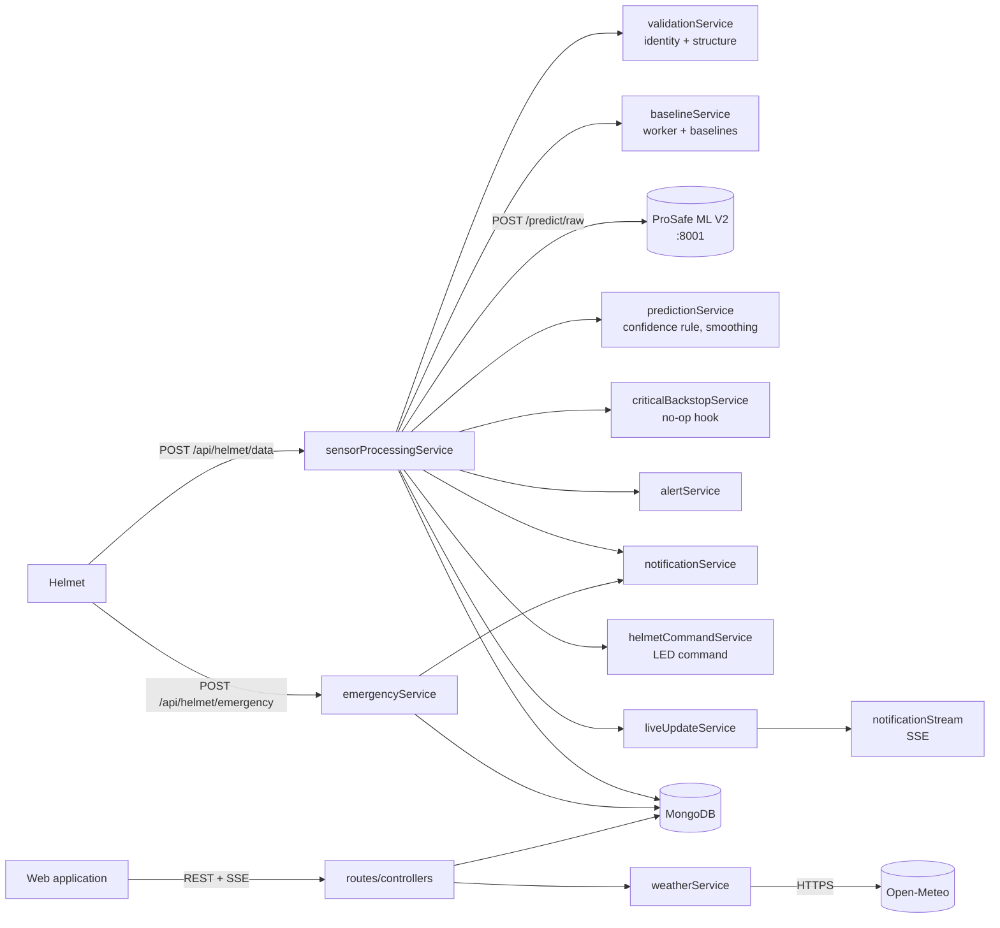

# ProSafe Backend (Node.js / Express)

The central service of ProSafe. It receives sensor batches from the helmets, resolves the worker, forwards the samples
to the ProSafe ML V2 service, post-processes the decisions, stores everything in MongoDB, raises alerts and
notifications, sends LED commands back to the helmets, handles the emergency workflow and serves the REST API and
live updates used by the web application.

For the complete system see the [project README](../../README.md). Related components:
[helmet firmware](../../ProSafe-Helmet/README.md) · [ML V2 service](../../ProSafe-ML-V2/README.md) ·
[frontend](../frontend/README.md).

## Contents

- [Technology stack](#technology-stack)
- [Architecture](#architecture)
- [Installation and start-up](#installation-and-start-up)
- [Environment variables](#environment-variables)
- [Database](#database)
- [API reference](#api-reference)
- [ML integration and post-processing](#ml-integration-and-post-processing)
- [Real-time updates](#real-time-updates)
- [Authentication and security](#authentication-and-security)
- [Emergency workflow](#emergency-workflow)
- [Testing](#testing)
- [Troubleshooting](#troubleshooting)

## Technology stack

From [`package.json`](package.json):

| Purpose | Package |
| --- | --- |
| HTTP server and routing | `express` ^5.2.1 |
| MongoDB ODM | `mongoose` ^9.9.4 (requires Node.js ≥ 20.19) |
| Authentication | `jsonwebtoken` ^9.0.2, `bcryptjs` ^2.4.3 |
| Profile image uploads | `multer` ^2.3.0 |
| PDF reports | `pdfkit` ^0.20.2 |
| Configuration | `dotenv` ^17.4.2 |
| CORS | `cors` ^2.8.6 |
| Tests | `jest` ^29.7.0, `supertest` ^7.0.0, `mongodb-memory-server` ^11.2.0 |

The ML service and the Open-Meteo weather API are called with Node's built-in `fetch`. The package is CommonJS.

## Architecture

```
server.js        loads config/config.env, connects MongoDB, starts the HTTP server, checks ML V2 /health
app.js           Express app: JSON body parser, /uploads static files, request log, CORS, routes, error handler
routes/          URL → middleware → controller (one file per resource)
controllers/     request/response translation only
services/        all business logic (processing pipeline, ML client, alerts, emergency, analytics, reports, ...)
models/          Mongoose schemas
middleware/      authMiddleware (JWT, roles), upload (multer), errorHandler
config/          config.env (not committed), processingConfig, appConfig, analyticsConfig, sensorRanges, guidanceRules, database
constants/       roles (ADMIN, WORKER), risk and system states, UNCERTAIN reasons
tests/           Jest + Supertest suites, in-memory MongoDB helpers
```



Key services:

| Service | Responsibility |
| --- | --- |
| `sensorProcessingService` | Helmet upload pipeline: validate → resolve worker → duplicates → ML V2 → confidence rule → backstop → smoothing → transitions and data-quality alerts → store → LED command → live update. Uploads of one worker are processed one at a time (in-process queue) |
| `validationService` | Identity and structure checks of helmet and emergency packets |
| `baselineService` | Resolves the worker from the helmet; returns the worker's baselines or an explicit unavailability reason |
| `mlService` | HTTP client for ML V2 (`/predict/raw`, `/health`), response validation, model identity check |
| `predictionService` | 0.70 confidence rule, majority-vote smoothing, risk-state transitions |
| `operationalStateService` | The single rule for the displayed state and the LED (see [ML integration](#ml-integration-and-post-processing)) |
| `emergencyService` | Emergency activation, reset request, reset status, acknowledgement |
| `alertService`, `notificationService`, `notificationStream`, `liveUpdateService` | Alerts, inbox notifications, SSE delivery |
| `dashboardService`, `analyticsService`, `analyticsPeriodService`, `reportService` | Dashboards, analytics (in-process cache), PDF reports |
| `userService`, `helmetService`, `userSensorService`, `safetyGuidanceService` | User and helmet management, sensor and prediction history, safety guidance |
| `weatherService` | Site weather from Open-Meteo (no API key) |
| `deviationService` | Physiological deviations for **display only** (never model features) |
| `criticalBackstopService` | Integration point for a deterministic Critical rule set. Deliberately returns `null`: no thresholds are defined |

## Installation and start-up

Prerequisites:

- **Node.js 20.19 or newer** (required by Mongoose 9 and mongodb-memory-server 11).
- **MongoDB**: a local server or a hosted cluster, reachable through a connection string.
- **ProSafe ML V2** running (default `http://localhost:8001`) for risk decisions. Without it the backend still runs, but
  every sample is stored as UNCERTAIN.

Steps:

1. Install dependencies.

   ```bash
   cd ProSafe-Web/backend
   npm install
   ```

2. Create `config/config.env` (ignored by Git; no template file is committed). Use the variables in
   [Environment variables](#environment-variables). Minimal example with placeholders:

   ```ini
   DB_URI=<your-mongodb-connection-string>
   PORT=5000
   JWT_SECRET=<a-long-random-secret>
   ML_SERVICE_URL=http://localhost:8001
   APP_TIMEZONE=Asia/Colombo
   ```

3. Start ProSafe ML V2 first ([instructions](../../ProSafe-ML-V2/README.md#inference-service-servepy)), then start
   the backend:

   ```bash
   node server.js
   ```

   `package.json` has no `start` or `dev` script; `nodemon` is installed as a dev dependency and can be used directly
   (`npx nodemon server.js`). There is no separate production start-up configuration.

4. Check the start-up log:
   - `Database connected`
   - `Server running on port 5000`
   - `ProSafe ML V2 OK: XGBoost EXTENDED (38 features) prosafe-ml-v2-xgboost-extended-exp2-2026-10-09`, or
     `ProSafe ML V2 NOT READY ...` (the server keeps running; samples are UNCERTAIN until the ML service is fixed).

### First administrator account

There is no seed script or registration endpoint. Users can only be created by an authenticated ADMIN
(`POST /api/users`), so the **first ADMIN must be inserted directly into the `users` collection**. Required fields
(see `models/User.js`): `userId` (for example `ADM-001`), `name`, `email`, `passwordHash` (a **bcrypt** hash),
`nic`, `phone`, `role: "ADMIN"`, `active: true`. Further users are created in the web application.

## Environment variables

Loaded from `config/config.env` by `server.js` (`dotenv`). Defaults are those in the code.

| Variable | Purpose | Required | Example / placeholder | Default |
| --- | --- | --- | --- | --- |
| `DB_URI` | MongoDB connection string | **Yes** | `<your-mongodb-connection-string>` | – |
| `JWT_SECRET` | Secret for signing JWTs | **Yes** | `<a-long-random-secret>` | – |
| `PORT` | HTTP port | No | `5000` | `5000` |
| `ML_SERVICE_URL` | ProSafe ML V2 base URL, no trailing slash | For risk decisions | `http://localhost:8001` | empty → every sample UNCERTAIN |
| `ML_REQUEST_TIMEOUT_MS` | Timeout per ML request | No | `5000` | `5000` |
| `ML_CONFIDENCE_THRESHOLD` | Minimum top-class probability for an accepted prediction | No | `0.7` | `0.7` |
| `ML_EXPECTED_MODEL` / `ML_EXPECTED_FEATURE_SET` / `ML_EXPECTED_FEATURE_COUNT` | Model identity the backend accepts | No | `XGBoost` / `EXTENDED` / `38` | same |
| `PREDICTION_WINDOW_SIZE` | Accepted predictions in the smoothing vote | No | `5` | `5` |
| `HELMET_SAMPLE_INTERVAL_SECONDS` | Helmet sampling period (analytics expectations) | No | `1` | `1` |
| `HELMET_MAX_SAMPLES_PER_BATCH` | Maximum samples per upload | No | `600` | `600` |
| `DATA_QUALITY_ALERT_AFTER_SECONDS` | UNCERTAIN duration before a DATA_QUALITY alert | No | `30` | `30` |
| `DATA_QUALITY_ALERT_COOLDOWN_MINUTES` | Minimum time between DATA_QUALITY alerts per worker | No | `10` | `10` |
| `EXPOSURE_HR_DEVIATION_THRESHOLD_PCT` | Heart-rate deviation "attention" flag (display / analytics only) | No | `20` | `20` |
| `ANALYTICS_BODY_TEMP_DEVIATION_THRESHOLD_PCT` | Body-temperature deviation threshold for analytics | No | – | unset (not reported) |
| `ANALYTICS_CACHE_TTL_MS` | Analytics cache lifetime | No | `180000` | 3 minutes |
| `APP_TIMEZONE` | Local calendar for "today", daily grouping and timestamps sent to ML V2 | No | `Asia/Colombo` | `Asia/Colombo` |
| `HELMET_OFFLINE_AFTER_SECONDS` | Helmet counts as online if data arrived within this time | No | `180` | `180` |
| `LOCATION_FRESH_AFTER_SECONDS` | Freshness of a worker location fix | No | `180` | `HELMET_OFFLINE_AFTER_SECONDS` |
| `SITE_LATITUDE`, `SITE_LONGITUDE` | Site location for the weather card | For weather | `<latitude>`, `<longitude>` | unset → no weather |
| `SITE_TIMEZONE` | Site time zone for the weather request | No | `Asia/Colombo` | `Asia/Colombo` |
| `SITE_NAME` | Site name in PDF reports | No | `<site name>` | `ProSafe Construction Site` |
| `NOTIFICATION_RETENTION_DAYS` | TTL of inbox notifications (alerts are never deleted) | No | `30` | `30` |
| `PROSAFE_V2_LIVE_URL` | Enables the live end-to-end test suite only | No (tests) | `http://127.0.0.1:8001` | unset → suite skipped |

The local development `config.env` sets the site coordinates to a clearly labelled Colombo city-centre placeholder,
not a real construction site.

## Database

MongoDB through Mongoose. `config/database.js` connects with `DB_URI`; a connection failure is logged, and the
process keeps running.

| Model (collection) | Stores | Notes |
| --- | --- | --- |
| `User` (`users`) | Accounts: `userId` (`ADM-001`, `W-001`, ... generated), name, email, bcrypt `passwordHash`, NIC, phone, address, role, profile image URL, assigned `helmetId`, `baselineHeartRate`, `baselineBodyTemperature`, notification and appearance preferences | Unique `userId`, `email`, `nic`. Soft delete (`active`, `deletedAt`). Baselines apply to WORKER accounts only |
| `Helmet` (`helmets`) | Registered helmets: `helmetId`, status | Unique `helmetId`. Soft delete; an assigned helmet cannot be deleted (409) |
| `HelmetData` (`helmetdatas`) | One document **per sample**: `raw` sensor values (may be null), `processed` (V2 audit features, READY samples only), `prediction` (predicted, smoothed and system state, probabilities, data quality, UNCERTAIN reasons, model identity, session ID, backstop flag) | Indexes on `{workerId, timestamp}`, `{helmetId, timestamp}`, `{timestamp}`. About 28,800 documents per worker per 8-hour shift; no retention policy |
| `WorkerProcessingState` (`workerprocessingstates`) | Per-worker live state: confirmed risk state, data-quality state and reasons, smoothing history, last session and model version, last packet time, emergency state and reset flags | Unique `workerId` |
| `Alert` (`alerts`) | `TRANSITION`, `DATA_QUALITY` and `EMERGENCY` alerts with state change, confidence, sensor snapshot, acknowledgement and resolution | Never deleted |
| `HelmetCommand` (`helmetcommands`) | Current command per helmet: `SET_RISK` with SAFE / WARNING / CRITICAL / UNCERTAIN | Unique `helmetId`; overwritten, not queued |
| `Notification` (`notifications`) | Per-user inbox entries (alerts, emergency, reset, data quality, account) | TTL index: deleted after `NOTIFICATION_RETENTION_DAYS` |

Relationships are by string IDs rather than Mongoose references: a WORKER's `helmetId` links to `Helmet.helmetId`, and
`HelmetData`, `Alert` and `WorkerProcessingState` reference the worker by `workerId` (= `User.userId`).

## API reference

Base URL: `http://<host>:5000`. All bodies are JSON unless noted. Authenticated routes need
`Authorization: Bearer <token>`. Errors are returned as `{"message": "...", "errors"?: {...}}`; unhandled errors
return `500 {"message": "Internal server error"}`, and malformed JSON returns 400.

### Helmet device endpoints (`/api/helmet`, no authentication)

| Method | Route | Purpose |
| --- | --- | --- |
| POST | `/api/helmet/data` | Upload a batch of 1 Hz samples (`{helmetId, workerId?, samples: [...]}`, 1–600 samples), or a legacy single sample. 201 when processed, 200 when every sample was a duplicate, 400 for structural errors, 404 `NO_WORKER_ASSIGNED_TO_HELMET`, 400 `WORKER_HELMET_MISMATCH` |
| GET | `/api/helmet/command/:helmetId` | Current LED command: `{"command": "SET_RISK", "risk": "SAFE" \| "WARNING" \| "CRITICAL" \| "UNCERTAIN"}` or `{"command": null}` |
| POST | `/api/helmet/emergency` | Emergency activation: `{helmetId, timestamp, emergency: true}`. 201 created, 200 already active, 400 invalid, 404 unknown worker |
| GET | `/api/helmet/:helmetId/emergency/reset` | Helmet reset poll: `{"reset": true \| false}` (always 200) |
| POST | `/api/helmet/:helmetId/emergency/reset/ack` | Helmet confirms it has cleared the emergency; finalises the reset |
| POST | `/api/helmet/:helmetId/emergency/reset` | **ADMIN (JWT).** Request a reset. 409 `NO_ACTIVE_EMERGENCY` |

Sample upload (illustrative values; channels may be `null`):

```http
POST /api/helmet/data
Content-Type: application/json

{"helmetId": "BS-H-001", "samples": [
  {"timestamp": "2026-10-09T03:30:05.123Z", "heartRate": 84, "bodyTemp": 36.71,
   "ambientTemp": 29.1, "noise": 71.4, "gas": 12.31, "uv": 2.63}
]}
```

Response (abridged):

```json
{
  "message": "Packet processed", "workerId": "W-001", "helmetId": "BS-H-001", "format": "batch",
  "samplesReceived": 1, "samplesProcessed": 1, "duplicatesSkipped": 0,
  "baselineAvailable": true, "mlAvailable": true, "mlUnavailableReason": null,
  "results": [{"timestamp": "...", "systemState": "UNCERTAIN", "predictedState": null, "confidence": null,
               "accepted": false, "smoothedState": null, "uncertainReason": "SENSOR_WARMUP"}],
  "riskState": "UNCERTAIN", "operationalState": "UNCERTAIN", "currentRiskState": null,
  "dataQualityState": "UNCERTAIN", "uncertainReason": "SENSOR_WARMUP",
  "stateChanged": false, "alertGenerated": false, "alertsGenerated": 0, "dataQualityAlertGenerated": false
}
```

A non-numeric channel value or `-1` is stored as `null`; out-of-range values are passed to ML V2, which applies the
plausibility rules. Samples whose worker and timestamp are already stored are skipped.

### Authentication (`/api/auth`)

| Method | Route | Auth | Purpose |
| --- | --- | --- | --- |
| POST | `/api/auth/login` | – | `{username, password}`; `username` is the user ID or the email. Returns `{token, user}` (token valid for 8 h). 401 for invalid credentials or inactive accounts |
| PATCH | `/api/auth/password` | Any user | `{currentPassword, newPassword}`. Password rule: at least 8 characters with a letter and a number |

### Users, sensors and guidance (`/api/users`, authenticated)

| Method | Route | Role | Purpose |
| --- | --- | --- | --- |
| GET | `/api/users/me` | Any | Own profile |
| PATCH | `/api/users/me` | Any | Update own name, phone, address, notification preferences, profile image (multipart `profileImage`). Baselines, role, email, NIC and helmet cannot be changed here |
| GET | `/api/users` | ADMIN | List users: `page`, `limit` (≤ 100), `search`, `role`, `helmetAssigned` |
| GET | `/api/users/:id` | ADMIN | User details with operational status |
| POST | `/api/users` | ADMIN | Create a user (JSON or multipart): `name, email, nic, phone, address?, role, password, helmetId?`, and for workers `baselineHeartRate`, `baselineBodyTemperature` |
| PUT | `/api/users/:id` | ADMIN | Update a user (same fields; password optional) |
| DELETE | `/api/users/:id` | ADMIN | Soft-delete a user and release the helmet; an admin cannot delete their own account |
| GET | `/api/users/:id/sensors/heart-rate`, `/body-temperature` | Self or ADMIN | Last 7 days of the personalized sensor, with baseline deviations |
| GET | `/api/users/:id/sensors/noise`, `/gas`, `/uv`, `/ambient-temperature` | Self or ADMIN | Last 7 days of the environmental sensor with display ranges |
| GET | `/api/users/:id/safety-predictions` | Self or ADMIN | Today's confirmed-state history grouped into periods (Safety Trend chart) |
| GET | `/api/users/:id/safety-guidance` | Self or ADMIN | Current condition and rule-based guidance from `config/guidanceRules.js` |

Validation (`userService`): email format; Sri Lankan NIC (9 digits + V/X, or 12 digits); phone (9–15 digits,
optional `+`); baselines for workers only, both or neither, heart rate 30–220 bpm and body temperature 30–43 °C.
Duplicate email, NIC or user ID returns 409. Profile images: JPEG, PNG or WEBP up to 5 MB, stored under
`uploads/profile-images/` and served at `/uploads/...`.

### Helmets (`/api/helmets`, ADMIN)

| Method | Route | Purpose |
| --- | --- | --- |
| GET | `/api/helmets` | List: `page`, `limit`, `search`, `assignment` (`assigned` / `unassigned`), `status` |
| GET | `/api/helmets/assignable` | Helmets available for assignment (`currentHelmetId` keeps the current one selectable) |
| GET | `/api/helmets/:helmetId` | Helmet details |
| POST | `/api/helmets` | Register a helmet `{helmetId}`; 409 if the ID exists |
| DELETE | `/api/helmets/:helmetId` | Soft-delete; 409 while it is assigned to a worker |

### Dashboards, alerts, notifications, analytics, settings (authenticated)

| Method | Route | Role | Purpose |
| --- | --- | --- | --- |
| GET | `/api/dashboard/admin` | ADMIN | Summary counts, worker status, helmet status, recent alerts, weather, worker locations |
| GET | `/api/dashboard/worker` | WORKER | Own status, helmet, latest sensors, recent alerts, weather |
| GET | `/api/alerts` | Any | Alerts: `type`, `risk`, `acknowledged`, `resolved`, `days`, `page`, `limit`. Workers only ever see their own |
| PATCH | `/api/alerts/:alertId/acknowledge` | ADMIN | Acknowledge an alert |
| GET | `/api/notifications` | Any | Own notifications: `unread`, `page`, `limit` |
| PATCH | `/api/notifications/:id/read`, `/api/notifications/read-all` | Any | Mark read |
| GET | `/api/notifications/stream` | Any | Server-Sent Events stream (see [Real-time updates](#real-time-updates)) |
| GET | `/api/analytics` | ADMIN | `period` = `daily` \| `weekly` \| `monthly` (required), `date` = `YYYY-MM-DD` (default today), `fresh=true` bypasses the cache |
| GET | `/api/analytics/report` | ADMIN | PDF report download for the same `period` / `date`; `format` may only be `pdf` |
| GET | `/api/settings/system-info` | Any | App name, role, user ID, time zone, `mlServiceConfigured` (never the URL or secrets) |
| GET | `/api/settings/site` | ADMIN | Read-only site settings from `config.env` |

## ML integration and post-processing

The backend computes **no model features**: ProSafe ML V2 is the single source of feature truth. The full contract is
in [`ProSafe-ML-V2/BACKEND_INTEGRATION_V2.md`](../../ProSafe-ML-V2/BACKEND_INTEGRATION_V2.md).

1. **Validate** the batch (identity and structure only) and **resolve the worker** from the helmet assignment.
2. **Baselines.** `User.baselineHeartRate` and `User.baselineBodyTemperature` are attached to every reading as context.
   Missing baselines are sent as `null`; ML V2 then returns UNCERTAIN `BASELINE_UNAVAILABLE`.
3. **ML request.** `POST {ML_SERVICE_URL}/predict/raw` with `{"readings": [...]}` in received order. Timestamps are
   converted to `APP_TIMEZONE` local time with an explicit offset so V2's workday follows the local calendar.
4. **Response checks.** Wrong model identity, HTTP errors, timeouts, malformed responses or a result count mismatch make
   every sample UNCERTAIN `ML_SERVICE_UNAVAILABLE`. Raw data are still stored; a sample is **never** stored as SAFE
   because the ML service failed.
5. **Session sync.** A new V2 `session_id` clears the vote history and the confirmed state.
6. **Confidence rule.** A READY prediction with top probability below `ML_CONFIDENCE_THRESHOLD` (0.70) is stored with
   its probabilities but reported as UNCERTAIN `LOW_CONFIDENCE` and does not vote.
7. **Backstop hook** (`criticalBackstopService.evaluate`): currently returns `null`. A future validated rule may only
   raise severity.
8. **Smoothing.** Majority vote over the last 5 accepted predictions; ties go to the more severe state; UNCERTAIN never
   votes. At 1 Hz a change is confirmed about 3 s after the classifier starts agreeing.
9. **Alerts.** A `TRANSITION` alert and notifications for every change of the confirmed state, except SAFE being first
   established in a new session. A `DATA_QUALITY` alert when a non-warm-up UNCERTAIN reason lasts at least 30 s (once
   per episode, at most once per worker per 10 minutes). `SENSOR_WARMUP`, `INSUFFICIENT_HISTORY` and
   `GAS_BASELINE_UNAVAILABLE` alone never alert.
10. **Operational state and LED** (`operationalStateService`): EMERGENCY > a confirmed WARNING / CRITICAL (shown with
    "data uncertain" when applicable) > UNCERTAIN > SAFE > UNKNOWN. SAFE is never shown while the latest data are
    UNCERTAIN. The LED command uses the same rule (`SET_RISK` with SAFE / WARNING / CRITICAL / UNCERTAIN).

The ML risk classes (SAFE, WARNING, CRITICAL) are model decisions. UNCERTAIN means no trustworthy decision is
available. EMERGENCY is a manual request for help and bypasses the ML path entirely.

## Real-time updates

- **Transport:** Server-Sent Events on `GET /api/notifications/stream`, authenticated with the normal Bearer header.
  The connection sends a heartbeat comment periodically. Socket.IO and polling of the processing pipeline are not used.
- **Events:** new notifications (alerts, emergency, reset, data quality) and `WORKER_UPDATE` events. A
  `WORKER_UPDATE` is published after each processed helmet upload and on emergency activation or resolution, once
  everything is stored. It carries the worker's status, LED state, latest sensor values and one point per sample,
  and no name, email, NIC, phone or baselines.
- **Scope:** delivered to the worker's own streams and to every ADMIN stream.
- **Limitation:** the subscriber registry is in process memory. Several backend instances would need a shared
  publish/subscribe layer (see `services/notificationStream.js`).

## Authentication and security

- **Login** with user ID or email and password (bcrypt). JWT signed with `JWT_SECRET`, payload `{id, role}`,
  expiry 8 hours. The frontend sends it as `Authorization: Bearer <token>`.
- **Roles:** `ADMIN` and `WORKER`, enforced by `verifyToken`, `requireRole` and `requireSelfOrAdmin` in
  [`middleware/authMiddleware.js`](middleware/authMiddleware.js). The role always comes from the token, never from
  the request body. Workers can only read their own data and cannot change their baselines.
- **CORS** allows `http://localhost:3000` and `http://localhost:5173` only (hard-coded in `app.js`). A deployed
  frontend on another origin requires changing that list.
- **Helmet endpoints are not authenticated** and use plain HTTP; any client that knows a helmet ID can post data or
  emergencies for it. Device authentication and encryption are listed as future work in the thesis.
- Passwords are never returned (`toPublicUser`). `GET /api/settings/system-info` never exposes the ML URL, the database
  connection or secrets. Error responses do not include stack traces.
- `config/config.env` and `uploads/` are excluded from Git. Never commit real connection strings or secrets.

## Emergency workflow

Implemented in [`services/emergencyService.js`](services/emergencyService.js); independent of the ML pipeline.

1. **Activation** (`POST /api/helmet/emergency`): the worker is resolved strictly from the helmet. If no emergency is
   active, `WorkerProcessingState.emergencyActive` is set, an `EMERGENCY` alert is created, all admins are notified
   and a live update is published. A repeated packet while active creates no second alert (idempotent).
2. **Reset request** (`POST /api/helmet/:helmetId/emergency/reset`, ADMIN): sets `resetRequested`; admins and the
   worker are notified. The emergency is **not** cleared yet.
3. **Helmet poll** (`GET .../emergency/reset`): returns `{"reset": true}` once a reset has been requested.
4. **Acknowledgement** (`POST .../emergency/reset/ack`): only this call clears the emergency, resolves the open
   `EMERGENCY` alerts (`resolvedAt`), notifies admins and the worker and publishes a live update. A duplicate
   acknowledgement is a no-op.

## Testing

```bash
npm test                        # jest --runInBand
```

- 21 suites in `tests/`, using Jest, Supertest and an **in-memory MongoDB** (`mongodb-memory-server`); no external
  database or ML service is needed. `tests/setupEnv.js` sets a test-only `JWT_SECRET`. The first run may download a
  MongoDB binary for mongodb-memory-server.
- Route-level integration tests (Supertest against `app.js`) cover auth, users, baselines, helmets, alerts,
  notifications, dashboard, analytics, reports, settings, CORS, safety guidance and sensor history. Service-level
  tests cover user validation, analytics periods, sensor ranges and safety guidance.
- `v2Integration.test.js` runs the real `mlService` against a scripted fake ML V2 (request contract, ordering,
  duplicates, warm-up, missing baselines, ML outage, wrong model, low confidence, smoothing and sessions, backstop
  hook). `liveUpdates.test.js` covers the `WORKER_UPDATE` events.
- `liveV2.e2e.test.js` is an end-to-end test against a **running** ML V2 service. It is skipped unless
  `PROSAFE_V2_LIVE_URL` is set:

  ```bash
  PROSAFE_V2_LIVE_URL=http://127.0.0.1:8001 npx jest tests/liveV2.e2e.test.js
  ```

Result when run on 2026-10-20 while this README was written: 20 suites passed and 1 skipped (the live suite);
380 tests passed and 4 skipped.

## Troubleshooting

| Symptom | Cause and fix |
| --- | --- |
| `Database connection error` at start-up | `DB_URI` missing or wrong, MongoDB not running, or the hosted cluster does not allow your IP address |
| `ML_SERVICE_URL is not set` / `ProSafe ML V2 NOT READY` | Start ProSafe ML V2 and check `curl http://localhost:8001/health`; set `ML_SERVICE_URL` without a trailing slash. Until then every sample is UNCERTAIN `ML_SERVICE_UNAVAILABLE` |
| 401 `Invalid or expired token` | Token older than 8 hours or `JWT_SECRET` changed; log in again |
| Browser CORS errors | The frontend origin is not `http://localhost:5173` or `http://localhost:3000`; update the `cors` origins in `app.js` |
| Helmet uploads return 404 `NO_WORKER_ASSIGNED_TO_HELMET` | Register the helmet and assign it to an active WORKER |
| Workers stay UNCERTAIN `BASELINE_UNAVAILABLE`, DATA_QUALITY alert "worker baseline not set" | Set both baselines for the worker (User Management) |
| Workers stay UNCERTAIN for the first minutes | Normal V2 warm-up (180 s on a cold start) |
| No weather on the dashboard | `SITE_LATITUDE` / `SITE_LONGITUDE` not set, or no internet access to `api.open-meteo.com` |
| Live updates stop | The SSE stream reconnects automatically; behind a proxy, make sure responses are not buffered |
| Tests fail to start mongodb-memory-server | The MongoDB binary could not be downloaded or started; check network access and Node.js ≥ 20.19 |
