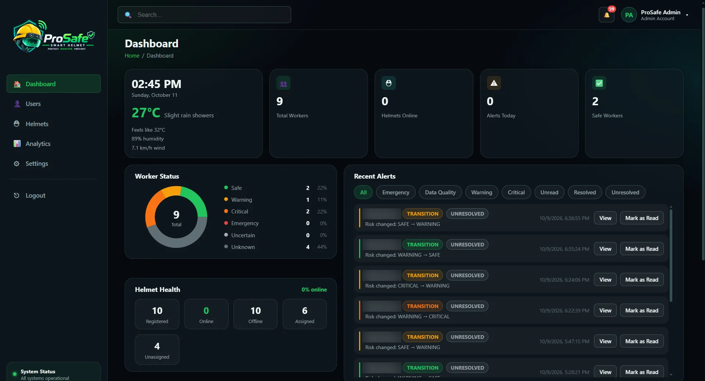
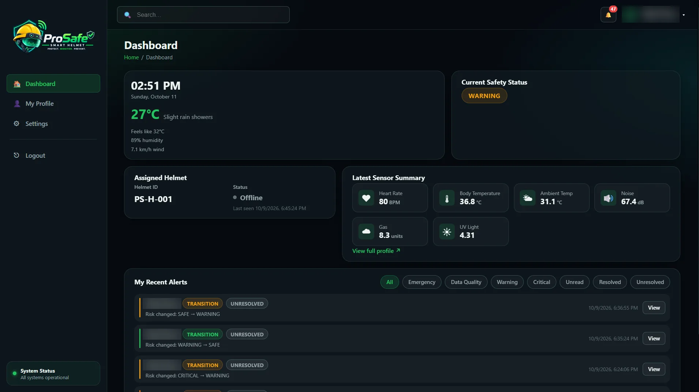

# ProSafe Web Application (React Frontend)

The operational monitoring interface of ProSafe. **Administrators** (site safety personnel) monitor all workers,
manage users and helmets, handle alerts and emergencies, and review analytics. **Workers** see their own safety status,
sensor readings, alerts and guidance.

It talks only to the [ProSafe backend](../backend/README.md). For the complete system see the
[project README](../../README.md). This application is separate from the public
[research website](../../ProSafe-Website/README.md).

## Contents

- [Technology stack](#technology-stack)
- [Application structure](#application-structure)
- [Administrator functions](#administrator-functions)
- [Worker functions](#worker-functions)
- [Installation and start-up](#installation-and-start-up)
- [Backend integration and live updates](#backend-integration-and-live-updates)
- [Authentication and routing](#authentication-and-routing)
- [Screenshots](#screenshots)
- [Testing](#testing)
- [Troubleshooting](#troubleshooting)

## Technology stack

From [`package.json`](package.json):

| Purpose | Package |
| --- | --- |
| UI | `react` / `react-dom` ^18.3.1 |
| Routing | `react-router-dom` ^7.18.3 |
| HTTP client | `axios` ^1.7.9 (REST); the browser `fetch` API for the SSE stream |
| Charts | `recharts` ^3.10.1 |
| Maps | `leaflet` ^1.9.4, `react-leaflet` ^4.2.1 (OpenStreetMap tiles) |
| Build and dev server | `vite` ^5.4.10 with `@vitejs/plugin-react` |
| Tests | `vitest` ^2.1.8, `@testing-library/react`, `@testing-library/user-event`, `@testing-library/jest-dom`, `jsdom` |
| Linting | `eslint` ^9 with the React, hooks and react-refresh plugins |

Styling is plain CSS: design tokens and component classes in [`src/theme.css`](src/theme.css) (dark navy/glass theme,
safety-green accent, status colours for SAFE / WARNING / CRITICAL / EMERGENCY / UNCERTAIN). No CSS framework is used.

## Application structure

```
src/
├── main.jsx               entry point (renders <App/>, imports theme.css)
├── App.jsx                providers + routes
├── api/                   axios client and one module per backend resource
├── context/               AuthContext (token + user), ToastContext, NotificationContext
├── hooks/                 useNotifications (SSE), useLiveWorkerUpdates, useDashboardData, useAppearance
├── live/liveUpdates.js    tiny event emitter for WORKER_UPDATE events
├── pages/                 Login, Dashboard (admin/worker), Users, Helmets, Analytics, Profile, Settings
├── components/
│   ├── layout/            AppLayout, Header, Sidebar, NotificationBell, PageHeader
│   ├── routes/            ProtectedRoute, RoleRoute
│   ├── dashboard/         metric, status, alerts, weather, helmet health, location map, emergency reset
│   ├── users/             user form, baseline fields, detail view, current condition, sensor modals, safety trend
│   ├── helmets/           list, cards, add/delete/details modals
│   ├── analytics/         analytics cards and charts
│   ├── settings/          account, password, notifications, appearance, site, system info
│   └── ui/                Button, Input, Modal, GlassCard, StatusBadge, SensorCard, ...
├── constants/             roles, UNCERTAIN reason texts
├── utils/                 validators, live merge, safety-trend transformation, formatting
└── tests/setupTests.js    Vitest setup
```

- **State management:** React context for authentication, toasts and notifications; page-level state in hooks.
  High-frequency live events use a small module emitter (`live/liveUpdates.js`) instead of React context, so a 1 Hz
  stream only re-renders the subscribed components.
- **API integration:** `src/api/apiClient.js` creates an axios instance with base URL
  `${VITE_API_BASE_URL}/api`, adds the Bearer token to each request and normalises errors to
  `{status, message, errors}`.
- **Appearance preferences** (compact mode, reduced animations) are stored in the browser's `localStorage` only.

## Administrator functions

| Page / feature | What it does |
| --- | --- |
| **Dashboard** (`/dashboard`) | Summary metrics (workers, helmets online, alerts today, safe workers), worker status summary (including an Uncertain group), helmet health, recent alerts (last 7 days) with detail view and acknowledgement, site weather, worker location map |
| **Users** (`/users`, `/users/add`, `/users/:id`, `/users/:id/edit`) | List, search and filter users; create, edit and delete accounts; assign helmets; set worker baselines (heart rate, body temperature; workers only, both or neither); view a worker's status, current condition and guidance, sensor history and Safety Prediction trend |
| **Helmets** (`/helmets`) | Register, list, inspect and delete helmets; see assignment and online status |
| **Alerts and emergencies** | Alert details and acknowledgement; **emergency reset** request for an active emergency (the helmet must confirm it) |
| **Analytics** (`/analytics`) | Daily, weekly or monthly analysis: safety trend, alert distribution and response, worker risk table, environmental analytics, exposure and health deviation, helmet reliability, high-risk times, key insights; PDF report download |
| **Notifications** | Bell with unread count, live delivery over SSE, mark read / mark all read |
| **Settings** (`/settings`) | Account details, password change, notification preferences, appearance, read-only site settings, system information |

## Worker functions

| Page / feature | What it does |
| --- | --- |
| **Dashboard** (`/dashboard`) | Own safety status card, assigned helmet, latest sensor summary, own recent alerts, site weather |
| **My Profile** (`/profile`) | Own details, status, current condition and guidance, sensor history and safety trend |
| **Settings** (`/settings`) | Account details (name, phone, address, profile image), password change, notification preferences, appearance, system information |

Workers cannot change their own baselines, role, email, NIC or helmet, and cannot open the admin pages.

### Status display

- **SAFE / WARNING / CRITICAL** are the confirmed (smoothed) ML risk states.
- **UNCERTAIN** (grey, dashed badge, hatched trend bands) means the latest data cannot support a decision; it is shown
  with its reason, e.g. "WARNING · Data uncertain: sensor skin contact lost" or "UNCERTAIN · no reliable prediction
  (last confirmed: SAFE)".
- **EMERGENCY** is a manual emergency from the helmet button and takes priority over every other state.
- Gas is shown in sensor "units", never ppm.

## Installation and start-up

Prerequisites: Node.js 18 or newer (Vite 5) and a running [backend](../backend/README.md) (default
`http://localhost:5000`).

```bash
cd ProSafe-Web/frontend
npm install
```

Optional `.env` file in this folder (ignored by Git):

```ini
VITE_API_BASE_URL=http://localhost:5000
```

| Variable | Purpose | Default |
| --- | --- | --- |
| `VITE_API_BASE_URL` | Backend origin, without `/api` and without a trailing slash | `http://localhost:5000` |

`VITE_` variables are embedded at build time; rebuild after changing them.

| Command | Purpose |
| --- | --- |
| `npm run dev` | Vite development server, http://localhost:5173 |
| `npm run build` | Production build into `dist/` |
| `npm run preview` | Serve the production build locally |
| `npm test` | Run the Vitest suite once |
| `npm run lint` | ESLint |

The backend's CORS configuration allows only `http://localhost:5173` and `http://localhost:3000`. Serving the
frontend from another origin (including `npm run preview`, which uses port 4173 by default) requires adding that
origin to the backend's `app.js`. No deployment configuration for this application exists in the repository.

## Backend integration and live updates

- **REST:** every page loads its data through `src/api/*` (for example `dashboardApi.getAdminDashboard()` →
  `GET /api/dashboard/admin`). Profile images are loaded from `${VITE_API_BASE_URL}/uploads/...`.
- **Live updates:** `hooks/useNotifications` opens **one** authenticated SSE connection per tab to
  `GET /api/notifications/stream` using `fetch` (the native `EventSource` cannot send an Authorization header), and
  reconnects with a 2 s / 5 s / 10 s backoff.
  - Notification events update the bell and inbox.
  - `WORKER_UPDATE` events go to `live/liveUpdates.js`; `useLiveWorkerUpdates(workerId, onUpdate, {onReconnect})`
    filters them per worker.
  - Pages load over REST first and then merge live events (`utils/liveMerge.js`: newer timestamp wins, duplicates are
    ignored). The admin dashboard refetches at most once per 5 s because its counts are computed by the server. The
    Safety Prediction modal extends its trend chart live (`utils/safetyTrend.js`).
  - After a reconnect, live views refetch over REST because events sent while disconnected are not replayed.
    60-second polls remain as a fallback.

## Authentication and routing

1. **Login** (`/login`): `POST /api/auth/login` with user ID or email and password. The token and the public user
   object are stored in `localStorage` (`prosafe_token` and the user key in `AuthContext`). A logged-in user who opens
   `/login` is redirected to `/dashboard`.
2. **Protected routes:** `ProtectedRoute` redirects unauthenticated users to `/login`.
3. **Role routes:** `RoleRoute allow={[ADMIN]}` wraps `/users/*`, `/helmets` and `/analytics`; other roles are
   redirected to `/dashboard`.
4. `/dashboard` renders the admin or the worker dashboard according to the role. `/profile` and `/settings` are
   available to both roles. Unknown paths redirect to `/dashboard`.
5. The backend enforces the same rules; the frontend checks only control navigation.

| Route | ADMIN | WORKER |
| --- | --- | --- |
| `/dashboard`, `/settings` | ✓ | ✓ |
| `/profile` | ✓ | ✓ (sidebar link for workers) |
| `/users`, `/users/add`, `/users/:id`, `/users/:id/edit` | ✓ | – |
| `/helmets`, `/analytics` | ✓ | – |

## Screenshots

Screens of this application, as published on the research website (worker names blurred):

| Administrator dashboard | Worker dashboard |
| --- | --- |
|  |  |

## Testing

```bash
npm test
```

36 test files (Vitest + React Testing Library, jsdom) next to the components, pages, hooks and utilities they cover:
route guards, user form and baseline validation, UNCERTAIN display, dashboards (including live refetch and merge),
alerts, notifications and SSE reconnect, emergency reset modal, helmets, analytics, settings, sensor modals, the
Safety Prediction modal and the safety-trend transformation.

Result when run on 2026-10-20 while this README was written: 36 files, 242 tests passed.

## Troubleshooting

| Symptom | Cause and fix |
| --- | --- |
| "Cannot reach the server. Check your connection." | The backend is not running, or `VITE_API_BASE_URL` points to the wrong host or port |
| CORS errors in the browser console | The frontend origin is not allowed by the backend (`app.js` allows ports 5173 and 3000 only) |
| Changing `.env` has no effect | Restart `npm run dev` or rebuild; Vite reads `VITE_` variables at start-up and build time |
| Login fails with "Invalid username or password" | Wrong credentials, inactive account, or no admin exists yet (see [First administrator account](../backend/README.md#first-administrator-account)) |
| Suddenly logged out / 401 errors | The JWT expires after 8 hours; log in again |
| Live updates stop | Check the backend log and network tab for `/api/notifications/stream`; the hook reconnects automatically and pages refetch after reconnecting |
| Workers always shown as UNCERTAIN | Usually a backend or ML issue: ML V2 not running, missing worker baselines or sensor warm-up. The status reason explains which |
| Map tiles or weather missing | The browser needs internet access for OpenStreetMap tiles; weather needs `SITE_LATITUDE` / `SITE_LONGITUDE` in the backend |
| Build errors after pulling changes | Run `npm install` again so `node_modules` matches `package-lock.json` |
