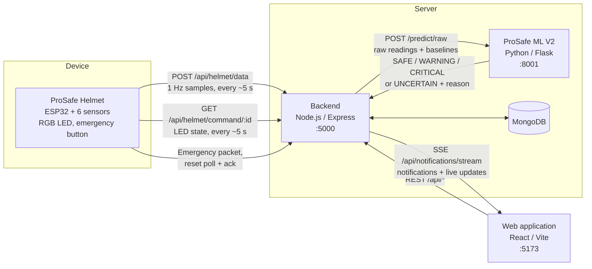

# ProSafe: Machine Learning-Based Smart Helmet for Personalized Construction Monitoring

ProSafe is an IoT and machine-learning system for monitoring the safety of construction workers. An ESP32-based smart
helmet measures ambient temperature, UV radiation, combustible gas and smoke response, sound level, heart rate and
skin temperature once per second. A backend forwards the measurements to a machine-learning service. The service
compares each worker's heart rate and skin temperature with **that worker's own baseline**, adds temporal trend and
exposure-duration features, checks **data quality**, and classifies each observation as **SAFE, WARNING or CRITICAL**,
or reports **UNCERTAIN** when the data cannot support a decision. A web application gives safety personnel and workers
near-real-time status, alerts and notifications, and the helmet shows the status on an RGB LED and provides a manual
emergency button.

> **Academic research prototype.** ProSafe was developed as an individual final-year research project
> (SLIIT IT4010, project R26-SE-042). It is not a certified safety device and must not be relied on to protect
> workers.

**Research website:** https://prosafe-research.netlify.app/ (separate from the monitoring application, see
[Research website](#research-website)).

## Contents

- [Research problem](#research-problem)
- [Research objectives](#research-objectives)
- [Main features](#main-features)
- [System architecture](#system-architecture)
- [Repository structure](#repository-structure)
- [Technologies](#technologies)
- [Getting started](#getting-started)
- [Configuration](#configuration)
- [Testing](#testing)
- [Research evaluation](#research-evaluation)
- [Research website](#research-website)
- [Researcher](#researcher)
- [Limitations and future work](#limitations-and-future-work)
- [Licence and usage](#licence-and-usage)

## Research problem

- **Changing hazards.** Construction workers are exposed to heat, UV radiation, noise and airborne hazards that change
  as work progresses, the weather varies and workers move between tasks.
- **Periodic monitoring.** Inspections and supervision remain essential but are periodic and depend on human
  observation, so gradual strain or long exposure may go unnoticed until it becomes obvious.
- **Generic fixed thresholds.** Many sensor alarms compare isolated readings with limits designed for an average
  worker and evaluate each sensor separately, missing the combined effect of several hazards.
- **Individual differences.** The same heart rate or skin temperature can mean different things for different
  workers.
- **Time and reliability.** Risk depends on how long conditions persist, and wearable readings are often affected by
  motion, poor contact and missing data.

Existing studies have usually addressed these difficulties separately. ProSafe addresses them together.

## Research objectives

**Main objective** (thesis Section 1.4): to design, develop and experimentally evaluate a personalized, ML-based smart
helmet framework that integrates environmental and physiological measurements with worker-specific baselines and
temporal exposure features for near-real-time construction worker safety monitoring and risk classification.

Specific objectives:

1. Critically review wearable sensing and intelligent construction safety monitoring approaches and identify the
   requirements for personalized, integrated risk assessment.
2. Design and implement an IoT-enabled smart helmet that collects environmental and physiological measurements and
   transmits timestamped data for centralized monitoring.
3. Develop an ML pipeline that uses worker-specific baselines, temporal features and data-quality validation to
   classify worker conditions as Safe, Warning or Critical.
4. Develop a backend and web application that processes classifications, displays worker conditions, generates
   alerts and communicates safety status to the helmet.
5. Evaluate the ML and system components for classification performance, Critical-event detection, data-handling
   reliability, response time and cross-worker performance.

## Main features

| Area | Implemented capability |
| --- | --- |
| Smart helmet | Six channels sampled at 1 Hz with per-sample UTC timestamps; batched upload every ~5 s with buffering and retry; invalid channels sent as `null` |
| Personalization | Worker-specific heart-rate and skin-temperature baselines, set by administrators; used for deviation features, never as model features |
| ML risk assessment | Streaming preprocessing, 38 engineered features, XGBoost classifier: SAFE / WARNING / CRITICAL |
| Data quality | Gate that returns **UNCERTAIN** (with a reason) for warm-up, missing baselines, gaps, missing or implausible sensor data, low confidence or an unavailable ML service. UNCERTAIN is not a fourth risk class and is never shown as SAFE |
| Decision post-processing | 0.70 confidence rule, 5-vote smoothing, alerts on confirmed state changes, data-quality alerts |
| Helmet feedback | RGB LED: green SAFE, amber WARNING, red CRITICAL, blue UNCERTAIN, red EMERGENCY |
| Emergency | Manual button → immediate local red LED and an emergency alert; reset only by an administrator request **confirmed by the helmet**. Independent of the ML pipeline |
| Web application | Administrator dashboard, worker dashboard, user and helmet management, alerts and notifications, live updates over SSE, sensor history, safety trend, safety guidance, analytics and PDF reports, settings |

The three ML classes are model decisions about the worker's condition. **UNCERTAIN** means no trustworthy decision is
available. **EMERGENCY** is a manual request for help and bypasses the ML path.

## System architecture



How one observation moves through the system:

1. The **helmet** samples all sensors once per second, timestamps the sample (NTP time) and buffers it. Every ~5 s it
   uploads up to 30 buffered samples over HTTP.
2. The **backend** validates the batch, resolves the worker from the helmet assignment, attaches the worker's
   baselines and sends the readings, in order, to **ProSafe ML V2**.
3. **ML V2** updates the worker's streaming state, computes the 38 features and applies the data-quality gate. If the
   data are not reliable it returns UNCERTAIN with a reason; otherwise the XGBoost model returns a class and
   probabilities.
4. The backend applies the confidence rule and smoothing, stores one document per sample in **MongoDB**, raises alerts
   and notifications on confirmed changes, updates the helmet's LED command and pushes a live update to open
   dashboards over Server-Sent Events.
5. The **helmet** polls its LED command every ~5 s. A pressed emergency button bypasses steps 2–4: the helmet turns
   red at once and posts an emergency packet; the backend alerts administrators.

Typical delay from a sustained change to the LED: up to ~5 s upload interval, ~3 s smoothing and up to ~5 s command
polling, on top of the feature windows themselves. The helmet uses HTTP polling; there is no push channel to the
device.

## Repository structure

```
ProSafe---Smart-Helmet-System/
├── ProSafe-Helmet/          ESP32 firmware (PlatformIO, Arduino framework)
├── ProSafe-ML-V2/           deployed ML service: streaming preprocessing, data-quality gate, XGBoost, experiments
├── ProSafe-ML/              original v1 ML prototype; historical, no longer called
├── ProSafe-Web/
│   ├── backend/             Node.js / Express API, processing pipeline, MongoDB models
│   └── frontend/            React monitoring web application
├── ProSafe-Website/         public research website (React, Netlify)
├── documents/               internal design documents (.docx): processing architecture, UI and backend requirements, style guide, logic, programming standards
├── output/pdf/              viva questions and answers (PDF)
├── tmp/pdfs/rendered/       rendered page images (working files)
├── .claude/launch.json      local dev-server launch configurations
└── README.md
```

| Component | Documentation | Role |
| --- | --- | --- |
| Helmet firmware | [ProSafe-Helmet/README.md](ProSafe-Helmet/README.md) | Sensing, timestamped 1 Hz samples, batched upload, LED, emergency button |
| ML V2 (deployed) | [ProSafe-ML-V2/README.md](ProSafe-ML-V2/README.md) | Decision service on port 8001, datasets, experiments, production model |
| ML v1 (historical) | [ProSafe-ML/README.md](ProSafe-ML/README.md) | First 10-feature classifier on synthetic data; kept for reference |
| Backend | [ProSafe-Web/backend/README.md](ProSafe-Web/backend/README.md) | API, ingestion pipeline, alerts, emergency, live updates, analytics |
| Frontend | [ProSafe-Web/frontend/README.md](ProSafe-Web/frontend/README.md) | Administrator and worker web application |
| Research website | [ProSafe-Website/README.md](ProSafe-Website/README.md) | Public presentation of the research |

**ProSafe-ML vs ProSafe-ML-V2.** The backend calls only **ProSafe ML V2** (`ML_SERVICE_URL`, port 8001), verified at
start-up through its `/health` endpoint. `ProSafe-ML/` is the original prototype: one reading per prediction,
10 features including raw baselines, a single synthetic dataset and a random row split. V2 replaced it on 2026-10-09
with streaming, worker-separated evaluation and data-quality handling; v1 is kept unchanged for reference.
Further integration details: [`ProSafe-ML-V2/BACKEND_INTEGRATION_V2.md`](ProSafe-ML-V2/BACKEND_INTEGRATION_V2.md).

## Technologies

| Area | Technologies | Manifest |
| --- | --- | --- |
| Hardware and firmware | ESP32, DHT11, GUVA-S12SD, MQ-2, INMP441, LM35, MAX30102, RGB LED, push button; PlatformIO, Arduino framework, ArduinoJson, SparkFun MAX3010x, Adafruit DHT | [`platformio.ini`](ProSafe-Helmet/platformio.ini) |
| Machine learning | Python 3.12, pandas, NumPy, scikit-learn, XGBoost, joblib, Flask, Streamlit, Matplotlib | [`requirements.txt`](ProSafe-ML-V2/requirements.txt) |
| Backend | Node.js, Express 5, Mongoose 9, JSON Web Tokens, bcryptjs, Multer, PDFKit | [`package.json`](ProSafe-Web/backend/package.json) |
| Database | MongoDB | – |
| Frontend | React 18, React Router 7, Vite 5, axios, Recharts, Leaflet / React Leaflet | [`package.json`](ProSafe-Web/frontend/package.json) |
| Research website | React 18, Vite 5, Tailwind CSS 3, three.js with React Three Fiber and Drei, lucide-react, Netlify | [`package.json`](ProSafe-Website/package.json) |
| Development and testing | Jest, Supertest, mongodb-memory-server; Vitest, React Testing Library; Python `unittest`, Streamlit AppTest; ESLint | the manifests above |

External services used at runtime: NTP servers (helmet clock), Open-Meteo (site weather, no API key) and OpenStreetMap
tiles (location map).

## Getting started

The start order follows the dependencies: the backend needs MongoDB and the ML service, the frontend needs the
backend, and the helmet needs the backend.

1. **MongoDB:** a local server or a hosted cluster with a connection string.
2. **ProSafe ML V2** (Python 3.12):

   ```bash
   cd ProSafe-ML-V2
   pip install -r requirements.txt
   python serve.py
   ```

   `http://localhost:8001/health` should report `"status": "ok"`, XGBoost, EXTENDED, 38 features.
   [Details](ProSafe-ML-V2/README.md#inference-service-servepy)

3. **Backend** (Node.js ≥ 20.19): create `ProSafe-Web/backend/config/config.env`, then:

   ```bash
   cd ProSafe-Web/backend
   npm install
   node server.js
   ```

   The first administrator account must be created directly in the database.
   [Details](ProSafe-Web/backend/README.md#installation-and-start-up)

4. **Frontend:**

   ```bash
   cd ProSafe-Web/frontend
   npm install
   npm run dev
   ```

   Open http://localhost:5173. [Details](ProSafe-Web/frontend/README.md#installation-and-start-up)

5. **Helmet** (PlatformIO): set the Wi-Fi credentials, backend address and helmet ID in `src/main.cpp`, register the
   helmet in the web application and assign it to a worker with baselines, then:

   ```bash
   cd ProSafe-Helmet
   pio run -t upload
   ```

   The helmet needs network access to the backend and internet access for NTP.
   [Details](ProSafe-Helmet/README.md#configuration)

No simulator for helmet data is included; the backend tests replay recorded data against the API instead.

## Configuration

| Connection | Where it is configured |
| --- | --- |
| Backend → MongoDB | `DB_URI` in `ProSafe-Web/backend/config/config.env` |
| Backend → ML V2 | `ML_SERVICE_URL` (default `http://localhost:8001`) and the expected model identity in `config.env` |
| Frontend → backend | `VITE_API_BASE_URL` in `ProSafe-Web/frontend/.env` (default `http://localhost:5000`); the backend's CORS list in `app.js` must include the frontend origin |
| Helmet → backend | URL, host and port constants plus `HELMET_ID` in `ProSafe-Helmet/src/main.cpp` |
| ML V2 | `PORT`, `PROSAFE_*` environment variables (see the ML V2 README) |

`config.env` and the frontend `.env` are excluded from Git and no template files are committed; the component READMEs
list every variable. Use placeholders in documentation and never commit real passwords, tokens, secrets or database
connection strings.

## Testing

| Component | Command | Result on 2026-10-20 |
| --- | --- | --- |
| ML V2 | `python tests/test_production_integration.py`, `test_streaming_preprocessor.py`, `test_preprocessing_parity.py`, `test_streamlit_app.py` | 52 tests passed (19 + 24 + 5 + 4) |
| Backend | `npm test` (Jest, Supertest, in-memory MongoDB) | 20 suites passed, 1 skipped; 380 tests passed, 4 skipped |
| Frontend | `npm test` (Vitest, React Testing Library) | 36 files, 242 tests passed |
| Research website | `npm test` | 5 files, 37 tests passed |
| Firmware | `pio run` (compile only; no unit tests) | Build succeeded |

These runs were made while this documentation was updated and match the counts reported in the thesis. The skipped
backend suite is the live end-to-end test against a running ML V2 service (`PROSAFE_V2_LIVE_URL`). The automated tests
use simulated services, recorded data or simulated helmet input; the assembled helmet was checked separately through
laboratory functional checks (thesis Appendix F).

## Research evaluation

As reported in the thesis (Chapter 3 and Appendices F and G):

- **Machine learning.** Four algorithms (Random Forest, XGBoost, SVM, Logistic Regression) were compared in **eight
  training and evaluation configurations** (32 results), with personalized and temporal feature sets and with training
  and evaluation data always from different workers. Data: four synthetic workers and three real workers.
- **Deployed model.** XGBoost with the 38-feature EXTENDED set (Experiment 2 configuration). Accuracy was 95.46% on
  W_002 and 98.23% on W_003, but **CRITICAL recall was 8.85% and 97.82%**. High accuracy did not ensure consistent
  detection of critical conditions.
- **Laboratory verification.** Ambient and skin temperature and heart rate were compared with reference devices; all
  13 functional checks of the physical helmet passed; the mean time from emergency button press to backend alert was
  0.69 s (three trials). UV, gas and sound readings are indicative only.
- **Software testing.** The automated suites listed in [Testing](#testing).
- **User acceptance.** A small descriptive evaluation with three administrators and three workers at one site.

The labels are produced by a rule-informed reference framework, so ML results measure agreement with that framework,
not clinical outcomes or injury prevention. Full results are on the [research website](https://prosafe-research.netlify.app/)
and in [`ProSafe-ML-V2/outputs`](ProSafe-ML-V2/outputs).

## Research website

https://prosafe-research.netlify.app/ presents the research (problem, methodology, interactive 3D helmet, results,
milestones, documents and presentations) to supervisors, evaluators and other visitors. It is a static site with no
connection to the monitoring system: no backend, database or live data. Source and deployment instructions:
[ProSafe-Website/README.md](ProSafe-Website/README.md).

## Researcher

| | |
| --- | --- |
| Researcher | Methya Vosadi Kariyapperuma |
| Student ID | IT21200892 |
| Degree | BSc (Hons) in Information Technology |
| Specialization | Software Engineering |
| Institution | Sri Lanka Institute of Information Technology (SLIIT) |
| Supervisor | Dr. Kalpani Manuthunga |
| Co-supervisor | Ms. Poojani Gunathilake |
| Project | IT4010 Research Project, R26-SE-042 (2026) |

## Limitations and future work

- **Limited data.** Three real workers, synthetic data and rule-informed labels; no recorded safety incidents.
- **Inconsistent CRITICAL detection** between evaluation workers (8.85% vs 97.82% recall). The model must not be used
  as the only Critical detector. A backend hook for validated deterministic rules exists but contains no rules.
- **Sensor calibration.** Gas (sensor units, not ppm), sound (unweighted, uncalibrated) and UV (approximate) need
  calibration against reference instruments.
- **Validation scope.** Short laboratory hardware tests and a small user evaluation; comfort, weight, battery life and
  longer field validation with more workers and sites are still needed.
- **Communication and security.** Plain HTTP without device authentication, polling-based LED and reset commands,
  dependence on site Wi-Fi, and in-memory ML state that is lost on restart.
- **Data management.** One database document per sample per second, with no retention policy yet.

Future work named in the thesis includes more labelled real workers with diverse Critical patterns, sensor
calibration, a lighter and longer-lasting helmet, push-based communication with device authentication, clearer alerts
and larger field studies.

## Licence and usage

No licence file is included in this repository, so **no licence has been granted**: all rights are reserved by the
author. The code and data are published for academic review of this research project. Contact the researcher before
reusing any part of it.
